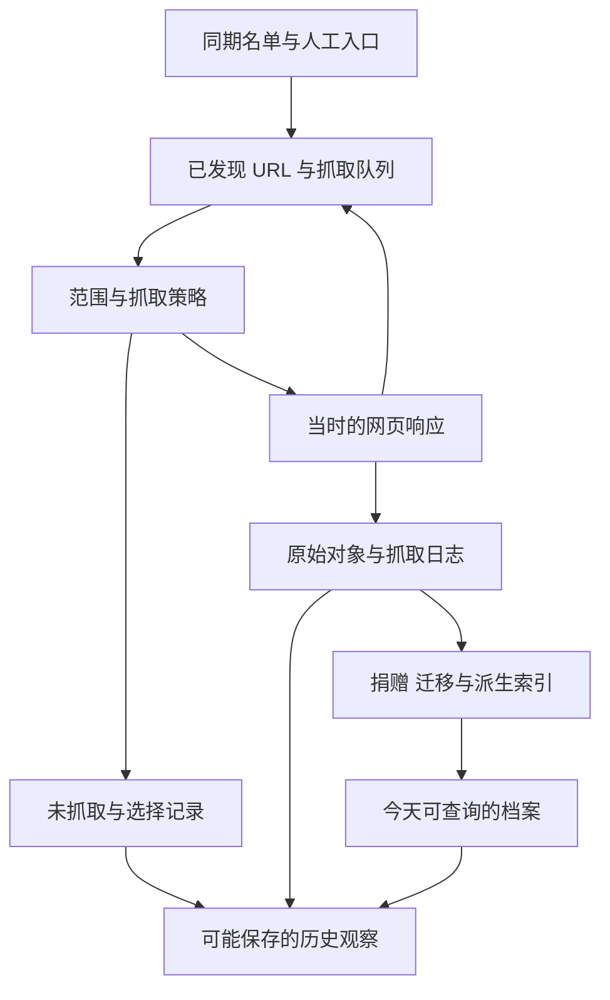

# 最初的档案如何建立：主索引接近读完后的发现问题

更新：2026-11-24（UTC+8）。本文件依据用户最新提供的覆盖情况、同期文献、项目作者的系统说明及固定版本源码，修订来源优先级。本轮没有运行来源测试、数据扫描或部署。具体组件的输入、信息损失与复用边界见[源码审计](OPEN_SOURCE_COMPONENT_AUDIT.md)。

后续[发现与取证流水线](DISCOVERY_AND_VERIFICATION_PIPELINE.md)补入具体历史文本材料和可实施接口。Usenet 消息、W3C 同期邮件、明确版本的 arXiv 论文提供另一种观察机制；它们的可得范围与基线外容量仍分别核定。本文件的 IA/WebBase 已近乎读完前提保持不变。

最新[论文机制与发现操作](LITERATURE_AND_DISCOVERY_OPERATORS.md)核到 CMU 原版 WebKB、NCSA 通告镜像与晚期 DMOZ/GeoCities 的具体用途；定义引用、语义反搜与 item 追溯三个有界操作。原始采集血缘与托管方分别记录；TUMBA 2001 启动不能代替捕获日期，Archive-It 平台成立年也不能排除导入的旧记录。来源资格按具体收藏、对象和操作判断。

## 1. 当前前提与尚未跨过的门槛

**WebBase 2001 已几乎读入，已使用的 IA 主体来源也几乎读完。**这是用户提供的项目事实，本轮没有重新测量其覆盖率。此前把 WebBase 2001 列为尚未开发的独立主力来源，已不适用于当前阶段。UKWA、Arquivo 或语言标注数据若来自同一批 IA 观察，也不能仅因交付渠道不同便重新计作新增供给。

“几乎读完”不自动给出每一种派生操作的完成清单；但也不能反过来假定正文外链、图目标或原始 URL 一定尚未处理。只有明确存在未消费的版本、范围或信息投影时，才重新开启该任务。

当前四项判断如下：

| 问题 | 已掌握的依据 | 当前结论 |
|---|---|---|
| 是否找到足够有说服力的来源供给？ | 已识别原始采集、选择记录、独立交存和历史引用等材料类型 | **尚未证明门槛级供给。**文献说明遗漏机制，不证明材料今日可取得、基线外且数量足够 |
| 是否明确可信发现机制？ | 同期种子与链接扩展、WebBase 遗漏反馈、PANDORA 选择记录、国家范围采集 | 机制已能具体描述；每条路线还要绑定实际材料及已处理范围 |
| 是否明确高效验证机制？ | 元数据先筛、原始记录定位、年度差集、按缺口读原文、可替代 witness | 可确定适配边界；尚未完成集成或测得本题产率 |
| 是否明确全球通信机制？ | ArchiveTeam 的有限分片与回传，Temporal 的批次生命周期与外部结果引用 | 有成熟机制可用；全球节点不能扩大同一历史观察的内容，也不能自动增加提供者预算 |

当前基线的 1% 门槛为 764,304.4645 EED；若合格增量的平均权重为 0.6，约需 1,273,841 个新增 hostname-year。该平均权重是情景条件，不是残余来源测量。现在缺少能支撑这一数量的可得材料清单，不能用工具数量、网页数或馆藏总量替代。[O0]

## 2. 原始建档是一条生产链

最初的采集者面对仍然运行的网站。它们从有限入口开始，通过正文链接、上一轮观察、人工选择和机构渠道不断增加已知 URL，再决定哪些对象实际抓取。公开查询系统是这条链的下游。



其中至少有四个不同集合：**被发现的 URL、被选中抓取的 URL、成功保存的对象、进入某个公开索引的对象。**它们的差异在早期 WebBase 实验、PANDORA 业务流程和 IA 历史访问说明中都有一手依据。[O2、O3、O6]

今天要恢复 1996—2001 的事实，必须使用当时留下且保存至今的观察。复制一套当年的爬虫，可以改善现有材料的遍历，不能重新取得一个已经消失的 1998 年响应。这使当前任务从一般爬取转为：**寻找尚未利用的历史观察，恢复其身份与时间，再判断是否增加年度集合。**

## 3. 四种原始生产机制，以及可迁移的部分

### 3.1 Alexa / Internet Archive：持续抓取后再捐赠

美国国会图书馆 1998 年的同期报道记载，Alexa 向其捐赠的是 1997 年初的快照；Alexa 自 1996 年采集，并向 IA 捐赠各轮副本。抓取发生时间与捐赠时间因此必须分开；同一 Alexa 观察的异地副本也不构成独立采集。[O1]

Alexa 抓取工程负责人 2007 年的一手说明明确了四步循环：按策略选 URL、抓取保存、解析新 URL、放回队列；每个对象单独记录捕获时间。文中还说明范围排除和深度策略，但这些具体配置属于该说明的年代，不能无条件回填 1996—2001。[O4]

**尚未核实的是 Alexa 1996 年第一批种子的实际清单与来源配比。**不能把一般爬虫常用的目录、用户提交或浏览行为，直接写成其已确认的首批来源。

对 Creeperman 的影响是先追踪 `original crawl → donation/import → index/version`。另一馆藏如果保存的是同一轮原件，价值取决于是否补回未交付的记录或不同字段；如果只是相同 URL 与日期的另一接口，就不扩大历史观察范围。

### 3.2 WebBase：先前抓取形成种子，未抓对象继续进入反馈

1998 年的 Stanford 域实验以先前抓取得到的 89,119 个 URL 为种子，最后知道 784,592 个 URL，实际得到约 225,000 个有效 HTML 页面。作者明确说明抓取在完成前停止，并存在范围和防无限页面限制。这些数字属于该次 URL 实验，既不是全球 hostname 数，也不是当前可用残余量。[O3]

2006 年 WebBase 作者说明还讨论了按站点抓取会漏掉“只能由站外链接进入”的页面，并提出将旧快照引用、但自身未出现在快照中的页面加入下一轮种子。我们可以迁移这一**遗漏反馈机制**：把未覆盖的历史目标送去寻找保存证据。不能迁移其“下一轮访问活站即可补抓”的时间条件，也不能未经生产记录确认便把 2006 年实现等同于 2001 发布图。[O5]

WebBase 2001 本身按已近乎读入处理。只有已有处理清单指出某类原始 URL、未抓目标、正文引用或身份信息没有消费时，才有对应的残余任务；否则关闭重复展开。其历史首批种子完整清单仍未核实。

### 3.3 Kulturarw3：主动构造国家范围

瑞典项目的 2000 年原论文将范围定义为 `.se` 加上通过瑞典联系信息识别的部分通用域及其他相关域。首轮只抓 `.se`，论文所述后期一轮约四成服务器并非 `.se`。原件设计分开保存采集元数据、服务器元数据和正文，包含 URL 与采集时间。[O7]

可迁移的经验是：**历史国家、机构与出版渠道提供的选择入口，可能不同于全球抓取的热门链接入口。**国家范围不能只按今天的 ccTLD 过滤；但注册信息只是当年选择网站的依据，并不自动成为网站存在证据。

该论文没有证明上述原件今天可以远程批量取得，也没有证明基线缺少它们。下一份有价值的材料是 1997—2001 各轮的生产与保存清单、实际字段和交付条件，而不是再列出一个档案馆名称。

### 3.4 PANDORA：人工选择与出版者渠道留下独立记录

PANDORA 1997 年业务模型的入口包括馆员发现、他人建议以及出版者的 ISSN/CIP 申请；模型规定候选分为接受、拒绝和待定，记录相应决定，对拒绝项记录拒绝原因。模型要求保存有证据意义的出版者往来，这类正式业务记录可以与对象关联，而不属于公开网页档案正文。[O6]

这提出一个具体的调查对象：**1996—2001 年选择、拒绝、待定及出版者通知的档案系列。**它们可能记载公开抓取索引没有的历史网站。但业务模型不是实际存量清单：是否生成、是否保存至今、是否包含精确 URL 和有效日期、是否可取得，都还未知。

拒绝收录只说明选择结果，不等于网站不存在；反过来，一条等待审查的 URL 也未必已经提供足够网站证据。应按记录原有语义判断，不能把业务状态直接转换成竞赛资格。

## 4. 重新定义剩余发现空间

令 `O` 为当前已取得的历史观察，`P_done(O)` 为已经完成的那些信息投影，`B` 为年度基线。主 URL 索引投影近乎没有增量，只能说明该投影的剩余贡献很小，不能推导历史全网已经覆盖。

在固定证据规则下，新的合格键需要来自下列变化之一：

1. **新增观察**：取得此前没有的同期抓取、目录、交存物或业务记录。
2. **新增投影**：从已经拥有、但相应操作尚未完成的材料中恢复原 URL、引用或记录关系。
3. **证据补全**：将已有候选与可信时间、身份映射或另一条记录连接，使原本不足的 witness 成立。

同一来源、版本、范围、操作已经完成时，换客户端或增加 worker 不产生第四种信息来源。对解释有误的已有处理，可以修复并重建；修复必须有具体字段或生成代码依据，不能预设存在巨大遗漏。

| 路线 | 具体研究对象 | 才值得开启的条件 | 关闭或降级条件 |
|---|---|---|---|
| 同期资料中的未展开关系 | 年度原文、链接图、重定向记录、目录条目 | 处理谱系确认该投影未完成；有精确身份和观察时间 | 同版本同操作已完成；只有归并后标识且身份不可恢复 |
| 公开正文之外的观察 | PANDORA 选择/拒绝/待定、出版者通知、抓取与质检报告 | 先有真实档案系列、字段与保存年份；再判断证据语义 | 只有制度说明，没有实际保存或获取依据 |
| 独立采集与交存 | 国家馆原始批次、机构保存、出版者交存 | 独立生产链、目标年记录、可取得形式与基线谱系均能说明 | 与已读 Alexa/IA 批次同源且无新字段/记录 |
| 离线原材料恢复 | 有原 URL 映射的 CD-ROM、镜像、备份及日志 | 原件、映射、可信年代和保管链可以关联 | 只剩今天的复刻页面或无法恢复日期的文件 |
| 已有候选定向补证 | 精确旧 URL、已知 host 的缺年 | 有可能包含目标年观察的具体档案范围 | 反复查已完整覆盖的来源而无版本变化 |

普通历史外链只直接证明来源页在该次观察中引用了目标。目标是否形成同年网站证据，应走竞赛允许的目录/图或捕获证据规则；不能把源页时间无条件赋给目标。相邻年份、相同正文、first/last 捕获边界也不允许填满中间年份。[O0]

如果原文引用也已经全部处理，第一条路线同样关闭。剩余主张只能是待确认的公开索引外观察与尚未纳入的独立原件；**目前尚无一条被证明能提供 1% 门槛级增量的主力路线。**

## 5. 用原始材料约束容量，而不是从工具吞吐反推供给

对一组材料 `s`，设 `Q_s` 为它在明确身份和可支持年份下，理论上可能提供的不同 hostname-year。它的直接贡献上界为：

```text
U_s = Σ[(h,y) ∈ Q_s \ B] w(TLD(h))
```

实际贡献还要经过证据裁决。这个上界只有在 `Q_s` 已有实际范围依据时才有意义；不能把 URL 数当作 hostname-year 数，不能把一批 2001 年记录乘以六年，也不能把每份同源镜像分别加总。多个材料共同补全一份 witness 时，应对组合任务估算，不能分别判为零收益后丢弃。[O0]

当前最有用的三个交付物是：

| 交付物 | 必须说明的内容 | 能改变什么决策 |
|---|---|---|
| 已处理范围账本 | IA/WebBase 的来源版本、年份、记录角色、投影操作、规范化及完成范围 | 明确哪些分支已经关闭，哪些确有处理缺口 |
| 历史观察库存 | 具体档案系列/介质/采集批次、保存年份、原 URL 与日期字段、可获取形式 | 判断是否真正存在新的历史材料 |
| 候选到证据的连接说明 | 标识映射、时间含义、原件位置、证据类型、适用规则 | 判断材料能否形成可验收年度键 |

这些是资料与字段清单，不是预定测试矩阵。它们仍缺项时，应明确写缺什么；已有文献不能替代它们，也不应为了产生一个产率数先扫描语义未明的对象。

## 6. 用户提供的项目清单应如何放进流程

详细固定版本与代码位置见[源码审计](OPEN_SOURCE_COMPONENT_AUDIT.md)。当前归类如下：

| 环节 | 借鉴项目 | 复用目的 | 不应赋予的能力 |
|---|---|---|---|
| 原始观察生产 | ArchiveTeam terroroftinytown、grab-site/wpull | 来源原生可枚举空间、种子与 frontier、原始响应保存、有限分片 | 不能今天重新产生早年响应；短链任务平台不是通用证据系统 |
| 已知 URL 的档案路由 | MemGator、TimeStitch、MementoMap | 多档案适配、缓存优先级、压缩覆盖画像 | 不是未知 hostname 的独立来源；默认画像不含年份 |
| 索引与正文访问 | cdx_toolkit、pywb、warcio、ArchiveSpark | 分页、元数据先筛、局部读取与解析 | 不能把 URL 去重、检索键或缓存时间当年度证据 |
| 资料关系抽取 | AUT、warc-indexer、urx 的适配器与提取器 | 从具体材料中提取历史引用及候选 | 默认范围过滤、状态过滤、www 合并不能直接沿用 |
| 检索和图处理 | OutbackCDX、SURT、cc-webgraph 的算法 | 索引、排序、节点映射与分析投影 | canonical key/PLD 不等于竞赛 exact hostname |
| 内容辅助分析 | OTMT、wayback-discover-diff | 主题变化和重复内容的审查线索 | 主题变了或正文相同，都不自动否定某个 host-year |

特别是 `urx`，多源、缓存与 `--archive-body` 确实存在；但其默认来源包含 Common Crawl，默认 strict 会过滤跨站目标，缓存只保留 URL 清单而不恢复捕获元数据，正文回放统一使用 Wayback。适配器有学习价值，当前整条输出不能直接充当竞赛证据库。Common Crawl 的代码可研究，其数据仍不进入本任务的活动候选池。

## 7. 全球分布任务应服务于不同材料和访问位置

原始 WebBase 的按站点分配、ArchiveTeam 的小批次领取，都体现了明确任务所有权和局部处理的价值。对于本项目，全球部署有三种具体用途：

1. 在能够取得某个来源的地区执行获准的数据获取，保存原始版本与完整性信息。
2. 在原件或现有副本附近完成流式解析、身份恢复和外链抽取。
3. 把小型候选、证据定位与最终结果清单交给全局精确归并。

沿用现有的 Temporal 批次工作流设计，控制消息只带 `source/version/range/operation`、策略版本及 manifest 引用；大对象不穿过控制队列。按地区与能力分派，结果不可变且幂等导入。每个真实提供者仍有统一请求预算；多个工具访问同一后端不能算作独立额度。详细生命周期见[全球执行设计](CAPACITY_AND_GLOBAL_EXECUTION.md)。

ArchiveTeam 的案例补充了一个来源层要求：任务必须由**已经明确的可观察空间**产生。例如短链服务的编号区间可以枚举；本题应从已有历史文件、目录和记录范围产生批次，不能从想象中的未知域名空间制造海量任务。

全球分布增加可达性、处理位置与恢复能力。若输入仍是相同且已消费的历史观察，它改善时间或成本，不增加可证明的历史事实。

## 8. 参考清单中需要单独校正的研究线索

Archive-It 2021 年官方公告确实介绍了 1996—1999 的 Parallel Language Records 与 Language Annotations，后者使用 CLD3 标注超过四百万个“websites”。它们来自 IA 既有历史集合；公告没有把这一数量定义为不同 exact hostname-year，也没有证明其在当前基线之外。[O8]

`edsu/imls-cdx` 的 README 则描述 2016 年 Archives Unleashed DC 的博物馆组，使用 IMLS Museum Universe Data File FY2015Q1 作为抓取入口。本轮没有找到它与上述早期语言数据集的配套关系。其真正可迁移之处是**从外部机构名录建立种子**；不能把 2015 年名录或 2016 年分析活动当成 1996—1999 的观察日期。[O9]

Archives Unleashed Datathons 提供批量档案分析的活动与工具背景；LongEval 的相应任务研究跨时间检索表现，所核查数据年份为 2022/2023。它们可帮助设计分析与评价，但不直接提供本竞赛目标年的新观测。已核到的活动与本任务目标不同，不据此断言国际上绝不存在同类活动。[O10、O11]

Warrick 的经典重建研究也说明了“从其他缓存和档案补回缺失资源”的方法，但其入口是已知站点，2008 年论文使用的是当时的缓存和档案。不能把那时的恢复率当作今天恢复 1996—2001 残余主机的成功率。[O12]

## 9. 下一步工作的具体顺序

1. 以用户提供的已近乎读完状态关闭 WebBase/IA 主体的重复发现优先级。只对有材料依据的未处理范围保留任务。
2. 先整理已定位的 Usenet 分组、W3C 目标月及 arXiv 明确正文版本的来源契约；并行研究 PANDORA 目标年业务档案目录与字段、Kulturarw3 生产/保存清单和已有处理谱系。具体入口及取得边界见[流水线来源表](DISCOVERY_AND_VERIFICATION_PIPELINE.md)。
3. 将可取得材料映射到 `原始对象—精确身份—日期角色—证据类型—基线范围`。没有可用原件或字段链的路线保留为研究线索，不进入容量预算。
4. 对已明确的材料固定适配器。优先复用记录解析、索引和任务运行时；自写部分集中于本竞赛的身份、年度、证据规则与处理完成状态。
5. 只有文献、清单和代码仍留下会改变决策的问题时，才定义相应有限核验；当前不预先安排测试数量、地区矩阵或产率。

## 原始依据

- **[O0] 项目事实与推导。** [问题定义](PROBLEM_DEFINITION.md)、[当前基线审计](BASELINE_AUDIT.md)、[门槛估算](CAPACITY_AND_GLOBAL_EXECUTION.md)。IA/WebBase 近乎处理完来自用户本次说明；本文集合边界和容量上界是项目推导。
- **[O1] LOC，1998。** [A Snapshot of Cyberspace](https://loc.gov/loc/lcib/9811/alexa.html)：1997 年初快照、1998 年捐赠、Alexa 向 IA 捐赠各轮副本。
- **[O2] Arms et al.，2006。** [A Research Library Based on the Historical Collections of the Internet Archive](https://www.dlib.org/dlib/february06/arms/02arms.html)，§1.1：当时 URL/date 访问索引与正文链接处理的区别。
- **[O3] Cho, Garcia-Molina, Page，WWW 1998。** [Efficient Crawling Through URL Ordering](https://archives.iw3c2.org/www7/proceedings/1919/com1919.htm)，§§5.1–5.2：种子、known/crawled 差异和抓取边界。
- **[O4] David Sherfesee，2007-05-04。** [Alexa 工程负责人证言的 USPTO 官方副本](https://ptacts.uspto.gov/ptacts/public-informations/petitions/1462025/download-documents?artifactId=xvhxleM4Fc3HtmwNUPNaBcAHxCu5NWcht9pQSC-ozQtO0x4PZTTB2YM)，§§8–11。后期系统说明，不当作全部早期生产配置。
- **[O5] Cho et al.，2006。** [Stanford WebBase Components and Applications](https://oak.cs.ucla.edu/~cho/papers/webbase-toit.pdf)，§2.1.1；[作者所在机构书目信息](https://research.ibm.com/publications/stanford-webbase-components-and-applications)。
- **[O6] NLA，1997 业务模型。** [PANDORA Business Process Model](https://pandora.nla.gov.au/bpm.html)，§§2.2–2.3、4.7、6、7。该模型不证明全部预定记录已经生成并保存至今。
- **[O7] Arvidson, Persson, Mannerheim，IFLA 2000。** [The Kulturarw3 Project](https://files.eric.ed.gov/fulltext/ED450729.pdf)，论文页 2–4／PDF 第 3–5 页。
- **[O8] Archive-It，2021-03-12。** [Early Web Datasets & Researcher Opportunities](https://support.archive-it.org/hc/en-us/community/posts/360077435972-Early-Web-Datasets-Researcher-Opportunities)。
- **[O9] edsu/imls-cdx。** [固定版本 README](https://github.com/edsu/imls-cdx/blob/8c9a30755d94bd99587ca77c61e57b1a0352cef8/README.md)。
- **[O10] Archives Unleashed。** [活动](https://archivesunleashed.org/events/)、[项目背景](https://archivesunleashed.org/about-project/)、[AUT 原始 schema](https://aut.docs.archivesunleashed.org/docs/1.1.0/dataframe-schemas)。
- **[O11] LongEval。** [2024 tasks](https://clef-longeval.github.io/2024/tasks/)、[data](https://clef-longeval.github.io/2024/data/)。
- **[O12] McCown et al.，JCDL 2008。** [Usage Analysis of a Public Website Reconstruction Tool](https://www.cs.odu.edu/~mln/pubs/jcdl08/warrick-usage-jcdl08.pdf)。

