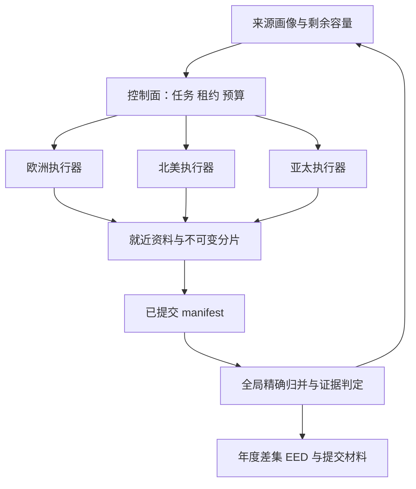

# 门槛估算与全球分布执行

设计与资料核查日期：2026-11-24（UTC+8）。本文承接[全过程与剩余发现](PROCESS_AND_RESIDUAL_DISCOVERY.md)，把来源剩余容量、请求效率、计算吞吐和地域可达性连接成一个可验证的实施方案。竞赛事实沿用当前仓库的规则与基线审计；外部系统的行为依据文末原始资料；容量情景和架构选择是本项目的推导。

**当前建议：采用一个逻辑控制面、三地可独立增减的执行器，以及靠近资料的批处理。先测不同地区能稳定取得哪些来源、每批能产生多少全局新增 EED，再决定增加地区、算力或来源。** 三地是首轮比较设计，不是已经测得的最优部署。候选地区为欧洲、北美、亚太；具体城市由实际路由、可用资源与成本决定。

## 1. 先把四种门槛分开

| 门槛 | 必须回答的问题 | 增加全球节点的作用 |
|---|---|---|
| 来源容量 | 目前可取得的资料，能否提供足够的合格、未计入 hostname-year？ | 只有取得原先不可达或未接入的资料，才可能扩大可观察范围；同一资料多取几份不增加容量 |
| 请求效率 | 为获得一个新增 EED，需要多少实际请求与等待？ | 改善路径、连接成功率和连续执行；仍受共同提供者预算约束 |
| 数据处理 | 下载、解析、归并、证据组装中，哪一步积压？ | 文件分片可并行；数据与计算放近可减少跨区搬运 |
| 可信交付 | 所有贡献是否全局去重、逐年可追溯、可以确定性重建？ | 需要共享规则、任务提交协议和最终归并；多个节点的自报收益不能直接相加 |

当前基线约 1.40 亿年度条目，不提供历史网站全集的分母。因此无法据此计算“历史网络已覆盖百分之几”。它对工程的明确影响是：**很多新取得的 URL 和捕获，经过身份、年份、证据与基线差集后，可能没有新增贡献。** 全球部署是否有价值，应看它增加的可用来源范围、实际完成吞吐和最终增量。[C0]

对于一组地区 A，令 O(A) 为这些地区在允许的访问方式下可以取得的观测，Γ 为既定证据规则。可兑现容量取决于 `W(Γ(O(A)) \ B)`。同一来源从不同地区访问，可能只改变取得速度；只有观测集合或证据组合发生变化，才可能改变最终容量。来源之间可能互补，不能未经全局归并就把各来源预测量求和。

## 2. 门槛需要多大的实际供给

### 2.1 固定计分目标

基线 `merge261121-3` 的初算 EED 为 **76,430,446.4446**。按现有四位小数权重计算：[C0]

| 目标 | 未舍入门槛 EED | 实际可达到的最低四位小数 EED |
|---|---:|---:|
| 最低提交 1% | 764,304.464446 | **764,304.4645** |
| 建议目标 2% | 1,528,608.928892 | **1,528,608.9289** |

下文以尚未入账新增、达到 1% 为情景。若已经积累合格贡献，使用 `G_remaining = max(0, G - E_credited)`。基线变更后重新计算差集与分母；这里的计分仍是本地初算，不代表组织者验收。

### 2.2 候选量、合格率与权重必须属于同一个集合

设 C 是一批通过格式和目标年份筛选、按 exact `(hostname, year)` 全局去重的候选。令：

- `N = |C|`；这一步尚未宣称证据合格。
- K 是 C 中证据合格且不在基线 B 与此前已入账集合中的记录。
- `q = |K| / N`，即“合格且新增”的联合比例。
- `w̄ = W(K) / |K|`，即同一 K 的平均权重。

于是有恒等式 `E = N × q × w̄`。不需要假定“证据合格”和“基线外”独立；也不能把两个不同样本的比例任意相乘。K 为空时 E=0，均权无需定义。

以 **w̄=0.6** 作敏感性分析：

| 联合比例 q | 达到 1% 所需去重候选 hostname-year |
|---:|---:|
| 1% | 127,384,078 |
| 5% | 25,476,816 |
| 10% | 12,738,408 |
| 25% | 5,095,364 |
| 50% | 2,547,682 |

表中 q 和 w̄ 都是**情景参数**，尚未从当前完整基线的来源差集测得。1% 的 q 也不是有证据支持的保守下界；实际来源可能几乎没有增量。新域名优先、独立来源和年代偏差，都可能改变最终新增集合的 TLD 组成，因此不能直接套用全基线的平均权重。

在这个均权下，至少需要约 **1,273,841 个合格新增 hostname-year**。若每个有贡献的确切 host 平均新增 1、2、3、6 个核心年份，对应约 1,273,841、636,921、424,614、212,307 个 host。这里的跨年贡献必须逐年有证据，不能由一次捕获推断持续存在。

### 2.3 请求成本决定定向验证的规模

对同一组已经结算的任务，记录全部实际 HTTP 请求 Q、连续墙钟时间 H 秒、最终全局新增 EED E。失败、重试、分页和补取正文都进入 Q；停机与空闲进入 H。定义：

```text
R_eff = Q / H                  # request / second
g     = E / Q                  # EED / all request
R_eff × g = E / H              # 同一结算口径下的恒等式
T_days ≈ G_remaining / (86400 × R_eff × g)
```

最后一行是未来情景外推，假定同样的请求组合、可用率与边际收益能够维持，并且可取得资料尚未耗尽。还应计入开始和收尾、证据结算及提交材料的固定开销。跨日统计采用 `ΣE/ΣQ` 与 `ΣQ/ΣH`，不取每日收益率的简单平均；有补证延迟时按任务批次归因。

| g：每次实际请求新增 EED | 全天平均 1 req/s | 全天平均 4 req/s | 全天平均 10 req/s |
|---:|---:|---:|---:|
| 0.01 | 884.61 天 | 221.15 天 | 88.46 天 |
| 0.05 | 176.92 天 | 44.23 天 | 17.69 天 |
| 0.10 | 88.46 天 | **22.12 天** | 8.85 天 |
| 0.30 | 29.49 天 | 7.37 天 | 2.95 天 |
| 0.60 | 14.74 天 | 3.69 天 | 1.47 天 |

4 req/s 和 10 req/s 不是提供者承诺的配额，也不是已经测得的持续吞吐。g 也不以 1 为上限：批量索引请求可以返回很多候选，定向查询也可能补足多个年份。该表说明单位收益的重要性，不能把候选表与请求表直接联立。

例如，假设被查询 host 中 15% 产生贡献，有贡献者平均新增 2.5 年，均权 0.6，每个尝试 host 平均需要 2 次请求，则 `g = 0.15 × 2.5 × 0.6 / 2 = 0.1125`。这对应约 340 万个尝试 host、679 万次请求，4 req/s 下约 19.66 天。四个比例必须来自相容的工作负载；这个例子仍是情景计算。

给定期限也能倒推最低产能：达到 1% 的 7、14、30 天期限分别要求约 **1.264、0.632、0.295 EED/s**。若持续只有 4 req/s，14 天目标要求平均约 **0.158 EED/request**，30 天目标要求约 **0.074 EED/request**。如果实测相差一个数量级，首先应改变来源或请求策略。

## 3. 已知文件规模说明了什么

### 3.1 大索引的字节数尚不能证明剩余容量

上一轮实际 Range 探针确认 `Arquivo IA.cdxj` 的 identity 对象大小为 **48,994,912,989 bytes**，约 49 GB；只读了开头小片段，没有完成全量扫描或基线求差。Roteiro 全量解析得到 4,955 个格式有效的去重 hostname-year，它们尚未全部完成证据判定和差集；即使全部新增且权重都为 1，也仅相当于 1% 目标的约 0.648%。[C1]

批量容量可以分解为：

```text
rows            = identity_bytes / mean_bytes_per_row
candidate_pairs = rows × valid_target_row_fraction × global_unique_pairs_per_target_row
novel_EED       = candidate_pairs × joint_qualified_novel_fraction × mean_weight
```

这些比例是同一总体逐层计数的比率；不是互相独立的随机变量。以 49 GB 对象、平均行长 400 B、均权 0.6 作三组**非实测**情景：

| 有效目标年行占比 | 全局唯一候选/有效目标行 | 合格且新增比例 | 推算新增 EED | 相当于最低门槛 |
|---:|---:|---:|---:|---:|
| 10% | 10% | 10% | 73,492 | 9.62% |
| 50% | 20% | 10% | 734,924 | 96.16% |
| 50% | 20% | 25% | 1,837,309 | 240.39% |

相同对象大小可以对应完全不同的可兑现容量。中间情景即使处理无限快，也不足以单独达到门槛。随机字节窗口有助于核查格式、年代和行长，但相同 host 可能跨窗口重复；不能将各窗口的不同 host 数直接外推成全局唯一数。

### 3.2 传输与归并先按实际数据流估算

假设传输 identity 字节，忽略协议、压缩、重试与限流，仅作带宽换算：

| 持续有效线路速率 | 下载 49 GB 索引的理想时间 | 传输 2.90 GB 年度 TXT 基线的理想时间 |
|---:|---:|---:|
| 10 Mbps | 10.89 小时 | 38.72 分钟 |
| 100 Mbps | 65.33 分钟 | 3.87 分钟 |
| 1 Gbps | 6.53 分钟 | 23.23 秒 |

这些不是实际下载测量。源站限制、磁盘和归并可能改变主瓶颈。基线可按版本复制到执行数据处理的节点；49 GB 原始索引应尽量只取得一次，再在其附近解析、压缩派生物并归并。AWS 的官方性能建议同样强调计算与对象存储同区域以降低延迟和跨区成本；这支持数据放置原则，不代表其他归档服务具有 S3 的吞吐能力。[C2]

如对象支持稳定的未压缩 Range，按 64 MiB 逻辑范围约形成 **731 个分片**。必须记录对象版本、总长度、分片范围和哈希，并处理首尾半行。ETag 是版本校验线索，不默认当作内容哈希；读取期间版本变化则重建该快照。普通 gzip 不能任意按解压后偏移分片，应取完整文件或使用可定位的压缩块索引。调度粒度以可恢复、能在几分钟内完成为目标，再根据实测调整。

解析、外部排序和精确求差可先使用流式程序与本地文件/数据库。不要把 1.40 亿行全部装进 Python 对象集合，也不要让小型控制数据库逐条调度这些行。必须量测 `bytes/s`、`records/s`、临时磁盘峰值和最终 `EED/s`；不同单位不能直接放进同一个最小值公式。

### 3.3 验证吞吐也必须进入预算

在均权 0.6 的情景下，如果每个合格新增年度记录都人工核对 30 秒，约需 **10,615 小时**；人工检查 1% 也约需 **106 小时**。因此逐记录追溯要由确定性的证据规则、原始定位和程序检查完成，人工用于来源日期语义、解析规则、异常与分层样本。这不是减少逐条证据要求，而是定义可扩展的验证方式。

抽样比例本身不构成质量保证。证据错误可能按来源版本或解析规则成簇出现，应按来源、年份与状态分层检查；发现规则错误后重新处理整个受影响范围。不能把一百万条重复捕获当成一百万个独立验证样本。

## 4. 成熟项目提供了哪些可直接采用的机制

| 项目/研究 | 已核实的机制 | 本项目采用什么 | 需要保留的边界 |
|---|---|---|---|
| Parallel Crawlers，Cho 与 Garcia-Molina | 比较并行爬虫的分配、协调、重复访问及通信问题 | 显式定义任务所有权和跨分区发现的路由 | 分布式访问本身不能保证无重叠，更不能决定历史证据有效性 [C3] |
| BUbiNG | 抓取/解析分离、紧凑字节表示、缓存与持久化 sieve、可配置任务分配 | 降低重复发现开销；网络和 CPU 队列分开；按资源类型决定并发 | 文档指出多 agent 不保证跨 agent 的 IP 延迟；默认集群通信也有网络前提。论文高吞吐不能外推为少数归档 API 的可用配额 [C4] |
| Apache Nutch | `generate → fetch → parse → updatedb` 的批处理循环；脚本关闭 map/reduce speculative execution | 可重跑的分片与阶段产物；外部请求不做推测性重复抓取 | Hadoop 批次计算不自动提供全球来源路由或共同提供者限流 [C5] |
| Apache StormCrawler / URLFrontier | 抓取执行与 URL frontier 分离；支持分布式队列与批量发现写入 | 执行器从服务领取工作，发现结果异步回流；成熟组件可按接口接入 | 当前 README 明示部分 delay gate 不跨节点传播，多个 GetURLs 客户端也有非原子窗口；应用仍需全局来源预算 [C6] |
| MapReduce | 把输入分片和计算靠近数据，失败重执行，输出经提交后可见 | 原始文件就近解析，按 host 归并，完整 manifest 发布后再纳入下游 | 纯解析可以安全重算；同样的推测执行策略不直接用于外部 HTTP [C7] |
| PostgreSQL / PGMQ | `SKIP LOCKED` 可服务队列式领取；PGMQ 提供可见性超时与重新投递 | 初版复用数据库任务账本或 PGMQ，避免自行创造一套消息系统 | 可见性超时内的投递承诺不等于端到端只执行一次；提交与重复计分仍由应用处理 [C8] |
| Chubby | 通过带代际的 sequencer 让接收方拒绝过期持有者 | 任务领取、续租、提交均检查代际，拒绝旧 worker 发布结果 | 代际只能约束接受该标记的接收端；远端 HTTP 服务不会替我们拒绝旧 worker [C9] |
| NATS JetStream / RabbitMQ Federation | 区域间异步消息复制/联邦，允许跨地域或间歇连接 | 区域离线缓冲需求成立后再加区域队列 | 复制消息不会自动同步任务归属、消费者确认或全局预算；不把跨洲链路放进每条任务的同步复制路径 [C10、C11] |

这里优先复用这些机制与已有解析组件，而不是把完整大型爬虫作为无法修改的系统边界。我们的吞吐关键常常是“向少数归档提供者查询历史对象”，不是同时访问数百万个彼此独立的现网服务器。

前一轮研究的 ArchiveSpark、ARCH、MementoMap 与 Archival Voids 仍适用：前两者帮助先处理元数据、按需读内容；后两者支持来源画像与查询路由。全球调度应同时判断“哪个来源可能有证据”和“从哪个地区访问该来源合适”。只做地区选择，会把无价值查询更快地发送出去。[C12]

## 5. 全球分布究竟提高哪一项产能

### 5.1 访问对象与历史计分对象不同

| 键 | 用途 | 例子 |
|---|---|---|
| exact hostname-year | 事实身份、年度差集、最终 EED | `www.example.org, 1998` |
| provider/账号/endpoint 组 | 请求预算、并发和冷却 | 一个归档服务的共同查询配额 |
| source/version/partition | 获取及解析任务身份 | 某版 CDXJ 的一个完整范围 |
| origin_family | 判断材料是否来自相同抓取祖源 | 同一 IA 捕获在另一机构出现 |
| region/source/operation | 选择可达且合适的执行路径 | 欧洲节点读取索引；北美节点访问某查询接口 |

查询一百万个历史 host，实际请求仍可能全部打向同一个提供者。为每个历史 host 分配独立限速器会失去保护作用。不同镜像的访问预算可能独立，但其历史证据和新增贡献仍要去重。

### 5.2 容量由可用路径、提供者预算和执行资源共同决定

令 A_rs 表示地区 r 对来源 s 的操作是否允许且可分派；R_s 是项目采用的该提供者长期请求预算；c_rs 是分给这一路径的并发请求槽，ℓ_rs 是包含失败与超时在内的平均占槽秒数，u_r 是规划可用率。稳态规划可用：

```text
R_s,plan ≲ min(R_s, Σ_r A_rs × u_r × c_rs / ℓ_rs)
Σ_s c_rs ≤ c_r
```

这是规划近似。Little 定律支持的是同一请求总体下“平均在途数 = 到达率 × 平均占槽时间”；c 是请求槽，不是 CPU 核。可达、可用率和并发分配相关时，保留它们的联合时间平均，不能任意拆成均值乘积。已经按全天墙钟计算的 R_eff 不再乘 u；已包含失败成本的 g 也不再乘一遍成功率。

区域总带宽、CPU、磁盘与验证队列另有约束。初版直接测量端到端 `E/H`，并用阶段积压诊断瓶颈，避免在数据不足时拟合复杂调度器。

例如每个 worker 在线时 1 req/s、时间可用率 80%，同一提供者的项目总预算为 4 req/s，且 g=0.1：

| worker 数 | 未封顶全天吞吐 | 理想错峰下的吞吐上界 | 达到 1% 的条件时间下界 |
|---:|---:|---:|---:|
| 1 | 0.8 req/s | 0.8 req/s | 110.58 天 |
| 3 | 2.4 req/s | 2.4 req/s | 36.86 天 |
| 6 | 4.8 req/s | 4 req/s | 22.12 天 |
| 12 | 9.6 req/s | 4 req/s | 22.12 天 |

这组数字只展示饱和机制，假设在线时间能充分错开、来源预算得到持续利用。一般 `E[min(offered(t), budget)] ≤ min(E[offered(t)], budget)`；如果 6 或 12 个节点都在同一段 80% 时间在线，全天吞吐仅为 3.2 req/s，对应约 27.64 天，而非 22.12 天。计算器同时给出这两类情景。第十二个节点可以改善可用性或接入别的来源，但不会凭空增加上述同一服务的预算。新增地区的收益应分别记为新增可达来源、持续成功吞吐、数据搬运节省与成本变化。

## 6. 首版架构：集中记录状态，分散取得与处理资料



“就近资料”是多个数据位置的逻辑层，不要求三个地区都复制同一份原始数据。控制面是一套逻辑权威状态，不要求所有阶段运行在同一台机器。

### 6.1 控制面保存什么

PostgreSQL 保存来源与地区能力、批次任务、依赖、租约、请求许可、对象 manifest 和派生状态。worker 通过出站 HTTPS 领取任务、汇报心跳和提交结果，不需要开放数据库或建立全球机器间的全连接网络。已有 Linux/Windows 机器也可作为执行器；容器或虚拟环境固定适配器版本，节点注册时报告支持的操作。

首版任务以索引分片、文件、有限查询批次为单位。控制数据库不承载 1.40 亿条基线的每行调度；基线成员查询和大规模归并留在数据处理层。PGMQ 可用作数据库内队列；若已有简单任务表，也可直接采用 PostgreSQL 的短事务领取机制。[C8]

### 6.2 任务必须有可复现身份

最小任务记录包括：

```text
task_id, source_id, source_version, operation, operation_version,
input_manifest_hash, partition_or_query_scope, target_years,
baseline_id, evidence_rule_id, normalization_id, weight_table_id,
capabilities_required, preferred_regions, dependencies,
owner, lease_epoch, lease_deadline, attempt, completion_state
```

`task_id` 对同一输入版本、操作与范围稳定。来源 URL 相同并不说明内容版本相同。抓取完成、证据处理完成、全局计分完成是不同阶段状态。正在归并的输出不会提前进入最终累计值。

任务分配可以随节点变化；归并采用版本化的虚拟分片，按 exact hostname 的稳定哈希路由，使同一 host 的各年证据进入同一逻辑分区。哈希仅用于路由，保存完整 hostname 与 year 作相等判断；扩缩容迁移虚拟分片，不随意改变事实身份。

### 6.3 执行可重试，发布与计分幂等

1. 控制面短事务领取任务，例如使用 `FOR UPDATE SKIP LOCKED`；设置 owner，增加 `lease_epoch`，以数据库时间记录期限，随即释放行锁。[C8]
2. worker 在本地执行；网络请求另外取得来源许可。续租和心跳检查 owner、epoch、状态与期限。失去租约后停止启动新操作；已发出的 HTTP 仍可能完成。
3. 输出先写入不可变对象；确认写入完成、大小与内容哈希后，用稳定 `commit_id` 申请发布。
4. 一个数据库事务内检查当前 owner/epoch/期限，登记 manifest 并完成该阶段任务。下游任务通过同一事务的 outbox，或可重放的已发布 manifest 扫描器生成。
5. 提交响应丢失时查询同一 `commit_id`；队列确认在结果持久发布后执行。旧 epoch 发布被拒，孤儿对象不进入结果集，允许延迟清理。
6. 归并按全局 exact `(hostname, year)` 结算。多个来源可增加不同证据引用，但同一合格事实只按规则计分一次。证据策略或基线变化后，重建派生视图与总分。

PGMQ 的可见性超时和 Chubby 的代际机制分别为投递恢复与过期持有者拒绝提供可复用思路；它们都不替代上述应用提交协议。[C8、C9] 我们承诺的是可恢复执行与幂等结果，不把远端读取表述成端到端只发生一次。

### 6.4 任务租约与来源预算分别管理

来源预算键覆盖实际共同配额：provider、账号、endpoint 组，以及提供者明确规定的其他范围。区域调度必须同时满足总速率、突发额度、在途请求数与适用的周期额度。重试也消耗预算。

首版少量节点可在请求前通过控制 API 取得短期许可；需要降低跨区交互后，才下发有明确数量与有效期的小批许可。区域许可总和不得超过预留预算。旧 worker 的未到期额度与尚可能在途的请求，不能在任务换主时立即重复发放；许可回收须覆盖请求超时和时钟误差余量。worker 按保守本地期限停止新请求，不能在失联后无限自行续额。

**epoch 拒绝旧提交，不能让归档服务器拒绝旧 HTTP。** 因而仍允许故障时少量重复读取，记录实际请求成本；不使用针对外部抓取的推测执行。纯文件解析可以重跑或并行重算。

429 触发同一预算范围的共享冷却，地区切换不能清空冷却。401 或明确授权不足的 403 转入来源权限状态；可归因于临时网络的 DNS/TCP/TLS 故障可在其他允许且可达地区重试。控制面失联时，只执行现有租约及仍有效的有界请求许可；许可到期暂停新请求，已经取得文件的纯本地处理可在其任务契约内继续。

### 6.5 数据放置与缓存

| 数据 | 默认放置方式 | 必须保留的边界 |
|---|---|---|
| 基线、规则、权重 | 版本化快照，复制到需要精确判断的处理节点 | 本地基线命中可省重复补证，但已知资料仍可能需要展开外链 |
| 大索引与 ARC/WARC | 尽量就近取得和处理，必要时保留一个共享耐久副本 | 本地临时缓存不等于证据已耐久保存 |
| 解析结果与候选分片 | 压缩列式或排序文件，发布 manifest 后进入归并 | 保留原始身份、时间字段、来源与完整性，不只回传计数 |
| 合格证据与新年度键 | 全球按同一键归并，保存多 witness 引用 | 每地区的“新增”可能互相重叠 |
| 查询与空结果缓存 | 来源版本、查询范围、年份和过滤条件共同作键 | 超时/截断不是完整空结果；来源变化后可失效 |
| 内容解析缓存 | payload hash 加解析版本；链接解析另带原 URL/base 上下文 | 相同内容不代表相同 hostname、年份或相对链接目标 |

对于可重复取得的开放大对象，可按证据策略保留稳定 locator 与必要见证片段；对于不可重复取得的原材料，需要耐久保存原始文件。由来源适配器明确这一保存契约，不能在临时文件删除后才判断证据能否回查。

## 7. 何时增加区域队列，何时增加计算资源

PostgreSQL＋HTTPS 在三地小规模批次任务下足以作为首版候选，实际承载能力仍需测量。跨区 round trip 的影响由批次大小摊薄；本项目首先需要处理的是来源和证据吞吐，而非每条 URL 的低延迟消息广播。

当测得控制面连接不稳定已造成明显空闲，或区域必须在有界授权内离线执行较长时间，可加 NATS JetStream 区域持久队列，使用 leaf 连接与 source/mirror 传递任务事件和结果。NATS 当前文档把 mirror 定义为单一上游副本，sources 用于多个上游的汇集；复制存在滞后，不等价于全局任务队列。[C10]

具体做法是控制面先固定任务区域所有者与 epoch，再通过 outbox 发布区域任务；各区域有独立 subject 与 inbox 去重，结果异步回传。不要把同一待办复制到三个地区后让它们各自认领。source/mirror 不自动复制完整消费确认与任务归属；来源流保留时间必须足以覆盖断线与追赶。消息投递成功也不代表结果 manifest 已提交。

RabbitMQ Federation 是已有 RabbitMQ 系统可选的跨区域连接方式。其官方文档支持跨数据中心、长距离和间歇链路；集群文档建议 WAN 场景采用 Federation/Shovel，避免普通集群对每个复制操作承担长距离成本。[C11] 首版不同时引入两套消息系统。

| 实测现象 | 先改变什么 |
|---|---|
| 某来源只有部分地区稳定取得有效响应 | 增加或迁移该来源的访问节点 |
| 提供者预算已满，节点在等待许可 | 改善每请求收益、接入独立来源；同源加节点不增加额度 |
| 已取得文件持续排队，CPU/磁盘饱和 | 在数据附近加处理资源或改善解析/归并 |
| 跨区传输占主要费用或等待 | 减少原始数据复制，就近产出压缩派生物 |
| 控制面通信造成大量空闲 | 调整任务批次；必要时加入区域持久队列 |
| q 接近零，即使完整处理容量也不足 | 更换年代、收藏或独立祖源；不要用节点数掩盖供给不足 |

## 8. 一个可核对的费用量级

以下仅用 DigitalOcean 2026-11-24 查询到的公开标价给出资源组合示例，不构成供应商选择，也不保证实际吞吐。Basic Regular 的 1 GiB/1 vCPU、2 GiB/1 vCPU、4 GiB/2 vCPU 月价分别为 6、12、24 美元；Spaces 基础价格为每月 5 美元，含 250 GiB 存储与 1 TiB 出站。[C13、C14]

| 组合 | 配置假设 | 月标价合计 |
|---|---|---:|
| 三地可达性试验 | 1 个 2 GiB 控制节点＋3 个 1 GiB 探针节点＋基础对象存储 | **35 美元** |
| 三地轻量处理 | 1 个 2 GiB 控制节点＋3 个 4 GiB/2 vCPU 执行器＋基础对象存储 | **89 美元** |
| 六地可达性试验 | 同控制与存储，6 个 1 GiB 探针节点 | 53 美元 |
| 六地轻量处理 | 同控制与存储，6 个 4 GiB/2 vCPU 执行器 | 161 美元 |

控制节点只承载批次元数据，不把完整大基线装进该 2 GiB 配置。4 GiB worker 采用流式分片和有界临时磁盘；其 80 GiB 磁盘不能被当成“49 GB 原文件加任意排序中间结果一定够用”。若完整物化，必须测得峰值后增加磁盘，并重新计费。

这些合计不含税费、备份、额外磁盘、超额存储/流量、托管数据库、控制面高可用、人工与付费数据。一个基础存储配额也不表示各地区各有完整原始副本。已有机器可降低新增租金，但网络、稳定性和运维成本仍要记录。官方区域表列有欧洲、北美与新加坡等可选地点，实际资源和路径需逐项确认。[C15]

## 9. 能区分瓶颈的最小实验

### A. 先测“地区 × 来源 × 操作”的有效可达性

从欧洲、北美、亚太各选一个可用执行位置，对实际准备使用的 4 个来源分别测元数据查询与小范围内容读取，在 3 个时间窗口重复，形成约 **72 个有界基础观测**。实际请求数按重试另计；探针同样计入来源预算。

记录 DNS、TCP/TLS、HTTP 状态、内容结构是否正确、完整性、平均与 p95 请求耗时、线速、429 与失败类型。HTTP 200 本身不等于取得预期数据：此前 UKWA 旧目录探针得到的是 HTML 应用壳，不能当作 CDX 下载成功。[C1]

同一个请求在多个地区重复用于配对比较路径；它只产生一份事实贡献，不能作为三倍发现量。地区亲和性绑定实际归档 endpoint，不依据历史网站域名所属国家猜测。

### B. 再测剩余产率与可取得容量

固定基线、规则和来源版本，在各来源选择有明确完整范围的互不重叠分片。先验证解析与证据语义，再流式全局去重、求差并计算 q、w̄、g。资料需要补证时，以完整任务组合结算成本与收益。

统计单位采用来源分片或 hostname 簇；捕获记录不当作独立样本。分层结果保留年代、收藏、祖源和状态差异。对相同语料镜像分别报告访问改善和证据重叠。剩余容量估计必须附上实际可取得的分片范围，不能只给一个抽样收益率。

### C. 把地域收益和资源收益分开比较

- **1 地对 3 地访问试验：** 相同总提供者预算、相近查询组合和交替时间窗口，比较有效完成率、空闲、重试和已结算 EED/墙钟时间。避免把三倍预算的效果误记为地域效果。
- **1 worker 对多 worker 解析试验：** 重放同一批不可变本地输入，不增加外部请求，测 records/s、归并吞吐、内存与临时磁盘峰值。
- **批量路径对定向路径：** 统一全局差集与证据规则，比较可用容量、实际请求/字节/人工成本和后续补证，不只比较原始 URL 数。

### D. 用少数故障检查提交语义

必须覆盖领取后退出、对象上传后未提交、提交成功但确认丢失、租约到期后旧 worker 返回四种情况。验收依据是任务可恢复、最终唯一键与 EED 不重复、不把孤儿对象入账、旧许可不会被同时重新发放。另检查阶段完成到下游任务生成之间没有空洞。

### 扩大条件

一条来源路线只有同时说明“真实新增收益、可取得剩余范围、完整证据语义、取得和处理所需时间”后，才承担门槛预测。地区仅在增加有效可达范围、持续吞吐或降低总成本时扩展。达到最新基线下的 1% 且材料完整时准备首批提交，2% 作为后续生产目标；竞赛时间从任务指定起点计算，不因部署或重跑而重置。[C0]

## 10. 本轮交付与实施顺序

本轮已经完成成熟实现与原始研究核查、数学口径审查、全球执行协议设计、公开费用查询及离线情景计算。**尚未部署地区节点，尚未测得跨地区可达性/吞吐，也尚未用完整基线测得来源新增比例。** 已有单环境探针不能替代全球测量。

下一步实现顺序：

1. 在持有比赛完整基线的机器绑定快照，复用已有解析与年度索引，完成 Roteiro 的证据—差集闭环。
2. 实现来源能力探针、批次 manifest、精确归并三个可独立运行的命令；随后增加 HTTPS 任务领取与共享请求预算。
3. 在可用的三地执行位置运行上述可达性试验；按结果选择来源的主访问路径与备用路径。
4. 用大来源完整分片测产率、去重与临时空间，更新估算配置，给出 1% 的来源组合与完成时间区间。
5. 在已经出现的瓶颈处增加执行器、区域队列或数据处理组件，保留同一任务与证据契约。

离线计算器、情景输入和当前输出：

- [`audit/estimate_capacity.py`](../audit/estimate_capacity.py)
- [`audit/capacity_scenarios_20261124.json`](../audit/capacity_scenarios_20261124.json)
- [`audit/capacity_estimates_20261124.json`](../audit/capacity_estimates_20261124.json)

从仓库根目录运行：

```bash
python audit/estimate_capacity.py --output audit/capacity_estimates_20261124.json
```

脚本只使用 Python 标准库和 Decimal，输出保存输入及脚本 SHA-256。它计算门槛、容量/请求敏感性、库存情景、来源预算饱和、理想传输时间与标价组合；不会联网、取样或部署。正缺口遇到零收益/零吞吐时返回不可达的 null；缺口为零时不再推算需要的数量与时间。实际测量值应显式替换情景输入并注明来源，不能因脚本有精确小数就认为预测已被实证支持。

## 资料与复核位置

- **[C0] 竞赛与基线。** [问题定义](PROBLEM_DEFINITION.md)、[当前基线审计](BASELINE_AUDIT.md)、[方案设计](SOLUTION_DESIGN.md)；冻结基线 `merge261121-3`。未重新解释或清洗分母。
- **[C1] 本仓库实际探针。** [`source_probe_20261124.json`](../audit/source_probe_20261124.json)、[来源调查 M1/M2](MATURE_APPROACHES_AND_SOURCES.md)。Roteiro 全量；IA/UKWA 范围和结果按日志限定。
- **[C2] AWS。** [Performance guidelines for Amazon S3](https://docs.aws.amazon.com/AmazonS3/latest/userguide/optimizing-performance-guidelines.html)，数据与计算同 Region、测量吞吐等实践。
- **[C3] Cho 与 Garcia-Molina。** [Parallel Crawlers](https://oak.cs.ucla.edu/~cho/papers/cho-parallel.pdf)，WWW 2002；并行分配、重复访问与通信的设计研究。检索到原始论文内容，直接 PDF 读取曾超时；本方案未援引其数值性能。
- **[C4] BUbiNG。** [作者论文](https://vigna.di.unimi.it/ftp/papers/BUbiNG.pdf)、[官方部署文档](https://law.di.unimi.it/software/bubing-docs/overview-summary.html)。抓取/解析解耦、紧凑表示、sieve 与分配；多 agent IP politeness 与网络条件以部署文档限定。
- **[C5] Apache Nutch。** [crawl 脚本](https://github.com/apache/nutch/blob/master/src/bin/crawl)，本次读取 blob `ae8f4f6ad48073af2d14a55ef0cf9a9ee8ee39e6`；[1.23 发布记录](https://nutch.apache.org/news/nutch-1.23-release/)。核实脚本阶段和 `mapreduce.map.speculative=false`、`mapreduce.reduce.speculative=false`。
- **[C6] Apache StormCrawler。** [URLFrontier README](https://github.com/apache/stormcrawler/blob/main/external/urlfrontier/README.md)，本次读取 blob `85cc4fc9c20644f44e3fa14bc53f5d192f2afb45`；具体跨节点 delay 与多客户端限制以该版本说明为准。
- **[C7] Dean 与 Ghemawat。** [MapReduce: Simplified Data Processing on Large Clusters](https://research.google/pubs/mapreduce-simplified-data-processing-on-large-clusters/)，OSDI 2004，[论文 PDF](https://storage.googleapis.com/gweb-research2023-media/pubtools/4449.pdf)。
- **[C8] PostgreSQL / PGMQ。** [SELECT 与 SKIP LOCKED](https://www.postgresql.org/docs/18/sql-select.html)、[PGMQ 1.13.0 文档](https://pgmq.github.io/pgmq/1.13.0/)。队列领取与可见性超时语义；不是业务效果只执行一次的保证。
- **[C9] Mike Burrows。** [The Chubby lock service for loosely-coupled distributed systems](https://static.usenix.org/events/osdi06/tech/full_papers/burrows/burrows_html/index.html)，OSDI 2006，§2.4 sequencer。
- **[C10] NATS。** [当前 Mirrors and sources](https://docs.nats.io/learn/jetstream/mirrors-and-sources)、[当前 Leaf nodes](https://docs.nats.io/learn/topologies/leaf-nodes)、[ADR-59](https://github.com/nats-io/nats-architecture-and-design/blob/main/adr/ADR-59.md)。另核对了[旧文档源码](https://github.com/nats-io/nats.docs/blob/master/nats-concepts/jetstream/source_and_mirror.md)，blob `b9b49798e25fa01d66ef49aaa3cb9a465e6d354e`；旧文档仓库已归档。实施时固定 server 版本并核对 retention/consumer 支持，不以旧路径代替当前部署文档。
- **[C11] RabbitMQ。** [Federation](https://www.rabbitmq.com/docs/federation)、[Clustering](https://www.rabbitmq.com/docs/clustering)。跨数据中心/间歇连接与 WAN 部署边界。
- **[C12] 归档检索与批量分析。** 本仓库[全过程文档](PROCESS_AND_RESIDUAL_DISCOVERY.md)的 ArchiveSpark、ARCH、IIPC、MementoMap 与 Archival Voids 原始来源链。
- **[C13] DigitalOcean。** [Droplet Pricing](https://www.digitalocean.com/pricing/droplets)，2026-11-24 查询 Basic Regular 月价；示例组合未实际购买。
- **[C14] DigitalOcean。** [Spaces Pricing](https://www.digitalocean.com/pricing/spaces-object-storage)，同日查询基础价格、含量及额外存储/流量价格。
- **[C15] DigitalOcean。** [Regional availability](https://docs.digitalocean.com/platform/regional-availability/)，同日核查；具体节点路径仍待实际探测。
