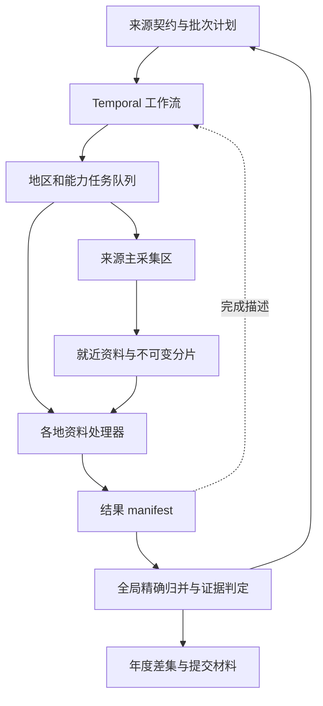

# 门槛估算与全球分布执行

设计与资料核查日期：2026-11-24（UTC+8）。本文承接[全过程与剩余发现](PROCESS_AND_RESIDUAL_DISCOVERY.md)，把来源剩余容量、请求效率、计算吞吐和地域可达性连接成一个可验证的实施方案。竞赛事实沿用当前仓库的规则与基线审计；外部系统的行为依据文末原始资料；容量情景和架构选择是本项目的推导。

**当前建议：以来源契约和已核实的成熟机制确定任务，采用 Temporal 的一个逻辑控制面、全球可增减的 worker，以及靠近资料的批处理。** 本轮复核撤下预设的三地探测和自建任务租约实现；来源、验证组件及剩余知识缺口见[研究复核后的方案](EVIDENCE_LED_REDESIGN.md)。下文数值模型保留为条件估算，尚无真实新增率和全球吞吐结果。

## 1. 先把四种门槛分开

| 门槛 | 必须回答的问题 | 增加全球节点的作用 |
|---|---|---|
| 来源容量 | 目前可取得的资料，能否提供足够的合格、未计入 hostname-year？ | 只有取得原先不可达或未接入的资料，才可能扩大可观察范围；同一资料多取几份不增加容量 |
| 请求效率 | 为获得一个新增 EED，需要多少实际请求与等待？ | 改善路径、连接成功率和连续执行；仍受共同提供者预算约束 |
| 数据处理 | 下载、解析、归并、证据组装中，哪一步积压？ | 文件分片可并行；数据与计算放近可减少跨区搬运 |
| 可信交付 | 所有贡献是否全局去重、逐年可追溯、可以确定性重建？ | 需要共享规则、任务提交协议和最终归并；多个节点的自报收益不能直接相加 |

当前基线约 1.40 亿年度条目，不提供历史网站全集的分母。因此无法据此计算“历史网络已覆盖百分之几”。它对工程的明确影响是：**很多新取得的 URL 和捕获，经过身份、年份、证据与基线差集后，可能没有新增贡献。** 全球部署是否有价值，应看它增加的可用来源范围、实际完成吞吐和最终增量。[C0]

对于一组地区 A，令 O(A) 为这些地区在允许的访问方式下可以取得的观测，Γ 为既定证据规则。可兑现容量取决于 `W(Γ(O(A)) \ B)`。同一来源从不同地区访问，可能只改变取得速度；只有观测集合或证据组合发生变化，才可能改变最终容量。来源之间可能互补，不能未经全局归并就把各来源预测量求和。

## 2. 门槛需要多大的实际供给

### 2.1 固定计分目标

基线 `merge261121-3` 的初算 EED 为 **76,430,446.4446**。按现有四位小数权重计算：[C0]

| 目标 | 未舍入门槛 EED | 实际可达到的最低四位小数 EED |
|---|---:|---:|
| 最低提交 1% | 764,304.464446 | **764,304.4645** |
| 建议目标 2% | 1,528,608.928892 | **1,528,608.9289** |

下文以尚未入账新增、达到 1% 为情景。若已经积累合格贡献，使用 `G_remaining = max(0, G - E_credited)`。基线变更后重新计算差集与分母；这里的计分仍是本地初算，不代表组织者验收。

### 2.2 候选量、合格率与权重必须属于同一个集合

设 C 是一批通过格式和目标年份筛选、按 exact `(hostname, year)` 全局去重的候选。令：

- `N = |C|`；这一步尚未宣称证据合格。
- K 是 C 中证据合格且不在基线 B 与此前已入账集合中的记录。
- `q = |K| / N`，即“合格且新增”的联合比例。
- `w̄ = W(K) / |K|`，即同一 K 的平均权重。

于是有恒等式 `E = N × q × w̄`。不需要假定“证据合格”和“基线外”独立；也不能把两个不同样本的比例任意相乘。K 为空时 E=0，均权无需定义。

以 **w̄=0.6** 作敏感性分析：

| 联合比例 q | 达到 1% 所需去重候选 hostname-year |
|---:|---:|
| 1% | 127,384,078 |
| 5% | 25,476,816 |
| 10% | 12,738,408 |
| 25% | 5,095,364 |
| 50% | 2,547,682 |

表中 q 和 w̄ 都是**情景参数**，尚未从当前完整基线的来源差集测得。1% 的 q 也不是有证据支持的保守下界；实际来源可能几乎没有增量。新域名优先、独立来源和年代偏差，都可能改变最终新增集合的 TLD 组成，因此不能直接套用全基线的平均权重。

在这个均权下，至少需要约 **1,273,841 个合格新增 hostname-year**。若每个有贡献的确切 host 平均新增 1、2、3、6 个核心年份，对应约 1,273,841、636,921、424,614、212,307 个 host。这里的跨年贡献必须逐年有证据，不能由一次捕获推断持续存在。

### 2.3 请求成本决定定向验证的规模

对同一组已经结算的任务，记录全部实际 HTTP 请求 Q、连续墙钟时间 H 秒、最终全局新增 EED E。失败、重试、分页和补取正文都进入 Q；停机与空闲进入 H。定义：

```text
R_eff = Q / H                  # request / second
g     = E / Q                  # EED / all request
R_eff × g = E / H              # 同一结算口径下的恒等式
T_days ≈ G_remaining / (86400 × R_eff × g)
```

最后一行是未来情景外推，假定同样的请求组合、可用率与边际收益能够维持，并且可取得资料尚未耗尽。还应计入开始和收尾、证据结算及提交材料的固定开销。跨日统计采用 `ΣE/ΣQ` 与 `ΣQ/ΣH`，不取每日收益率的简单平均；有补证延迟时按任务批次归因。

| g：每次实际请求新增 EED | 全天平均 1 req/s | 全天平均 4 req/s | 全天平均 10 req/s |
|---:|---:|---:|---:|
| 0.01 | 884.61 天 | 221.15 天 | 88.46 天 |
| 0.05 | 176.92 天 | 44.23 天 | 17.69 天 |
| 0.10 | 88.46 天 | **22.12 天** | 8.85 天 |
| 0.30 | 29.49 天 | 7.37 天 | 2.95 天 |
| 0.60 | 14.74 天 | 3.69 天 | 1.47 天 |

4 req/s 和 10 req/s 不是提供者承诺的配额，也不是已经测得的持续吞吐。g 也不以 1 为上限：批量索引请求可以返回很多候选，定向查询也可能补足多个年份。该表说明单位收益的重要性，不能把候选表与请求表直接联立。

例如，假设被查询 host 中 15% 产生贡献，有贡献者平均新增 2.5 年，均权 0.6，每个尝试 host 平均需要 2 次请求，则 `g = 0.15 × 2.5 × 0.6 / 2 = 0.1125`。这对应约 340 万个尝试 host、679 万次请求，4 req/s 下约 19.66 天。四个比例必须来自相容的工作负载；这个例子仍是情景计算。

给定期限也能倒推最低产能：达到 1% 的 7、14、30 天期限分别要求约 **1.264、0.632、0.295 EED/s**。若持续只有 4 req/s，14 天目标要求平均约 **0.158 EED/request**，30 天目标要求约 **0.074 EED/request**。如果实测相差一个数量级，首先应改变来源或请求策略。

## 3. 已知文件规模说明了什么

### 3.1 大索引的字节数尚不能证明剩余容量

上一轮实际 Range 探针确认 `Arquivo IA.cdxj` 的 identity 对象大小为 **48,994,912,989 bytes**，约 49 GB；只读了开头小片段，没有完成全量扫描或基线求差。Roteiro 全量解析得到 4,955 个格式有效的去重 hostname-year，它们尚未全部完成证据判定和差集；即使全部新增且权重都为 1，也仅相当于 1% 目标的约 0.648%。[C1]

批量容量可以分解为：

```text
rows            = identity_bytes / mean_bytes_per_row
candidate_pairs = rows × valid_target_row_fraction × global_unique_pairs_per_target_row
novel_EED       = candidate_pairs × joint_qualified_novel_fraction × mean_weight
```

这些比例是同一总体逐层计数的比率；不是互相独立的随机变量。以 49 GB 对象、平均行长 400 B、均权 0.6 作三组**非实测**情景：

| 有效目标年行占比 | 全局唯一候选/有效目标行 | 合格且新增比例 | 推算新增 EED | 相当于最低门槛 |
|---:|---:|---:|---:|---:|
| 10% | 10% | 10% | 73,492 | 9.62% |
| 50% | 20% | 10% | 734,924 | 96.16% |
| 50% | 20% | 25% | 1,837,309 | 240.39% |

相同对象大小可以对应完全不同的可兑现容量。中间情景即使处理无限快，也不足以单独达到门槛。随机字节窗口有助于核查格式、年代和行长，但相同 host 可能跨窗口重复；不能将各窗口的不同 host 数直接外推成全局唯一数。

### 3.2 传输与归并先按实际数据流估算

假设传输 identity 字节，忽略协议、压缩、重试与限流，仅作带宽换算：

| 持续有效线路速率 | 下载 49 GB 索引的理想时间 | 传输 2.90 GB 年度 TXT 基线的理想时间 |
|---:|---:|---:|
| 10 Mbps | 10.89 小时 | 38.72 分钟 |
| 100 Mbps | 65.33 分钟 | 3.87 分钟 |
| 1 Gbps | 6.53 分钟 | 23.23 秒 |

这些不是实际下载测量。源站限制、磁盘和归并可能改变主瓶颈。基线可按版本复制到执行数据处理的节点；49 GB 原始索引应尽量只取得一次，再在其附近解析、压缩派生物并归并。AWS 的官方性能建议同样强调计算与对象存储同区域以降低延迟和跨区成本；这支持数据放置原则，不代表其他归档服务具有 S3 的吞吐能力。[C2]

如对象支持稳定的未压缩 Range，按 64 MiB 逻辑范围约形成 **731 个分片**。必须记录对象版本、总长度、分片范围和哈希，并处理首尾半行。ETag 是版本校验线索，不默认当作内容哈希；读取期间版本变化则重建该快照。普通 gzip 不能任意按解压后偏移分片，应取完整文件或使用可定位的压缩块索引。调度粒度以可恢复、能在几分钟内完成为目标，再根据实测调整。

解析、外部排序和精确求差可先使用流式程序与本地文件/数据库。不要把 1.40 亿行全部装进 Python 对象集合，也不要让小型控制数据库逐条调度这些行。必须量测 `bytes/s`、`records/s`、临时磁盘峰值和最终 `EED/s`；不同单位不能直接放进同一个最小值公式。

### 3.3 验证吞吐也必须进入预算

在均权 0.6 的情景下，如果每个合格新增年度记录都人工核对 30 秒，约需 **10,615 小时**；人工检查 1% 也约需 **106 小时**。因此逐记录追溯要由确定性的证据规则、原始定位和程序检查完成，人工用于来源日期语义、解析规则、异常与分层样本。这不是减少逐条证据要求，而是定义可扩展的验证方式。

抽样比例本身不构成质量保证。证据错误可能按来源版本或解析规则成簇出现，应按来源、年份与状态分层检查；发现规则错误后重新处理整个受影响范围。不能把一百万条重复捕获当成一百万个独立验证样本。

## 4. 成熟项目提供了哪些可直接采用的机制

| 项目/研究 | 已核实的机制 | 本项目采用什么 | 需要保留的边界 |
|---|---|---|---|
| Parallel Crawlers，Cho 与 Garcia-Molina | 比较并行爬虫的分配、协调、重复访问及通信问题 | 显式定义任务所有权和跨分区发现的路由 | 分布式访问本身不能保证无重叠，更不能决定历史证据有效性 [C3] |
| BUbiNG | 抓取/解析分离、紧凑字节表示、缓存与持久化 sieve、可配置任务分配 | 降低重复发现开销；网络和 CPU 队列分开；按资源类型决定并发 | 文档指出多 agent 不保证跨 agent 的 IP 延迟；默认集群通信也有网络前提。论文高吞吐不能外推为少数归档 API 的可用配额 [C4] |
| Apache Nutch | `generate → fetch → parse → updatedb` 的批处理循环；脚本关闭 map/reduce speculative execution | 可重跑的分片与阶段产物；外部请求不做推测性重复抓取 | Hadoop 批次计算不自动提供全球来源路由或共同提供者限流 [C5] |
| Apache StormCrawler / URLFrontier | 抓取执行与 URL frontier 分离；支持分布式队列与批量发现写入 | 执行器从服务领取工作，发现结果异步回流；成熟组件可按接口接入 | 当前 README 明示部分 delay gate 不跨节点传播，多个 GetURLs 客户端也有非原子窗口；应用仍需全局来源预算 [C6] |
| MapReduce | 把输入分片和计算靠近数据，失败重执行，输出经提交后可见 | 原始文件就近解析，按 host 归并，完整 manifest 发布后再纳入下游 | 纯解析可以安全重算；同样的推测执行策略不直接用于外部 HTTP [C7] |
| PostgreSQL / PGMQ | `SKIP LOCKED` 可服务队列式领取；PGMQ 提供可见性超时与重新投递 | 保留为队列语义比较；首版任务生命周期改为 Temporal | 可见性超时内的投递承诺不等于端到端只执行一次 [C8] |
| Chubby | 通过带代际的 sequencer 让接收方拒绝过期持有者 | 用于理解失联旧执行者的边界；首版不自制代际租约层 | 归档提供者不会替我们拒绝旧 worker 发出的 HTTP [C9] |
| Temporal | Task Queue、活动尝试、心跳检查点、超时重试和持久工作流 | 首版直接复用生命周期；批次 Activity 传 manifest 引用 | 活动速率不等于 HTTP 速率；结果幂等与证据裁决仍由应用处理 [C16—C18] |
| NATS JetStream / RabbitMQ Federation | 区域间异步消息复制/联邦，允许跨地域或间歇连接 | 区域离线缓冲需求成立后再加区域队列 | 复制消息不会自动同步任务归属、消费者确认或全局预算；不把跨洲链路放进每条任务的同步复制路径 [C10、C11] |

这里优先复用这些机制与已有解析组件，而不是把完整大型爬虫作为无法修改的系统边界。我们的吞吐关键常常是“向少数归档提供者查询历史对象”，不是同时访问数百万个彼此独立的现网服务器。

前一轮研究的 ArchiveSpark、ARCH、MementoMap 与 Archival Voids 仍适用：前两者帮助先处理元数据、按需读内容；后两者支持来源画像与查询路由。全球调度应同时判断“哪个来源可能有证据”和“从哪个地区访问该来源合适”。只做地区选择，会把无价值查询更快地发送出去。[C12]

## 5. 全球分布究竟提高哪一项产能

### 5.1 访问对象与历史计分对象不同

| 键 | 用途 | 例子 |
|---|---|---|
| exact hostname-year | 事实身份、年度差集、最终 EED | `www.example.org, 1998` |
| provider/账号/endpoint 组 | 请求预算、并发和冷却 | 一个归档服务的共同查询配额 |
| source/version/partition | 获取及解析任务身份 | 某版 CDXJ 的一个完整范围 |
| origin_family | 判断材料是否来自相同抓取祖源 | 同一 IA 捕获在另一机构出现 |
| region/source/operation | 选择可达且合适的执行路径 | 欧洲节点读取索引；北美节点访问某查询接口 |

查询一百万个历史 host，实际请求仍可能全部打向同一个提供者。为每个历史 host 分配独立限速器会失去保护作用。不同镜像的访问预算可能独立，但其历史证据和新增贡献仍要去重。

### 5.2 容量由可用路径、提供者预算和执行资源共同决定

令 A_rs 表示地区 r 对来源 s 的操作是否允许且可分派；R_s 是项目采用的该提供者长期请求预算；c_rs 是分给这一路径的并发请求槽，ℓ_rs 是包含失败与超时在内的平均占槽秒数，u_r 是规划可用率。稳态规划可用：

```text
R_s,plan ≲ min(R_s, Σ_r A_rs × u_r × c_rs / ℓ_rs)
Σ_s c_rs ≤ c_r
```

这是规划近似。Little 定律支持的是同一请求总体下“平均在途数 = 到达率 × 平均占槽时间”；c 是请求槽，不是 CPU 核。可达、可用率和并发分配相关时，保留它们的联合时间平均，不能任意拆成均值乘积。已经按全天墙钟计算的 R_eff 不再乘 u；已包含失败成本的 g 也不再乘一遍成功率。

区域总带宽、CPU、磁盘与验证队列另有约束。初版直接测量端到端 `E/H`，并用阶段积压诊断瓶颈，避免在数据不足时拟合复杂调度器。

例如每个 worker 在线时 1 req/s、时间可用率 80%，同一提供者的项目总预算为 4 req/s，且 g=0.1：

| worker 数 | 未封顶全天吞吐 | 理想错峰下的吞吐上界 | 达到 1% 的条件时间下界 |
|---:|---:|---:|---:|
| 1 | 0.8 req/s | 0.8 req/s | 110.58 天 |
| 3 | 2.4 req/s | 2.4 req/s | 36.86 天 |
| 6 | 4.8 req/s | 4 req/s | 22.12 天 |
| 12 | 9.6 req/s | 4 req/s | 22.12 天 |

这组数字只展示饱和机制，假设在线时间能充分错开、来源预算得到持续利用。一般 `E[min(offered(t), budget)] ≤ min(E[offered(t)], budget)`；如果 6 或 12 个节点都在同一段 80% 时间在线，全天吞吐仅为 3.2 req/s，对应约 27.64 天，而非 22.12 天。计算器同时给出这两类情景。第十二个节点可以改善可用性或接入别的来源，但不会凭空增加上述同一服务的预算。新增地区的收益应分别记为新增可达来源、持续成功吞吐、数据搬运节省与成本变化。

## 6. 首版架构：复用 Temporal，全球执行批次活动

本轮依据进一步的官方文档与源码复核，采用 Temporal 作为任务生命周期的首选实现。来源、发现和验证的完整依据见[研究复核后的方案](EVIDENCE_LED_REDESIGN.md)。此前 PostgreSQL＋自建 HTTPS 领取、租约、epoch、reaper 和请求许可协议从首版移除；PostgreSQL 如保留，只承担结果目录等数据职责。[C16]



### 6.1 框架负责执行状态，应用负责资料与证据

各地 worker 通过 SDK 主动轮询指定 Task Queue，执行普通远程 Activity。Temporal 负责分派、活动尝试、心跳、超时、重试和工作流恢复；Creeperman 负责来源版本、文件范围、身份年份、证据规则、差集和 EED。全球 worker 不要求跨洲多主控制数据库，也不需要互相建立全连接网络。[C16]

任务以可恢复的文件、索引分片或有限查询批次为单位。任务输入只传 job_id、operation/version、source/version、scope、manifest URI/hash、所需策略版本和输出位置。只有差集等操作绑定 baseline_id，纯原始解析不随基线更新而重抓。输入、输出和证据明细都留在数据层。

### 6.2 Manifest 与恢复

采用官方 Claim Check：大资料留在外部存储，活动输入输出传引用。Temporal 当前自动 External Storage 尚处 Public Preview，而且接收端解码会自动下载内容；显式 URI/hash 可以使实际处理 Activity 控制数据读取位置。[C17]

活动先把完成的分块持久保存，再通过 heartbeat details 报安全检查点；完成时返回结果 manifest、摘要、计数和完整范围。心跳会节流，最后一次调用不保证已到服务端；重试可能从更早的检查点开始。接替者必须能读到已提交块，否则只能重新取得输入重算。[C16]

结果导入按稳定任务键与不可变结果清单幂等进行，最终按完整 exact hostname-year 去重。重复执行可产生替代证据，但不能多记贡献。框架的 Activity completed 与来源完整、证据合格、计分完成分开。

所有结果块持久化并通过完整性检查后才发布最终 manifest，下游只导入最终清单；导入提交后才记录批次业务完成。不同尝试不覆盖彼此文件，迟到结果不改写已发布清单。无证据和规则不满足是正常带原因的终态；永久错误不重试，可恢复故障才按有限次数或总期限重试。

StartToClose 约束单次尝试，ScheduleToClose 约束整个活动；ScheduleToStart 是队列等待期限，其超时不会自动重试。若某地区没有 worker，应用须选择另一个具有数据和访问能力的队列。一个工作流保持有界批次窗口，避免把所有 URL 或无限事件历史塞进一个执行。[C16、C17]

### 6.3 来源预算在主采集区统一管理

每个 provider 首先指定一个主采集区域，其中只有一个活跃采集进程或一个统一出口预算作用域；所有并行 Activity 共用 HTTP 限速器、并发上限和冷却状态。处理项目已有副本可在全球合适位置并行；若还需 provider 的 range GET、revisit 补取、CDX 或身份查询，须汇成受同一预算约束的采集批次。多实例采集确有需要时，再采用区域内共享限流设施；无需为每次 HTTP 跨洲申请许可。

Temporal Python SDK 的 max_activities_per_second 和 max_task_queue_activities_per_second 分别限制 worker 与队列的 Activity 速率，不是活动内部的 HTTP 速率。同队列 worker 配置不同 queue rate 还会由最后 poller 的值覆盖。批次包含很多请求时，必须另有实际 HTTP 预算。[C18]

提供者按 IP、账号或 endpoint 声明的配额，与项目选择的统一预算分别记录。429 冷却在相应预算范围共享。Temporal 超时不会物理停止断连的旧进程，因此同区替换或跨区接管前须确认旧实例已停止或旧出口被撤销，且不能提前结束冷却。幂等结果不能阻止重复 HTTP；首版不自动复制整份来源额度。

### 6.4 数据放置与缓存

| 数据 | 默认位置与处理方式 | 保留的语义 |
|---|---|---|
| 基线、规则、权重 | 版本化快照，按需复制到差集节点 | 同年命中可停止重复补证；不能一并删除资料展开工作 |
| 大索引与 ARC/WARC | 尽量一次取得并就近处理；耐久副本按来源契约保存 | 临时缓存不等于证据已持久保存 |
| 候选、解析结果与证据 | 区域内先归并为压缩分片，发布 manifest 后进入全局归并 | 回传完整键和证据定位，不能只回传一个计数 |
| 查询与空结果缓存 | 来源版本、范围、年份、过滤规则共同作键 | 超时和截断不是完整空结果 |
| 内容分析缓存 | payload hash 加解析版本；相对链接另含原 URL/base | 同内容不等于同 hostname、年份或响应状态 |

归并采用稳定虚拟分片，将同一 exact host 的年度记录汇到相同逻辑分区；哈希只用于路由，完整 hostname/year 才用于相等判断。增加全球节点时优先分派独立来源和不同数据分片，避免每地区复制全量原文。

## 7. 扩展条件与其他成熟系统的位置

Temporal 已提供当前需要的批次生命周期，不再同时新增区域 NATS 层。Prefect 是可行替代，但普通 Failed 重试、worker 在线状态、flow 失联标记与重新调度是不同机制，须分别配置；不能用一个 retries 参数概括机器失联后的恢复。[C19]

NATS JetStream 的持久 pull consumer、批量领取和确认可解决消息投递；阶段依赖、全批次状态和结果导入还需应用组织。只有明确的区域离线需求无法由现有批次边界满足时，再研究它的责任范围。现阶段不实现自制任务同步层。

| 具体瓶颈 | 对应改变 |
|---|---|
| 某个已选来源只能从部分地区取得 | 把该来源采集任务放到合适地区，保留受控接管路径 |
| 提供者预算已满 | 改善每请求收益、接入不同来源；增加节点不提高同一配额 |
| 已取得文件在等待解析 | 在数据附近增加处理 worker 或改善外排 |
| 原始资料反复跨区搬运 | 先在来源区投影、局部归并，再传压缩派生物 |
| 控制通信占据批次主要时间 | 调整批次粒度；先检查是否误把每 URL 做成活动 |
| 合格集合与基线重叠极高 | 研究不同年份、投影或独立祖源 |

地区数不再预设为三地。任务按访问能力和数据位置分配，必要的地域比较应由已经选定的来源与操作提出。

## 8. 旧资源组合的标价示例

**本节保留此前价格资料与情景算术，不是当前 Temporal 方案的部署预算。** 旧组合中的小型控制节点未覆盖 Temporal 服务、持久化和运维需求；本轮未购买或部署资源。

以下仅用 DigitalOcean 2026-11-24 查询到的公开标价给出资源组合示例，不构成供应商选择，也不保证实际吞吐。Basic Regular 的 1 GiB/1 vCPU、2 GiB/1 vCPU、4 GiB/2 vCPU 月价分别为 6、12、24 美元；Spaces 基础价格为每月 5 美元，含 250 GiB 存储与 1 TiB 出站。[C13、C14]

| 组合 | 配置假设 | 月标价合计 |
|---|---|---:|
| 旧三地小实例示例 | 1 个 2 GiB 节点＋3 个 1 GiB 节点＋基础对象存储 | **35 美元** |
| 旧三地处理实例示例 | 1 个 2 GiB 节点＋3 个 4 GiB/2 vCPU 节点＋基础对象存储 | **89 美元** |
| 旧六地小实例示例 | 同 2 GiB 节点与存储，6 个 1 GiB 节点 | 53 美元 |
| 旧六地处理实例示例 | 同 2 GiB 节点与存储，6 个 4 GiB/2 vCPU 节点 | 161 美元 |

旧组合中的 2 GiB 节点只假定承载少量批次元数据，不能解释为可运行当前完整控制服务。4 GiB worker 若处理大资料，仍需流式分片和有界临时磁盘；80 GiB 磁盘不能保证容纳 49 GB 原文件及任意排序中间结果。

这些合计不含税费、备份、额外磁盘、超额存储/流量、托管数据库、控制面高可用、人工与付费数据。一个基础存储配额也不表示各地区各有完整原始副本。已有机器可降低新增租金，但网络、稳定性和运维成本仍要记录。官方区域表列有欧洲、北美与新加坡等可选地点，实际资源和路径需逐项确认。[C15]

## 9. 先完成知识工作，再定义有区分力的执行

原“3 地 × 4 来源 × 2 操作 × 3 时段”的 72 次探测，以及针对自建租约的故障试验，从当前计划撤下。测试数量应由未解决问题决定。当前优先完成：

1. WebBase 的历史生产版本绑定与上游 hostname 处理说明；已找到作者转换代码，不再把 normalization 视为完全未知。
2. UKWA 年度包的有效交付说明；Arquivo 链接 SURT 与原始 URL 映射关系。
3. 原任务包 Contributor 来源说明和基线版本来源，明确哪些内容有吸收记录，哪些仍 unknown。
4. pywb/warcio 的具体调用边界、证据类型到最小读取动作的映射，以及 Temporal Activity 的批次输入输出。

每个问题先查原始说明和生成代码。若仍有无法由资料回答的关键点，再写出两个会导致不同选择的解释、所需最小观察和改变决策的判据。例如只核验一个明确交付物是否按声明返回，或核对某个确定映射是否保留原 hostname；不以随机大扫描代替字段和来源语义。

真实新增容量最终仍要在合格输入与完整基线间求差。但在数据身份、日期和取得契约未明确前，不进行产率外推；在实际来源与操作未确定前，不安排泛化的全球可达性网格。区域扩展与资源测量用于回答真实瓶颈。

## 10. 当前交付与实施顺序

此前已经完成门槛和敏感性算术、公开价格查阅及单环境有限来源探针。本轮完成资料与源码复核，修改了来源优先级、验证组件和分布式实现选择；本轮没有新增数据请求、性能测试或部署，也没有产生新的可提交 EED。

当前顺序为：

1. 完成上述来源契约与历史身份/日期链，并把基线出处未知项明确记录。
2. 固定 WebGraph、pywb/warcio、已有 Creeper 年度索引与 Temporal 的适配接口。
3. 只有资料仍留有决定性歧义时，才定义针对该歧义的有限核验。
4. 输入、证据规则和基线都明确后，执行确定的批量投影、年度差集与按需补证。
5. 根据来源剩余范围与实际处理瓶颈调整地区和资源，累计到最新基线下的最低 1%，并准备完整材料；2% 仍为后续目标。

已有离线计算器和输出保留，供有依据的参数替换后重新估算。本轮没有运行它们：

- [estimate_capacity.py](../audit/estimate_capacity.py)
- [capacity_scenarios_20261124.json](../audit/capacity_scenarios_20261124.json)
- [capacity_estimates_20261124.json](../audit/capacity_estimates_20261124.json)

这些资产中的产率、持续吞吐与价格组合均保留其原有情景含义。旧控制节点的 $35/$89 等组合不构成 Temporal 服务、持久化与运维的预算；不得因计算输出有精确小数就把条件估算当成已验证计划。

## 资料与复核位置

- **[C0] 竞赛与基线。** [问题定义](PROBLEM_DEFINITION.md)、[当前基线审计](BASELINE_AUDIT.md)、[方案设计](SOLUTION_DESIGN.md)；冻结基线 `merge261121-3`。未重新解释或清洗分母。
- **[C1] 本仓库实际探针。** [`source_probe_20261124.json`](../audit/source_probe_20261124.json)、[来源调查 M1/M2](MATURE_APPROACHES_AND_SOURCES.md)。Roteiro 全量；IA/UKWA 范围和结果按日志限定。
- **[C2] AWS。** [Performance guidelines for Amazon S3](https://docs.aws.amazon.com/AmazonS3/latest/userguide/optimizing-performance-guidelines.html)，数据与计算同 Region、测量吞吐等实践。
- **[C3] Cho 与 Garcia-Molina。** [Parallel Crawlers](https://oak.cs.ucla.edu/~cho/papers/cho-parallel.pdf)，WWW 2002；并行分配、重复访问与通信的设计研究。检索到原始论文内容，直接 PDF 读取曾超时；本方案未援引其数值性能。
- **[C4] BUbiNG。** [作者论文](https://vigna.di.unimi.it/ftp/papers/BUbiNG.pdf)、[官方部署文档](https://law.di.unimi.it/software/bubing-docs/overview-summary.html)。抓取/解析解耦、紧凑表示、sieve 与分配；多 agent IP politeness 与网络条件以部署文档限定。
- **[C5] Apache Nutch。** [crawl 脚本](https://github.com/apache/nutch/blob/master/src/bin/crawl)，本次读取 blob `ae8f4f6ad48073af2d14a55ef0cf9a9ee8ee39e6`；[1.23 发布记录](https://nutch.apache.org/news/nutch-1.23-release/)。核实脚本阶段和 `mapreduce.map.speculative=false`、`mapreduce.reduce.speculative=false`。
- **[C6] Apache StormCrawler。** [URLFrontier README](https://github.com/apache/stormcrawler/blob/main/external/urlfrontier/README.md)，本次读取 blob `85cc4fc9c20644f44e3fa14bc53f5d192f2afb45`；具体跨节点 delay 与多客户端限制以该版本说明为准。
- **[C7] Dean 与 Ghemawat。** [MapReduce: Simplified Data Processing on Large Clusters](https://research.google/pubs/mapreduce-simplified-data-processing-on-large-clusters/)，OSDI 2004，[论文 PDF](https://storage.googleapis.com/gweb-research2023-media/pubtools/4449.pdf)。
- **[C8] PostgreSQL / PGMQ。** [SELECT 与 SKIP LOCKED](https://www.postgresql.org/docs/18/sql-select.html)、[PGMQ 1.13.0 文档](https://pgmq.github.io/pgmq/1.13.0/)。队列领取与可见性超时语义；不是业务效果只执行一次的保证。
- **[C9] Mike Burrows。** [The Chubby lock service for loosely-coupled distributed systems](https://static.usenix.org/events/osdi06/tech/full_papers/burrows/burrows_html/index.html)，OSDI 2006，§2.4 sequencer。
- **[C10] NATS。** [当前 Mirrors and sources](https://docs.nats.io/learn/jetstream/mirrors-and-sources)、[当前 Leaf nodes](https://docs.nats.io/learn/topologies/leaf-nodes)、[ADR-59](https://github.com/nats-io/nats-architecture-and-design/blob/main/adr/ADR-59.md)。另核对了[旧文档源码](https://github.com/nats-io/nats.docs/blob/master/nats-concepts/jetstream/source_and_mirror.md)，blob `b9b49798e25fa01d66ef49aaa3cb9a465e6d354e`；旧文档仓库已归档。实施时固定 server 版本并核对 retention/consumer 支持，不以旧路径代替当前部署文档。
- **[C11] RabbitMQ。** [Federation](https://www.rabbitmq.com/docs/federation)、[Clustering](https://www.rabbitmq.com/docs/clustering)。跨数据中心/间歇连接与 WAN 部署边界。
- **[C12] 归档检索与批量分析。** 本仓库[全过程文档](PROCESS_AND_RESIDUAL_DISCOVERY.md)的 ArchiveSpark、ARCH、IIPC、MementoMap 与 Archival Voids 原始来源链。
- **[C13] DigitalOcean。** [Droplet Pricing](https://www.digitalocean.com/pricing/droplets)，2026-11-24 查询 Basic Regular 月价；示例组合未实际购买。
- **[C14] DigitalOcean。** [Spaces Pricing](https://www.digitalocean.com/pricing/spaces-object-storage)，同日查询基础价格、含量及额外存储/流量价格。
- **[C15] DigitalOcean。** [Regional availability](https://docs.digitalocean.com/platform/regional-availability/)，同日核查；具体节点路径仍待实际探测。
- **[C16] Temporal 生命周期。** [Understanding Temporal](https://docs.temporal.io/evaluate/understanding-temporal)、[Worker performance](https://docs.temporal.io/develop/worker-performance)、[Activity failures](https://docs.temporal.io/encyclopedia/detecting-activity-failures)。SDK/API/服务端固定阅读版本见[复核文档 E26](EVIDENCE_LED_REDESIGN.md)。
- **[C17] Temporal 数据与限制。** [Worker best practices](https://docs.temporal.io/best-practices/worker)、[External Storage](https://docs.temporal.io/external-storage)、[System limits](https://docs.temporal.io/evaluate/cloud/limits)。采用显式 Claim Check，限制按具体部署形态解释。
- **[C18] Temporal Activity 速率。** Python SDK `9f2195a7f0a19ddb55c6ec5f9fe70943051ada3c` 的 [Worker 参数](https://github.com/temporalio/sdk-python/blob/9f2195a7f0a19ddb55c6ec5f9fe70943051ada3c/temporalio/worker/_worker.py)与 [Activity worker](https://github.com/temporalio/sdk-python/blob/9f2195a7f0a19ddb55c6ec5f9fe70943051ada3c/temporalio/worker/_activity.py)。
- **[C19] Prefect 替代方案。** 固定 `97915452decd5b53b038cdf0e429109343370f9d` 的 [RetryFailedFlows](https://github.com/PrefectHQ/prefect/blob/97915452decd5b53b038cdf0e429109343370f9d/src/prefect/server/orchestration/core_policy.py)及[失联 flow 文档](https://github.com/PrefectHQ/prefect/blob/97915452decd5b53b038cdf0e429109343370f9d/docs/v3/advanced/detect-zombie-flows.mdx)。
