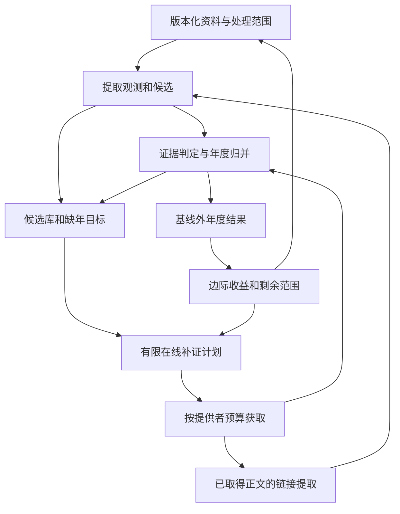

# 发现与取证解耦：数据契约、查询语义与执行预算

设计与资料核查：2026-11-24（UTC+8）。本文把新提供的来源与工具建议落实到现有设计。规则、计分对象和基线沿用[问题定义](PROBLEM_DEFINITION.md)；原始建档机制见[档案起源与剩余发现](ARCHIVE_ORIGINS_AND_RESIDUAL_FRONTIER.md)。本文完成的是原始资料与固定版本代码核查、接口设计及静态推导，没有下载新语料、运行来源测试、查询真实候选、部署系统或产生新增 EED。

## 1. 当前决策

**分开调度资料发现与证据补全，共享可追溯的观测账本。** 资料处理产生线索，也可能直接产生合格证据；在线补证只承担剩余证据缺口，在线发现和注册信息丰富分别使用自己的预算。所有路径最后对同一 exact hostname-year 求差。

1. **保留已知覆盖前提。** WebBase 2001 与已使用 IA 主体来源近乎处理完；JISC、Arquivo、语言标注等同祖源派生物只有明确未处理范围、不同记录或遗漏信息时才重开。不能把同一观察换个下载地址再算一次库存。
2. **优先核查另一种历史观察。** Usenet 消息、同期邮件与明确版本的论文具有可定位材料；其候选可能补充网页索引，但基线外容量尚未证明。IA 托管 Usenet 不等于 IA 网页抓取；反过来，材料类型不同也不自动保证有增量。
3. **发现层不一律离线。** 已取得文件的解析可离线；首次获取、全文检索、RDAP 与按需取回正文分别有网络、费用和访问约束。它们使用不同预算。
4. **验证是证据判定，不等于必须再发 HTTP。** 已有资料满足确切身份、年份、网站语义和保管链时直接验收。HTTP 200 HTML 是优先检索路径；可信同期目录、图谱等仍按任务规则各自判断。
5. **CDX 的 annual collapse 不作为年度去重器。** 按 exact host 的缺年选择 witness，客户端建立年度位图；来源完成状态独立记录。
6. **保留 Temporal。** PostgreSQL 可保存来源、任务目录和结果状态；本轮不另加 PGMQ 或自制全球租约层。大名单以分片和 manifest 传递。
7. **全球 worker 不直接复制配额。** 按真实 provider 和 endpoint 预算分派采集任务；更多地区提供可达性、数据就近处理和受控接管，不预设请求容量线性增长。

## 2. 六个对象和三个独立状态轴

| 对象 | 身份与最小字段 | 完成条件或作用 |
|---|---|---|
| `SourceSlice` 资料分片 | provider、origin_family、对象版本/hash、年代范围、记录角色、获取契约、处理范围 | 明确哪些原始观察存在、可以取得、已经执行过什么操作 |
| `Observation` 原始观测 | 来源定位、原字符串、记录 ID、日期原文与语义、正文上下文、提取版本 | 保存“材料实际说了什么”；允许日期或身份未决 |
| `Candidate` 候选身份 | exact hostname 或待解析主体、关联观测、可能年份、原始 URL | 合并同一对象的线索，不丢失独立出处；日期提示不等于合格年份 |
| `VerificationTarget` 证据目标 | exact `(h,y)`、缺少的证据、已有 witness、查询计划与预算 | 只为未覆盖、尚未形成合格证据或需审计的目标补证 |
| `EvidenceBundle` 证据包 | exact h、实际年份、原件/回放定位、日期解释、规则版本、接受或拒绝原因 | 可以组合互补材料；不以来源数或重复频次代替证据条件 |
| `OperationRun` 操作记录 | input manifest、operator/version、scope、cursor、attempt、完整性、费用、输出 manifest | 防重复、续跑与结算；任务成功不等于查询完整或证据成立 |

三种状态分别维护：**资料操作是否完成、某个查询范围是否消费完整、某个 hostname-year 是否合格。** 一次 Activity 正常返回，可以只完成一次有预算上限的检索；它不能自动把这个 host 标成不存在。

核心年份用六位位图表示：

```text
covered_mask(h) = baseline_mask(h) OR locally_qualified_mask(h)
missing_mask(h) = 0b111111 AND NOT covered_mask(h)
new_mask(h)     = locally_qualified_mask(h) AND NOT baseline_mask(h)
```

位图中的一位只由该年的合格证据设置。某 host 在一年已入表，仍可有其他缺年任务。活动候选 TXT 按任务书排除已在任一相关年度入表的 host；该导出视图不删除内部缺年队列。基线更新只重建差集和调度视图，不要求重新获取同一原件。



只有确有未执行操作且值得展开的资料进入发现路径。某页已在基线中不妨碍提取其未消费外链；已近乎处理完的正文也不因可能含链接而自动重开。

## 3. 来源优先级由具体材料决定

### 3.1 当前可绑定的来源

下表的优先级表示下一步资料整理的顺序，不代表已经测得产率、准许无限请求或已经批准大规模执行。

| 路线 | 已核实的具体材料与时间依据 | 剩余知识缺口 | 当前决定 |
|---|---|---|---|
| Usenet `usenet-comp` | IA 官方文件目录列出 `comp.os.linux.announce.mbox.zip`、`comp.sys.dec.mbox.zip`；消费者固定源码报告分别覆盖 1993-04—2013-05、1990-04—2013-05 [P1] | 单条消息年代、目标期记录数、版本/hash、已有处理范围及精确基线差集 | 优先整理分组文件契约。目录可读不等于 ZIP 已下载、内容已验收或当前下载吞吐已知 |
| W3C `www-talk` | 官方逐月 HTML 目录覆盖 1996—2001；管理员说明 mailbox 目录需 Member access，可联系索取 [P2] | 公开 HTML 获取边界、具体消息日期与镜像重叠；批量权限尚未取得 | 优先作为来源和日期语义清楚的文本路线；不写成匿名 bulk mbox，也不擅自联系管理员 |
| arXiv 同期论文 | S3 PDF/source tar 与 manifest 有官方契约，按 YYMM 分组，从 1991-08 起；Requester Pays、us-east-1 [P3] | 目标包实际版本、目标期可取原版本、费用与候选重叠 | 按 `论文 ID + vN` 整理资料契约；不能以论文首次编号给后来正文定年 |
| Debian 等同期项目邮件 | 官方公开档案政策及目标年页面可定位；本轮直开部分列表遇到 403 [P4] | 当前批量交付方式、具体对象范围及与 Usenet 网关的同源关系 | 补充路线；不把历史 mbox 讨论当今天的匿名批量承诺 |
| JISC UK host-linkage | 官方描述从约 25 亿个 200 响应提取 1996—2010 链接；文件结构和年度语义明确 [P5] | 与已读 IA/UKWA 的范围、投影关系；实际可得文件版本、未处理范围 | 仅对明确残余重开；全球 target 只是被这些源页观察到的目标，不是全球网站全集 |
| WebBase 2001 / LAW uk-2002 | 官方分别说明 2001、2002 年抓取；前者 118,142,155 URL 节点 [P6] | 2001 已近乎读入；后者超出核心期 | 不安排 WebBase 重下载；2002 节点只能保留真实年份的线索，不回填核心年 |
| Arquivo CDXJ / 原始收藏 | 官方推荐选收藏、批量下载 CDXJ、筛选后取资源 [P7] | 收藏级祖源、目标年覆盖、已有完成范围 | 优先复用本地副本；只接入有材料依据的不同收藏或未消费信息 |
| DMOZ 1999—2000 dump | 已确认旧 ODP 导出机制、当前 Curlie 下载说明；未绑定目标年代 dump 对象 [P8] | 当年文件、版本、条目日期、保管链及访问条件 | 保留研究问题，不列入已可下载库存或百万级产能 |
| PANDORA / Kulturarw3 业务与交存材料 | 原始建档机制已研究，见前文档 | 目标年代实际系列、字段、原件与取得契约 | 继续独立材料研究；和已具体定位的公开文本路线并行推进 |

Usenet 目录上 ZIP 的 2013 年日期是转存对象信息，不是里面消息的历史日期。作者报告的完整消息数量也不是目标期 hostname 数。本轮只查看目录与说明，未取这两个 ZIP。

### 3.2 图谱中的三个不同断言

JISC host-linkage 的实际文本格式为**两列 TSV**：第一列 `year|sourcehost|targethost`，第二列为链接 URL 的计数；不是把任意四列直接当成 host-year 表。年度来自源页捕获。官方还提示去重可能使未变化页面在后续年份图中缺失。[P5]

- `sourcehost` 出现在构造图的成功响应中，需进一步确认原始身份和年份信息足够。
- `targethost` 被同期源页引用，说明当年有这条链接观察；不自动证明目标抓取成功。
- 图中的目标是否可直接按竞赛可信 dated graph 路径纳入，取决于生成语义、身份保真和适用规则；不能统一升级为“目标 HTTP 200 HTML 已存在”。

同理，WebBase URL 节点总数不能直接解释成成功 HTTP 抓取的独立 hostname 数，更不能解释成基线外数量。LAW 当前页面支持“2001 年抓取”，本轮未找到其“2001 年 1 月”这一更精确日期的原始依据。[P6]

### 3.3 现代 zone 与 RDAP 放到辅助路径

当前 zone 只覆盖当前保留并在相应列表中的名称；早年存在而今天消失的站点不在这一输入空间。CZDS 的日常服务是申请并获得各 TLD 批准后的当前 zone 下载；相应协议对历史文件使用条件有规定，但不保证存在 1996—2001 库存。获得 zone 访问也不自动允许把它作为高量查询 registry/registrar 的输入；须按具体交付条件判断。[P9]

RDAP 是在线请求。IANA 将 `registration`、`reregistration`、`reinstantiation` 和 `transfer` 作为不同事件；应保留 domain 对象顶层事件的 action、date 与来源，不和嵌套 entity 的日期混淆。[P10]

```text
registration <= 2001：增加一条注册线索；不证明网站或其子域当年存在。
registration > 2001：不硬排除；同一字符串可能曾用过、删除后重新创建。
日期缺失 / 当前未注册 / DNS 无委派：不等于历史不存在。
```

因此，本轮不采用“现代全量 zone → 全量 RDAP → 年代硬过滤”作为主发现链。仅在某批候选有具体身份疑问、取得条件明确且成本有依据时做辅助丰富；当前没有证据证明其优于已定位的历史 URL 文本路线。

## 4. 文本发现怎样形成可信候选

### 4.1 先保存观测，再做身份和时间解释

每条 URL 提取记录保留：来源对象/version/hash、Message-ID 或论文 ID+vN、原始日期头、日期含义与冲突、MIME part/字节位置/PDF 页码、URL 原文、上下文位置、提取版本与来源家族。

时间至少拆成 `record_event_time`、`content_version_time`、`archive_capture_time`、`container_created_time`、`retrieved_at`。不同材料只填写有依据的字段，不能互相代填：

- 邮件原始 Date 与档案接收时间冲突时保留冲突；无时区、跨年边界不静默补齐。
- arXiv manifest 的 timestamp 是 tar 创建时间；OAI-PMH datestamp 是元数据变更时间。引用 URL 的年份绑定实际读取的正文版本。[P3]
- 引述旧邮件、计划上线、示例 URL、当前有效入口分别标注。引用出现在 1999 年邮件中，不等于它在 1999 年仍运行。
- 邮箱域、Message-ID 域、SMTP/NNTP 路由主机、FTP 与 `mailto:` 保留为相应线索；不把 `bob@example.com` 改写成已观测的 `www.example.com`。

Usenet 的固定消费者实现还提示：分隔符可能是 `From <deja-id>`，ID 可为负数；Date 格式不统一，Message-ID 可能缺失。应采用格式适配器和原始定位，不能用任意 `^From ` 正则切割整份内容。其整包读入内存、缺时区默认 UTC 等实现选择不直接照搬。[P1]

### 4.2 竞赛身份与检索身份分开

`hostname_exact` 从原始 URL 按任务口径解析、检查、规范化；保留裸域、www 及不同子域。`surt_key` 用于归档检索和排序，`registrable_domain` 只作分析及来源侧重。三个字段不互相替代。

默认 SURT 的 www 归并、图工具的 PLD 聚合，以及索引别名可能改变 exact hostname。索引只提供 canonical key 且没有 original 时，保持身份不确定，寻找原映射。精确差集可以流式排序归并；若采用 Bloom filter 作前置加速，阳性须再查精确集合，避免误删真正新增项。[既有固定源码审计见 P15；本段数据结构为项目设计]

### 4.3 优先级使用可解释线索，不伪装成命中概率

起步阶段按以下证据强弱分组：已定位可取的历史捕获；同期明确网站 URL；有上下文的 bare `www` 地址；一般域名文本；仅基础设施线索。每组内部结合缺年、可用档案定位、日期可信度、独立观测家族和预期取证成本排序。最终价值仍按合格增量的 TLD 权重计算。

原始出现频次只能作为特征：同一签名的千次出现、交叉发帖、同一消息多个镜像，不是千条独立证据。按 Message-ID、内容版本和祖源关联观测；仍保留各副本定位以便恢复。没有相容的实际结算数据前，不给这些分组编造成功概率。

大文件先产生不可变候选分片，局部去重后做全局 exact host 归并。只有有限的高价值窗口进入在线工作流；持久候选库保留未调度材料。低成本同年基线过滤可以关闭补证分支，不删除原始观测或值得展开的资料。

## 5. CDX 查询必须以证据目标为中心

### 5.1 `collapse=timestamp:4` 的真实语义

固定阅读 `internetarchive/wayback@a331f968c2a8b3ef56b82dc3a9faed11900e84b2`。README 和 `CollapseFieldFilter` 都说明折叠比较的是**相邻结果行的字段**；没有按 hostname 或 URL 分组重置。对于以下构造输入，按年份折叠会得到：[P11]

| 输入顺序 | original 的 host | 年份 | 年份折叠结果 |
|---:|---|---:|---|
| 1 | a.example.com | 1999 | 保留 |
| 2 | b.example.com | 1999 | 丢弃 |
| 3 | b.example.com | 2000 | 保留 |
| 4 | c.example.com | 2000 | 丢弃 |

这是源码语义的静态反例，没有运行接口测试。b 的 1999 和 c 的 2000 会被这个投影删掉。另一方面，一个 host 的不同 URL 各自含 1996—2001 捕获时，年份会随 URL 边界反复切换，输出可远多于六行。若输入年份序列为 `y1…ym`，单字段折叠的输出数为 `1 + Σ[i=2…m] 1[yi != y(i-1)]`（m>0），其中没有 hostname 分组。

多加一个 `collapse=urlkey` 也不是 SQL 的复合分组：该代码按多个过滤器顺序执行，任一拒绝即丢行。`collapse=digest` 同样不能承担跨年的证据归并。

### 5.2 `domain` 查询不能充当 exact host 验证

`matchType=domain` 会把子域纳入检索范围；显式 matchType 的语义不会因为 `url` 中还带 `/*` 就退化成单一 hostname。它会扩大查询成本，也会偏离本项目独立候选和确切身份的单位。[P11]

本项目默认使用已有独立观测中的 exact URL 或 same-host 范围。单个 host 的补年与从基线根域大规模枚举子域分别处理，后者不进入活动发现策略。

即使用 `matchType=exact` 或 `host`，归档 canonicalization 也可能合并 www 等形式。验收前必须解析返回的 `original` 并与目标 h 精确比较。若使用 `limit=1` 作廉价 witness 选择，应先在支持的服务端下推经过正确转义的 original-host 过滤，再对返回结果解析复核；只在客户端过滤第一行会漏掉后续符合条件的记录。无法下推时，使用有界续取并记录尚未遍历范围。

### 5.3 分层选择 witness，不反复扫描大站

| 顺序 | 操作 | 何时继续 |
|---|---|---|
| 0 | 查本地观测、已取得索引、已有证据及查询缓存 | 已充分则直接判定，不发同义请求 |
| 1 | 有 ARC/WARC record locator 时按记录取得；否则查线索中的 exact original URL | original 身份、实际 capture 年或网站语义不足时换 witness |
| 2 | 查同一个 exact host 的根 URL，优先线索年份与缺年 | 根页缺失不说明整站不存在 |
| 3 | 对确有必要的 same-host 范围有界分页，客户端填缺年位图 | 多缺年或大站共用一次有界扫描；不机械执行六次全站扫描 |
| 4 | 根据目标年代、收藏和可用性换另一个有理由的档案来源 | 每次保留已完成范围、剩余问题与预算 |

时间边界为明确的 14 位 timestamp，例如 1999 年使用 `19990101000000`—`19991231235959`，并校验实际结果。不同服务对短日期的填充和过滤对象不同；不能照搬所有 CDX/全文服务的参数。[P7、P11]

200 HTML 是廉价的优先证据选择条件；它没有覆盖所有允许的目录/图谱、其他可接受 MIME 或重定向证据。字段至少保留 `original,timestamp,statuscode,mimetype,digest`，加可取得的长度和文件/偏移定位。`fl` 减少响应字节，不保证后端扫描量同比减少。

一条候选 witness 失败后选择同年替代记录。已有合格 witness 后停止该年重复取证，除非有审计或未消费资料展开理由。一个内容摘要可共享内容读取/分析成本，但年度事实仍绑定各自的捕获记录。

### 5.4 空结果与分页结束需要单独证明

已读 `CDXServer.writeCdxResponse()` 中，原始扫描行计数在日期、权限、regex、collapse 等过滤之前推进；输出计数最后增加。非分页路径可以受配置的 `queryMaxLimit` 限制，续取 token 的写出又要求输出达到 `writeLimit`。因此该实现存在“原始读取触顶、过滤后零/少量结果、没有 resumeKey”的路径。[P11]

**这证明客户端不能仅用空结果或无 token 宣称查完；不证明 Wayback 2026 年生产配置恰好采用某个具体 readLimit。** 本轮没有测量生产后端。

下列状态分别属于证据目标、候选 witness、查询范围与操作结果，应分别保存，不组成一个互斥状态枚举：

- `qualified`：已形成该目标的合格证据，其他范围可不继续。
- `witness_rejected`：这个记录不适用；目标尚可使用替代 witness。
- `complete_for_declared_index_view`：有来源契约支持的有限范围完整消费；才能记录该范围的 no_match。
- `budget_exhausted` / `possibly_truncated`：正常结束当前批次，但范围未完成。
- `transient_failure` / `access_blocked`：保留错误和重试/取得条件；不缓存成不存在。

分页完成条件绑定 provider、索引视图/版本、scope、时间范围、过滤条件、游标与策略版本。ZipNum 的 pageSize 是压缩块单位，不是结果行数；过滤后的空页仍需按页范围继续。某页 `limit=1` 取到的 witness 被拒绝后，需要继续该页剩余范围。某些分页视图可能不含最新 live 索引，完整性只覆盖声明视图。对于需证明完整的批量导出，还应审查同一 canonical key、同秒记录在续取键递增时的边界；不能只靠 token 循环断言全部记录已取。[P11]

## 6. 正文取证与反馈不混淆时间

`id_` 可用于减少 pywb 回放中的正文重写，但不能描述为原始 ARC/WARC 的完整下载。回放响应仍可能处理 headers、选择邻近捕获或解析 revisit。已读 pywb 源码明确区分这些层次。[P12]

证据记录同时保存 requested timestamp、实际被选中的 capture timestamp、原始 URL、URI-M/Content-Location/Memento-Datetime、索引/原件定位及重定向链。回放服务的跳转与原网站历史 HTTP 重定向分别解释。实际捕获落在另一年时，不能为请求年份设置合格位。

revisit 可复用另一条记录中的 payload；目标年度事实须由对应年的观测证明。保留可取得的当前记录和 headers；需要正文时解析 payload 引用链，并独立保存其来源 URL、日期和记录定位。缺失当前 headers 时，不得用旧 payload 的 headers 无标记代填；证据是否充分由完整证据包及版本化规则判断。CDX 对 revisit 的补齐字段不是“已看到当年完整原始响应”的同义词。

digest 的相等只证明在相同算法、字段语义和字节域下的内容标识相等。它适合内容缓存、默认页聚类与异常优先审查；不自动证明多个 host 是同一身份或都无效。历史默认页、停放页、Under Construction 页是否合格，由网站证据规则判断。SimHash 近似相似性更不能直接作删除条件。[P15]

解析新取得的正文时，保存原始 URL、`base` 解析、链接原文、解析版本及目标 host。相对链接不能只由 payload hash 决定；同样正文在不同 base 下会指向不同目标。普通外链形成线索，目标页面的存在年份继续独立判定。发现闭环只处理未消费的材料；同一消息、同一页或相似模板不会无限自我复制为新任务。

## 7. 多馆路由与端点预算

### 7.1 覆盖画像的作用范围

先用目标年代、来源收藏、已知原件/索引定位、host/path 画像与当前可服务性筛选来源，再用 TLD/语言等辅助排序。`.uk → UKWA`、`.pt → Arquivo` 可以作软先验，不能硬排除其他馆，也不保证该馆有 1996—2001 记录。

MementoMap 论文 Table 3 的 ODU 日志覆盖 2015-10-25—2019-01-16，14 个上游、61,816,637 次请求，hit 5.44%、miss 92.92%、error 1.64%；按表计算非命中为 94.56%。这是特定广播工作负载的经验依据，不是当前候选的预计浪费率；论文引言的 93.56% 与表不一致。[P13]

现有固定 MementoMap 实现的 CDX→画像路径未解析 timestamp，不能据此自动路由六个目标年。可为明确收藏/年代的索引分别生成画像，保留其范围与版本；不把“没有画像命中”一律作为永久否定。[P15]

LANL 2025-08 公告计划最迟 9 月底退出 Time Travel；当前 Memento 官网确认聚合服务已停止，2026 年恢复的是静态资料站。本项目采用直接来源适配，必要时本地运行 MemGator；不依赖公共 Time Travel。公告不支持推断精确停机日或所有 Memento 服务都关闭。[P14]

### 7.2 已核实的配额资料

| 服务/端点 | 当前可追溯资料 | 本项目采用方式 |
|---|---|---|
| Arquivo full-text / URL search | 官方 API Wiki：250 请求 / 60 s / IP | 检索预算；不视为固定持续吞吐 |
| Arquivo CDX | 官方 API Wiki：250 请求 / 60 s / IP | 与 Memento 的 400 分开记录 |
| Arquivo Memento | 官方 API Wiki：400 请求 / 60 s / IP | 仅适用于对应接口 |
| Arquivo 单列回放等端点 | 官方 API Wiki：4000 请求 / 60 s / IP | 不能因同有 `/wayback` 前缀就套到 CDX/TimeMap |
| Wayback CDX / TimeMap | 客户端维护者 issue #205 转述与 IA 人员沟通：共同查询池 30/min；v0.5.1 默认设为 24/min | 有来源的保守客户端参考；计数键和本项目获准持续容量未据此确定，不推导 `24 × 地区数` |

Arquivo Wiki 当前标记 2026-06-15 编辑；各分类是否还能相加为独立池没有在该表中保证。Wayback 客户端限速对象也不会自动跨进程共享。所有提供者配额记录包含 checked_at、出处、适用 endpoint、计数作用域、并发限制及冷却范围。[P7、P16]

全文检索属于发现预算。Arquivo 的 `q` 文档明确不接受 URL 作为 query，而引导 URL 查询走 versionHistory、CDX 或 Memento；`siteSearch` 还会去掉协议和 www。不能原样把 `q="http://www."` 当成已确认有效的历史 URL 召回机制。改用有历史语义的主题/语言词和收藏条件，逐条核实实际结果 capture；全文检索的命中总数也不是独立 hostname 数。[P7]

## 8. 全球通信承接批次，不承接每一个 URL

延续[全球执行设计](CAPACITY_AND_GLOBAL_EXECUTION.md)的 Temporal 生命周期、外部对象引用与幂等结果协议：

1. 资料处理按实际文件/可定位压缩块分片，在数据附近解码、抽取、局部去重。基线与规则快照按需复制，原文不反复跨洲传输。
2. 同一 exact host 的观测和缺年在稳定逻辑分区合并；短窗口内合并相同 provider、scope、缺年的查询计划，避免同一 URL 每出现一次就发一次请求。
3. 采集任务发往适合该来源的地区。首版每 provider 只有一个受管理的活跃出口预算作用域；地区间分布不同来源，文件处理器分布于各数据位置。处于同一地区不等于自动共享额度：所有 HTTP 调用，包括 Range、revisit 补取和重试，都经同一进程的 limiter 或明确共享的区域内限流设施，并满足端点和 provider 的共同约束。
4. 控制消息只含 task/operation/version、input manifest URI/hash、范围、规则版本与输出位置。大名单、正文、证据分片由对象存储承接。
5. worker 完成不可变输出块后发布最终 manifest；导入按任务键与结果摘要幂等处理，并在同一可恢复导入过程登记观测、派生待办和已完成范围。迟到尝试不覆盖已发布结果，重复 witness 不重复计分。
6. HTTP 重试、Activity 重试与跨区接管有统一尝试记录和总预算。请求端处理共享 cooldown；旧实例未停止或出口未撤销时不复制整份额度到新地区。

队列、缓存和索引各有职责：Temporal 管任务生命周期，PostgreSQL 可管小型目录/状态，批量候选和证据分片管记录，OutbackCDX 可服务捕获查询但不代替年度基线及证据裁决。没有具体瓶颈前不同时叠加 PGMQ、Redis、NATS 和跨洲数据库写入。[既有固定实现依据 P15、P17]

## 9. 用验证成本限制进入在线队列的速率

发现吞吐很高不意味着端到端贡献很高。设每秒准入的唯一补证计划数为 `λ`；一个计划绑定 exact host、待补年份集合和来源策略，可服务多个 hostname-year。每个计划对 endpoint 组 e 的平均实际请求消耗为 `c_e`，该组可用请求预算为 `R_e`。在工作负载稳定且容量估计成立的条件下，逐组采用带余量的准入约束：

```text
λ × c_e < R_e                 对每个实际受限 endpoint 组 e
```

`c_e` 包含无命中、分页、重试、被拒 witness、正文和 revisit 请求；共同后端需共用约束。多年份共用一次扫描或多个计划合并请求时，实际请求只登记一次。CPU、字节和人工审核另列，不把异单位直接相加。多任务类型可写成 `Σ_j λ_j c_je < R_e`。

这些是平均负载的规划约束，不单独保证有限队列或时延。若端点平均请求占槽时间为 `s_e`、并发上限为 `K_e`，还需检查平均占槽 `λ c_e s_e ≤ K_e` 并留余量；瞬时窗口、突发、超时与冷却另行约束。在线队列通过有界窗口和可恢复检查点控制。目前没有这些成本的实测参数。

调度器使用有界在线窗口：候选先落持久分片，准入受共享预算、优先级和可用 witness 约束；队列积压时减少低价值在线任务。离线发现可以继续累计有空间预算的库存，也可暂停低收益分片，不需要让每个名字立刻形成长寿命 Workflow。

已结算批次统一报告：原始观测数、唯一候选 host、拟补证 host-year、本地合格数、基线外数、全局边际 EED，以及各类请求、字节、墙钟时间和审核成本。发现来源与验证来源分别归因，同一最终 `(h,y)` 只计分一次。某个查询尚未完成时，不把它算入“已判明无证据”的分母。

当前 1% 门槛仍为 **764,304.4645 EED**；平均新增权重 0.6 的情景要求约 **1,273,841 个合格新增 hostname-year**。[P0] 本轮定位了更具体的候选材料和请求机制，但没有测得这些来源的剩余合格容量。Usenet 文件数、JISC URL 数、API 上限和 worker 数都不能代替这一缺口。

## 10. 组件复用与接下来可交付的工作

| 部分 | 成熟机制 | Creeperman 的必要适配 |
|---|---|---|
| 元数据与正文 | ArchiveSpark、warcio、pywb 的元数据先行、局部记录读取 | exact host-year 差集、必要 witness、实际年份及原件引用 |
| CDX 客户端 | GLAM-Workbench 分页落盘与缓存；CreepsoOff 工具的查询指纹、续取检查、退避 | 无 token 不自动等于完整；按缺年选择替代 witness；不以镜像生成 WARC 冒充原档案 |
| 档案路由 | MemGator 超时/休眠、MementoMap 本地画像 | 年代/收藏维度、当前 endpoint 清单、provider 共享预算 |
| 文本发现 | Usenet 既有消费者的格式适配；W3C/arXiv 官方对象与版本机制 | 记录定位、日期冲突、实际 URL、消息同源关系；不补猜 www |
| 来源盘点 | `ymaurer/cdx-summarize` 的时间聚合 | 从 original 恢复 exact host、保留 witness；其默认域层级和 fullhost 都不能直接当竞赛键 |
| RDAP 辅助 | `pepa65/domaincheck`（Rust）与 `jedarden/domain-check`（Go）的请求/解析 | 原始事件与失败状态；后者 bulk CLI 丢弃注册字段，不能直接作年代筛选器 |
| 全球批次 | Temporal 的队列、心跳、失败恢复与 Claim Check | 版本化输入输出、幂等导入、资料完成状态、来源请求预算 |

新代码审计细节、固定提交和采用边界见[源码审计](OPEN_SOURCE_COMPONENT_AUDIT.md)。

接下来按依赖推进：

1. **补来源清单与处理账本。** 对 Usenet 具体 group、W3C 月份、arXiv 具体版本登记年代/交付/已有处理范围；对 IA/WebBase 只登记真实未处理缺口。
2. **固定逻辑契约。** 把本文六类对象、exact hostname 规则、日期字段、候选/缺年视图和查询完整性状态作为适配器输入输出；现有文档已同步。
3. **绑定成熟实现。** 资料解析和在线补证分别做有限分片接口，外部产物通过 manifest 流转；先去掉源码中不适用的聚合和完成假设，再讨论运行参数。
4. **只为尚未解决的决策安排后续判别。** 说明具体对象、两种竞争解释和改变方案的判据。数据访问、格式和证据语义明确以后，真实残余率仍需精确差集；本轮没有提前执行这些任务。

本轮完成的是上述知识依据和设计契约。没有把一个高吞吐工具的存在写成高产率保证，也没有把尚未取得的目标年材料写成可兑现库存。

## 原始依据与固定阅读版本

- **P0 · 项目规则与计分。** [问题定义](PROBLEM_DEFINITION.md)、[门槛估算](CAPACITY_AND_GLOBAL_EXECUTION.md)、[基线审计](BASELINE_AUDIT.md)。IA/WebBase 近乎完成来自用户说明。
- **P1 · Usenet。** [IA 官方文件目录](https://archive.org/download/usenet-comp/)；消费者 `alphalinux/mailing-list-archives@2c9b45193312840f20b219078630af617c3cf53b` 的 [SOURCES.md](https://github.com/alphalinux/mailing-list-archives/blob/2c9b45193312840f20b219078630af617c3cf53b/SOURCES.md)、[格式适配脚本](https://github.com/alphalinux/mailing-list-archives/blob/2c9b45193312840f20b219078630af617c3cf53b/fetch-usenet-archive-mbox.py)。文件存在于提供者目录、作者报告年代和实际内容验收是不同层次。
- **P2 · W3C。** [www-talk 总索引](https://lists.w3.org/Archives/Public/www-talk/)、[1996-01](https://lists.w3.org/Archives/Public/www-talk/1996Jan/)、[管理员 2026-10-28 的档案与 mbox 说明](https://lists.w3.org/Archives/Public/www-talk/2026Oct/0000.html)、[官方修复说明](https://www.w3.org/blog/2026/historical-www-talk-archives-made-complete/)。修复主要补 1993 年至 1995 年 2 月，不能把其现代修复时间当目标年新增观察。
- **P3 · arXiv。** [S3 批量全文](https://info.arxiv.org/help/bulk_data_s3.html)、[版本可用性](https://info.arxiv.org/help/versions.html)、[OAI-PMH 元数据](https://info.arxiv.org/help/oa/index.html)。
- **P4 · Debian。** [邮件列表与公开档案政策](https://www.debian.org/MailingLists/)、[debian-devel 索引](https://lists.debian.org/debian-devel/)、[1996-12-12 发行公告](https://lists.debian.org/debian-announce/1996/msg00026.html)。可定位不代表本轮已能读取全部目标文件。
- **P5 · British Library。** [JISC UK host-linkage 数据说明](https://britishlibrary.github.io/data.bl.uk/ukwa.ds.2/host-linkage/)。
- **P6 · LAW。** [webbase-2001](https://law.di.unimi.it/webdata/webbase-2001/)、[uk-2002](https://law.di.unimi.it/webdata/uk-2002/)。图生成代码与原始观察关系见[此前复核](EVIDENCE_LED_REDESIGN.md)。
- **P7 · Arquivo。** [APIs 总表与 bulk 步骤](https://github.com/arquivo/pwa-technologies/wiki/APIs)、[全文/URL API 参数](https://github.com/arquivo/pwa-technologies/wiki/Arquivo.pt-API)、[CDX API](https://github.com/arquivo/pwa-technologies/wiki/URL-search%3A-CDX-server-API)。
- **P8 · DMOZ。** [Curlie 当前下载说明](https://www.curlie.org/rdf.html)、[W3C 旧 DmozRdf 格式说明](https://www.w3.org/wiki/DmozRdf)。本轮未找到可绑定的 1999—2000 dump；该结论是检索缺口，不是不存在证明。
- **P9 · ICANN。** [CZDS 帮助](https://czds.icann.org/help)、[2024-12-01 .COM Registry Agreement](https://itp.cdn.icann.org/en/files/registry-agreements/com/com-agreement-html-01-12-2024-en.htm) 的 Zone File Access 附录 §§1.3、1.5。限制按具体来源协议解释。
- **P10 · RDAP 时间。** [IANA RDAP JSON Values](https://www.iana.org/assignments/rdap-json-values)、[RFC 9083](https://www.rfc-editor.org/rfc/rfc9083.html)；[ICANN 2017 原始工作组讨论](https://lists.icann.org/hyperkitty/list/gnso-rds-pdp-wg%40icann.org/message/ARVLXAYCABES2WBMQ2OHZPFKP7AJYBAT/)解释当前对象创建日期与字符串历史首次使用的差别，该讨论不是新增协议义务。
- **P11 · Wayback CDX 固定源码。** `internetarchive/wayback@a331f968c2a8b3ef56b82dc3a9faed11900e84b2`：[README](https://github.com/internetarchive/wayback/blob/a331f968c2a8b3ef56b82dc3a9faed11900e84b2/wayback-cdx-server/README.md)、[CollapseFieldFilter](https://github.com/internetarchive/wayback/blob/a331f968c2a8b3ef56b82dc3a9faed11900e84b2/wayback-cdx-server/src/main/java/org/archive/cdxserver/filter/CollapseFieldFilter.java)、[CDXServer](https://github.com/internetarchive/wayback/blob/a331f968c2a8b3ef56b82dc3a9faed11900e84b2/wayback-cdx-server/src/main/java/org/archive/cdxserver/CDXServer.java)。源码路径证明语义边界，不能据此指定当前生产配置。
- **P12 · pywb 固定源码。** `webrecorder/pywb@28750e62b7c00d0bb72643b2ae68b6c2ea7a0abf`：[content_rewriter](https://github.com/webrecorder/pywb/blob/28750e62b7c00d0bb72643b2ae68b6c2ea7a0abf/pywb/rewrite/content_rewriter.py)、[rewriterapp](https://github.com/webrecorder/pywb/blob/28750e62b7c00d0bb72643b2ae68b6c2ea7a0abf/pywb/apps/rewriterapp.py)、[resolvingloader](https://github.com/webrecorder/pywb/blob/28750e62b7c00d0bb72643b2ae68b6c2ea7a0abf/pywb/warcserver/resource/resolvingloader.py)。
- **P13 · MementoMap 论文。** Alam et al., JCDL 2019，[全文](https://arxiv.org/pdf/1905.12607)，Table 3 和样本范围；非命中 94.56% 为依据表中比例计算。
- **P14 · Time Travel。** [LANL 原始退出公告，2025-08-07](https://groups.google.com/g/memento-dev/c/Tr_xBWzBr0Y)、[Memento 当前 About](https://mementoweb.org/about/)。
- **P15 · 组件源码。** [归档项目源码审计](OPEN_SOURCE_COMPONENT_AUDIT.md)，含 SURT、MementoMap、MemGator、OTMT、SimHash、CDX 客户端及本轮新增工具的固定提交。
- **P16 · Wayback 客户端限流依据。** [维护者 issue #205](https://github.com/edgi-govdata-archiving/wayback/issues/205)、[v0.5.1 发布说明](https://wayback.readthedocs.io/en/latest/release-history.html)、固定 `ff7955ea3d8017de380300d2c45b080beadb2b7f` 的 [_client.py](https://github.com/edgi-govdata-archiving/wayback/blob/ff7955ea3d8017de380300d2c45b080beadb2b7f/src/wayback/_client.py)。这不是 IA 对本项目的吞吐承诺。
- **P17 · 全球批次实现。** [门槛估算与全球执行](CAPACITY_AND_GLOBAL_EXECUTION.md) §§5—7 及 C16—C18、[研究复核后的方案](EVIDENCE_LED_REDESIGN.md) 的 Temporal/ArchiveSpark/pywb 固定阅读依据。
