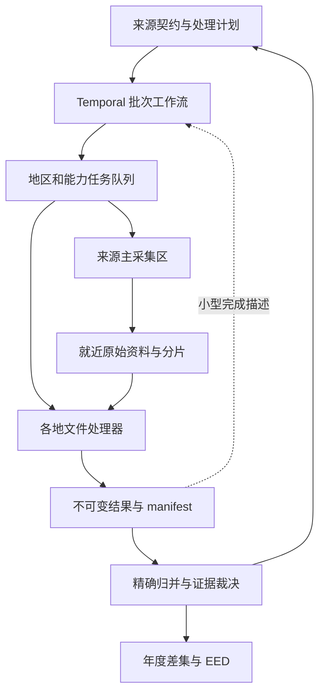

# 来源、发现、验证与全球通信：研究复核后的方案

更新日期：2026-11-24（UTC+8）。本轮只阅读竞赛文档、来源说明、原始论文与公开实现，没有新增来源探针、数据扫描、吞吐测试或部署。本文件修订此前“先做小来源闭环和三地探测”的推进顺序；来源与机制依据先明确，再处理资料仍无法回答的判别问题。

## 1. 四项自检的结论

| 自检问题 | 现有依据 | 修订后的判断 |
|---|---|---|
| 是否有足够具体、值得判别的来源？ | 已找到 WebBase 2001 的公开图、URL 映射与作者转换工具；UKWA 年度 CDX；Arquivo PWA9609 版本映射与 dated inlinks；1996/1998 离线原材料 | 已形成具体路线，但尚无相对完整基线的新增容量证明。不同提供者不能自动算不同抓取祖源 |
| 是否有可信发现机制？ | 索引投影、源节点图证据、已知页面的历史外链、同 host 根 URL 补年、RSM 全文入口均有论文或实际实现依据 | 分别规定输入、输出和成立条件；RSM 仅列研究辅助路线，其链接仓库的关键词模块并未实现 |
| 是否有高效验证机制？ | ArchiveSpark 的两阶段加载；pywb CDX/ZipNum 与局部记录加载；warcio；WARC revisit 解析 | 直接复用定位、读取和解析；自写部分集中于 exact hostname-year、年度差集与竞赛证据裁决 |
| 是否有高效分布式通信？ | Temporal 的 Task Queue、长轮询、Activity 心跳/重试和 Claim Check；已读 SDK/API/服务端责任位置 | 首选 Temporal 管理批次生命周期，全球 worker 运行普通处理函数；移除初版自建 PostgreSQL 租约协议及逐请求跨区许可 |

这里“有成熟依据”表示可以确定机制和模块边界，不表示这些组件已在 Creeperman 中完成集成。旧的容量计算仍可作条件估算，但不能用假设产率或一个公开 URL 代替来源契约。

## 2. 首先固定判断对象

核心目标仍是 1996—2001 年、基线外且有合格证据的 exact `(hostname, year)`。裸域、`www` 和其他子域分别处理；不同路径和重复捕获不另计。当前基线初算 EED 为 76,430,446.4446，1% 的可达四位小数门槛为 764,304.4645。均权 0.6 时约需 1,273,841 个合格新增年度键。这些任务事实见[问题定义](PROBLEM_DEFINITION.md)和[门槛估算](CAPACITY_AND_GLOBAL_EXECUTION.md)。

大基线只说明已有集合很大，不能给出历史网站全集的覆盖率。来源判断须分开三件事：

1. **观测祖源不同**：是否由不同历史抓取、离线采集或调查产生。
2. **交付或投影不同**：同一次抓取是否通过另一渠道、另一年度分片、另一种链接/文本投影提供。
3. **计分集合不同**：该路线最后成立的年度键是否在当前基线之外。

前两项解释为什么值得研究；第三项才决定新增贡献。当前可读仓库只保存原任务包 `Contributor_Data_Source_and_Methods_Summary_20261003.md` 的指纹，没有正文或完整逐来源谱系。因此下列路线的“基线是否已经吸收”一律标记为 unknown，既不声称新颖，也不预设已经饱和。[E0]

来源契约至少包含：原始采集者、提供者、collection/version、记录单位、时间字段及其角色、原始 URL/hostname 的保留方式、节点或记录定位、生成代码、可取得的元数据/原文范围，以及基线出处状态。只有这些字段允许我们写出具体的发现操作和证据规则。

## 3. 收敛后的来源路线

### 3.1 WebBase 2001：独立抓取祖源，优先补齐历史生产链

LAW 官方将 `webbase-2001` 归于 Stanford WebBase 的 2001 年抓取，列出 118,142,155 个 URL 节点、1,019,903,190 条边，以及图、URL 列表和校验文件。它说明做过无效链接过滤与 URL normalization。节点数不是 hostname 数，也不是基线外数量；该 collection 只直接支持其实际 2001 年观测，不能扩成六年。[E1]

WebGraph 教程规定 `.urls` 第 i 行对应节点 i；`.graph + .properties` 可顺序访问邻接表。normal/natural 版本具有不同编号顺序，必须使用相匹配的图与 URL 映射。这里可以直接使用 WebGraph 读取 API，不必自行解码压缩图。[E2]

本轮进一步阅读作者仓库 `vigna/webgraph@2ffd9d9a7144c7024974e92379a05978fb97a8b5` 中的 WebBase 转换工具：[E3]

| 文件 | 代码确认的行为 | 对本任务的含义 |
|---|---|---|
| `URL2.java` | host/protocol 小写、去 hostname 尾点；未指定端口与 80 合并；没有执行删除 www/子域或 DNS 别名合并；`getDomain()` 实际返回完整 host | 现存转换实现保留竞赛关心的 www/子域差别；不能反推上游抓取没有处理别名 |
| `Hasher.java` | 按规范化 URL 的 CRC64 建节点身份；把首次输入的原始 URL 写入 `.urls` | 身份归并键与输出标签不同；不能简单称 URL 列表全部是规范化串 |
| `Converter.java` | 每行第一个 URL 是源页面，TAB 后是后继 URL；去重并过滤不可映射后继；把集合大小写成 outdegree | 正出度有源记录的外链观测依据 |
| `c/webbase.c` | 读取 WebBase 导出记录及 successor list，输出链接列表 | 它是导出格式转换器；没有在这里验证或输出 HTTP 状态和逐记录日期 |

据此，将节点分成“有保留出边的源节点”和“当前图中零出度节点”。在版本链与 hostname 身份成立、并适用竞赛的可信 dated graph 证据规则时，前者可用 collection 年份、源 URL、节点编号与邻接边构成证据。零出度节点先保留候选：原作者对另一版 WebBase 图的论文明确指出，零出度可能来自真实无外链页面，也可能来自仅发现尚未抓取的页面；不能迁移该论文的节点比例到 LAW 版本。[E4]

**尚需补齐的知识已很具体：** 公开图与转换实现的历史生产版本对应、上游导出的 hostname 处理、可关联的原始时间/状态元数据。现存文件的 Git 历史起于 2021 年，缺少 2001 数据的 build manifest。不能保证全部已发布标签都未经上游改写，也没有依据宣称该图删除了 www。原始 WebBase RepositoryFeeder 文档有 URL、timestamp、offset 等接口，但其特定本地 crawl 的接口能力不等于今天可以取得 2001 全网原件。[E5]

本路线已有独立祖源、可枚举交付物和可审查生成机制，因此比只列一个档案服务名称更值得投入；它仍未证明能够单独跨过门槛。

### 3.2 UKWA/JISC：年度实际抓取 URL 的批量差分

这套 British Library 数据是 IA 中 `.uk` 及渲染所需资源的提取；早期相当一部分来自 Alexa。官方明确该特定提取不含 Common Crawl。原始整体 ARC/WARC 与开放派生物的访问条件不同，不能从 CDX 可公开推出原文也可公开。[E6]

最直接的交付物是 18 个年度、内部未排序的 CDX 文件。官方字段包含原始实际抓取 URL、逐条 capture timestamp、状态、MIME、digest、offset 与归档文件名。读取原始 URL 后投影成 exact hostname-year，即可进入年度差集；canonical key 只作检索键。[E7]

另一个交付物是 `crawl_year | source_host | target_host` 链接图，来自源网页捕获中的链接提取。年份属于源页面观测；去重会使未变化的页面在后续年度缺席，不能用缺边证明不存在。其 host 归并规则仍需生产说明，年度 CDX 的原始 URL 契约更直接。[E8]

这是明确的批量访问路线，也是同源不同投影的路线。当前大文件的实际交付能力未在本轮探测；先核定有效下载清单/交付说明。此前旧 URL 返回 HTML 应用壳的记录保留为历史观察，不扩展为全部渠道不可用的结论。

### 3.3 Arquivo：分清 IA 导入、版本映射与历史链接

PWA9609 文档分别列出 Roteiro 1996、IA 1996—2000、IA 2000—2008、BN 2004—2006、AWP2/AWP4 2008/2009 等组成，并说明提供 version id 到原始 URL 和 timestamp 的映射。跨年代文档版本总数不能用于预测核心年度新 host。[E9]

链接集按目标 URL 倒排，但其日期角色不同：[E10]

| 字段 | 含义及使用方式 |
|---|---|
| `url` | 目标 SURT；不能未经核查逆变换为 exact hostname |
| `captureDate` | 目标页在 Arquivo 的捕获日期，可为空 |
| `inlinks[].source` | 源页面 SURT |
| `inlinks[].date` | 源页面捕获日期；筛选 1996—2001 历史外链用此字段 |
| `inlinks[].anchor` | 源页面锚文本，可用于目录/链接语义与后续检索 |

可利用已覆盖页面的历史外链产生新的候选，但不能把目标日期借给源观测，也不能凭一个源链接直接宣称目标同年已被抓取。若原始 URL 映射与链接记录确实可对齐，可恢复身份；本轮未证实该连接关系。SURT 身份恢复和原始版本映射是该路线的明确待判别处。

Arquivo 的官方 bulk 流程本身已经是成熟方案：选 collection，取 CDXJ，先筛元数据，再按需读原内容。Roteiro 与 Archive95 中同名 CD-ROM 属于同一原材料；IA 导入部分与 UKWA 的 IA 血缘也不能算作独立抓取。[E9、E11]

### 3.4 Archive95：以原材料恢复补充残余

优先研究有原始映射依据的两组材料：PC Press Internet CD 的 1996 年逐站文件—URL 映射，以及 Packard Bell Internet on a CD 的 1998 年离线内容及保留原链接的 HTML 属性。现存缺失/损坏映射仍须保留为未解决；被保存的页面和只作为外链出现的目标分别处理。[E12]

已读固定版本 `0390d478c3c0c200b95fbdd7cead28a74d5345b4`：展示层会去掉 www 等前缀，日期缺失时会回退到 collection 日期。因此采用 raw manifest 的 `entry.url`、原盘映射和日期依据，不能从展示索引直接产生年度表。[E13]

这条路线的独立性在原材料采集机制；今天把材料放到 IA 托管不改变其历史祖源。1995 年 Netscape cache 属于扩展年代，不拿来支撑 1996—2001。小型离线资料适合残余补充与恢复方法研究，不能因“独立”便宣称足以达到 1%。

### 3.5 暂缓作为主力的资料

UMN 1996—2000 link lists 目前只有目录级说明，还缺 README、逐文件年代、节点规范化和原始采集关系；Netcraft 已有历史 HTTP 调查机制，但未取得早期行级字段和交付条件。NYPW 的论文与代码可学习取样、TimeMap 和根 URL 补早期记录，不能把其 IA 提供的 ZipNum 样本或研究产物直接写成我们已可批量取得的数据。相关限制保留在[来源调查](MATURE_APPROACHES_AND_SOURCES.md)。

## 4. 可信发现机制及其不同预测

| 机制 | 输入与操作 | 为什么大基线下仍可能有增量 | 何时不能提供预期增量 |
|---|---|---|---|
| 直接年度投影 | 有来源契约的 CDX、源节点图或历史目录 → exact host/year → 同年差集 | 某来源的部分年份、子域或原始观测没有被基线吸收 | 合格年度集合已被完整吸收时，直接计分增量为零 |
| 历史资料展开 | 选择目录/门户等资料，复用已有链接投影或提取原文外链 | 来源页已计入不代表其外部目标、目录条目都已处理 | 若相同版本和操作已完整展开，重复解析不产生新的观察范围 |
| 同 host 补年 | 独立观察的深路径 URL → 同一 exact host 的根路径/时间查询 → 缺年证据 | 深路径晚出现，而同一 host 根页有更早捕获 | 没有目标年证据便不增加该年；不得合并 www 或枚举基线子域 |
| 历史全文入口 | RSM 的词表、查询历史和结果集合循环 | 可进入已有超链接入口未触及的可搜索材料 | 全文索引不含该材料、年份语义不符或词汇无法触及时无帮助 |
| 原材料恢复 | 原文件 + URL 映射 + 可信日期依据 | 不同采集与保存机制保留了常见抓取未观察的网页 | 身份或日期无法恢复时只保留候选/待定材料 |

前两项不能交换处理顺序：直接计分可先去除已入账年度键；外链展开须先决定资料是否值得展开，再过滤产出的目标。否则会因一个已知目录页自身不再计分而删除其发现能力。[E14]

同 host 根 URL 补早期记录有 NYPW 原论文依据，但其研究样本的别名合并、长尾削减和年份重采样不迁移到本竞赛。内容相同也不意味着 hostname/year 相同。[E15]

### RSM 的可复用程度必须更正

TPDL 2016 论文描述并评估了 RSM，使用 Vocabulary、SearchLog、ResultBank，conservative 策略减少读页面补词的次数。本轮核读论文链接仓库 `oduwsdl/archive_profiler@339fbc9338c705c2a107702eb13dbdfc81e3e7e1`，其中 `keyword_sample_profiler.py` 只有 TODO；另一个 gh-pages 分支是项目页面。现有主程序主要实现 CDX profiling。因此有论文机制依据，但没有在所链接仓库定位到可直接接入的完整关键词采样器；不声称作者从未实现过，也不把它列为即用组件。[E16]

Arquivo 全文 API 还要求具体适配：`siteSearch` 忽略 protocol 和前缀 www；`from/to` 的说明涉及页面最晚/最早捕获，短日期的补全规则也不能照搬其他 CDX API。必须逐结果检查 originalURL 和 tstamp。默认标题去重及结果排名不保证可穷举一个 host 或 collection。用于抓正文/抽链接时采用原始内容接口，避免重放导航和改写链接进入候选。[E17]

MementoMap 则有现存的生成、压缩和批量 lookup 工具，可作为定向补证的来源路由组件。画像只决定查询优先级；对不完整画像的 miss 不能解释成历史不存在。[E18]

## 5. 高效验证：复用成熟的两阶段访问

验证目标为：对每个尚缺的 `(h,y)` 找到至少一个在当前规则下成立的 witness。witness 可以是一条可信记录，也可以是具有关联依据的原文、URL 映射与时间材料的组合。一次查询失败或第一条捕获不合格，不能丢弃同键的其他证据。

### 5.1 数据路径与具体组件

| 步骤 | 复用的机制 | Creeperman 必要适配 |
|---|---|---|
| 读轻量索引 | pywb CDX 查询不加载 WARC；ArchiveSpark CDX DataSpecs | 按原始 URL 提取 exact host；解释逐记录日期 |
| 求年度差集 | 复用旧 Creeper 年度位图；以外排和全局精确归并实现差集 | 从缺年集合删除已在基线或本轮合格表的年度键；资料展开仍走独立分支 |
| 保留可替代证据 | 元数据筛选后按需读取 | 同键保存候选 witness 迭代器及范围定位；已足够的目录/图/索引证据可直接停止 |
| 稀疏定位 | pywb ZipNum 二级索引与压缩块读取 | 区分 CDX 压缩块偏移与 WARC 记录偏移 |
| 按记录取证 | `BlockArcWarcRecordLoader.load(url, offset, length)`、warcio | 核对原始记录身份/日期/类型，按缺口读头或正文 |
| 处理 revisit | pywb `ResolvingLoader` 分别加载本次头与原 payload | 当前捕获身份、时间、状态与 payload 来源分栏；原始字段与恢复字段分栏 |
| 形成年度事实 | 不由重放工具代判 | 版本化证据规则、完整证据定位、全局唯一年度键与 EED |

ArchiveSpark 明确推荐通过 CDX 先筛元数据，再按需加载原归档；没有 CDX 时，先建索引再使用两阶段加载。pywb 已实现 ZipNum 同 shard 相邻压缩块在上限内合并读取；WARC 多记录区间的组合调度则需我们按实际来源适配，不能称为 pywb 已自动完成。[E19、E20]

大批本地完整索引用一次顺序投影、外排和年度差集；稀疏补证使用 CDX/ZipNum 的定向定位。原生 CDX 的 URL key 排序不能直接当作 exact hostname-year 排序。需要读取的原记录按文件/偏移组织，减少重复打开和连接；相同年度一旦成立，停止尚未发出的冗余补证。

### 5.2 按缺口升级读取

| 已有信息 | 最小后续动作 |
|---|---|
| 可信且符合证据规则的索引、目录或图记录 | 保存原始定位和判定依据，完成该年度；不强制阅读全文 |
| 身份、record type、状态或引用关系缺失 | 从目标记录偏移读取并解析归档头及必要 HTTP 头 |
| revisit 的内容事实仍影响资格 | 解析当前头，沿真实引用定位 payload；内容分析可复用 |
| 需要目录上下文、软错误判别或其他正文事实 | 只读相关正文，保留派生依据 |
| 记录损坏、不可取或证据不够 | 记录具体缺口，改用同年下一 witness 或其他来源 |

“只读头”指读取并解压目标 ARC/WARC 记录的内层头，对整个文件发 HTTP HEAD 做不到这一点；流解压可能预读正文。读头成功不等于完整记录摘要通过。warcio 的 raw stream 与 decoded content stream 各有用途，不能把解码后的内容随意当成原始字节层。[E21]

### 5.3 必须保住的语义

- SURT 是检索表示。cdxj-indexer 官方示例已经显示它可能去掉 www；竞赛身份使用原始 URL。
- ARC→WARC 容器转换建议保留原捕获时间；payload migration 的 conversion 记录则使用转换记录创建时间。日期随记录类型和来源链解释，文件打包日期不代替捕获日期。[E22]
- identical-payload revisit 可以跨 URI 复用内容。本次 hostname、年份和响应元数据仍取本次记录；摘要相同不推出状态相同。NYPW 当前 `hydratewarc.py` 的 digest LRU 复用 mime/status 可作为研究补字段策略，不能直接用来裁决竞赛证据。[E15、E22]
- 200/HTML 是排序或某分析任务的选择条件，不是全局充分必要条件。可信 dated graph/目录走自身证据规则；3xx、304、错误响应、缺状态分别处理。远端档案服务的下载状态与历史原服务器状态分开。
- 相同 payload 的正文分析可以缓存；相对链接解析还依赖 original URL/base。内容缓存不替代捕获身份缓存。

因此，自写代码的重点是一个可审查的薄适配层：身份、年份、证据规则、年度差集、来源范围与可替代 witness。成熟归档格式、压缩索引和恢复读取不再重复实现。

## 6. 全球通信：由 Temporal 管任务，由区域处理数据

### 6.1 当前首选组成

采用一个逻辑 Temporal 服务、按地区/能力区分的 Task Queue、各地 Python worker，以及外部不可变文件和结果清单。普通远程 Activity 封装现有批处理函数。来源计划和计分仍由 Creeperman 定义；Temporal 管分派、活动尝试、心跳、超时、重试与工作流恢复。[E23]

区域 worker 主动轮询命名队列，无需控制端主动连接每一洲的机器。任务按数据所在地区、来源访问能力和操作类型路由。地域分布不要求部署一个跨洲多主数据库。

“各地”由可用资源与来源位置决定，架构不预设必须三洲或某个城市；大对象优先在已有副本附近处理。全球节点可以负责不同来源的采集、不同分片的计算、身份恢复和归并。原始资料不经控制队列转发，也不为增加地区而复制整套语料。

### 6.2 任务通信以 manifest 为单位

Activity 输入只传稳定 job_id、操作/版本、来源版本、范围、manifest URI/hash、输出位置和相关策略版本。纯原始解析不依赖 baseline；只有差集等操作绑定基线版本，避免基线更新导致重抓原始资料。

Activity 读取输入清单，在本地流式处理；完成的块先持久化，再用 heartbeat details 报进度；结束时返回结果 manifest URI/hash、完成范围和计数。后续导入活动幂等接收结果，完整年度键做精确归并。Heartbeat 会节流，最后一次调用不保证已经抵达服务端；接替 worker 应能读取已提交块，或从较早安全点重算。[E23]

所有结果块持久化并完成完整性检查后，才发布不可变的最终结果 manifest；清单标明完整范围与终态，下游只导入最终清单。工作流在幂等导入提交后才记录该批次业务完成。不同尝试的文件不相互覆盖，迟到尝试不能改写已发布清单；完成回报丢失时可复用已提交结果。

这是 Temporal 官方推荐的 Claim Check：大输入输出留在外部存储，任务传标识。目前自动 External Storage 仍标记 Public Preview，而且解码端会自动下载内容；本项目显式传 URI/hash，使真正需要资料的 Activity 决定何时读取、在哪读取。[E24]

若有 U 个待处理条目，每批约 b 个，批次数 K≈ceil(U/b)。调度与完成回报随 K 增长，心跳随各批持续时间/有效心跳间隔增长；无需为每条 URL 发跨洲任务 RPC。这是通信粒度推导，不是吞吐实测。工作流保留有界任务窗口，不将全量 URL、证据表或无限历史放入单个工作流。[E25]

### 6.3 请求预算留在采集区

每个 provider 首先设一个主采集区域，其中只有一个活跃采集进程或一个统一出口预算作用域；所有并行 Activity 共用 HTTP 限速器、并发上限与冷却状态。同区扩容、进程替换与跨区接管都遵守这一约束。若有明确多实例采集需求，再复用区域内共享限流设施，不将每次 HTTP 的许可放到跨洲控制面。

各地区文件处理器读取项目已有的不可变副本。若还需向 provider 发 WARC range GET、revisit 补取、CDX 或身份映射查询，就将需求汇成受该 provider 预算约束的采集批次；活动名叫“解析”不改变其外部请求性质。只有读取项目已有副本的流量属于内部数据读取。

已读 Temporal Python SDK 的两个参数都是 Activity 速率：`max_activities_per_second` 限制单 worker，`max_task_queue_activities_per_second` 限制服务端队列分派。同一队列值不一致时最后 poller 的配置生效。每个 Activity 内部包含很多 HTTP 请求，因此队列速率不能冒充提供者 HTTP 配额。[E26]

提供者声明的按 IP/账号/endpoint 配额，与项目选择的统一预算分别保存；全球节点数量不能自动变成额外配额。429 冷却按适用预算范围共享。同区替换或跨区接管时，应确认旧采集实例停止或旧出口被撤销后再启用，且不能提前结束尚未到期的冷却；Temporal 超时不会物理停止失联进程，结果去重也不能追回已发出的重复 HTTP。

### 6.4 框架保证与应用责任

| 事项 | 采用的责任边界 |
|---|---|
| worker 消失、活动超时、重试与状态恢复 | Temporal 原有能力；设置合适 heartbeat/StartToClose/ScheduleToClose |
| 队列没有可用 worker | 观察等待状态并选择另一适合队列；ScheduleToStart 超时本身不重试 |
| 活动重复执行 | 输出不可变；按稳定 job_id/result manifest 幂等导入；不累计两份贡献 |
| 本地文件只能由某机器读取 | 使用对应数据/机器队列，或先将可恢复块持久保存到接替者可读的位置 |
| 来源真实、年份成立、hostname 正确 | Creeperman 来源适配器与证据规则 |
| 全局去重和最终 EED | Creeperman 数据层；完成一个 Activity 不等于贡献已验收 |

无证据、规则不满足和正常过滤作为带原因的完成结果；输入契约不合法等永久错误不重试。可恢复的临时故障才进入 Retry Policy，并设置明确尝试次数或总期限；重试从已提交检查点继续，避免整批重复访问。某来源完整查无匹配只关闭该来源/版本/范围的任务，不表示网站在历史上不存在。

首版不再增加 PostgreSQL claim/lease/reaper、单独 HTTPS 任务 API 或 NATS 队列。PostgreSQL 如用于结果目录或审计表，只承担数据职责。Prefect 是可行替代：但普通 Failed 重试、worker 在线状态、flow 失联转 Crashed 与重新派发须分别配置；不是加一个 retries 参数便自动等价于 Temporal 的活动恢复。NATS 解决持久消息投递，仍需应用组织多阶段状态与恢复；当前没有与 Temporal 叠加的必要。[E27]

服务采取自托管还是托管尚未选择。原 $35/$89 月价表对应旧进程组合，只保留为资源价格示例，不能当成 Temporal 的当前完整部署预算。

## 7. 现在应完成什么，再谈判别性执行

前一版固定“3 地 × 4 来源 × 2 操作 × 3 时段”的 72 次探测，以及以自建租约为对象的故障试验，从当前实施顺序撤下。节点数、来源数和测试数应由真正未解决的问题导出。

| 仍需回答的问题 | 先用什么知识材料解决 | 何种执行结果才会改变决策 |
|---|---|---|
| WebBase hostname 和年份能否形成可信图证据？ | 历史生成记录、转换代码版本、上游导出说明 | 文档仍留行级歧义时，检查有明确身份的对应记录；不能靠“扫描无报错”代替来源链 |
| UKWA 当前怎样取得目标年包？ | 提供者有效文件清单、仓储交付说明 | 只核对选定交付物能否取得与是否符合声明格式，不预设全球网格探测 |
| Arquivo 链接 SURT 能否恢复 exact hostname？ | 生产 normalization 和原 URL/版本映射关系 | 对明确关联作核验；无法恢复者改走 raw URL/CDX 路线 |
| 哪些材料已经被基线吸收？ | 原 Contributor 来源说明及 baseline 版本记录 | 在输入和资格都明确后，求确定集合差分；其前不估算新增率 |
| 哪个地区适合某个实际操作？ | 已选 provider/存储位置、访问契约、worker 可用资源 | 只比较确有多条合理路径的操作；来源不合格或不可交付时先解决来源问题 |
| 处理资源是否需要扩容？ | 文件格式、实际规模、组件内存/外排与恢复机制 | 真实阶段积压及资源需求形成具体问题后，再进行针对性测量 |

当前可固定的实现边界为：WebGraph/已有图读取器、pywb/warcio、ArchiveSpark 的访问顺序、exact hostname-year 差集，以及 Temporal 批次编排。来源适配仍需满足上述具体契约。下一阶段以来源说明和接口定义为产物，再对残余不确定性安排有限执行；不把“测试”当作学习资料含义的替代品。

## 8. 原始资料与代码定位

- **E0 · 竞赛与来源文件。** [问题定义](PROBLEM_DEFINITION.md)、[来源审计](SOURCES_AND_AUDIT.md)、[`audit/source_manifest.json`](../audit/source_manifest.json)。Contributor 文档指纹 `1ea749ff2fb2bdb4a25bc48874b8dc9c5022f4864345a2935aabe8bb825200ab`；本轮没有原文，不据指纹猜测来源清单。
- **E1 · LAW 数据。** [webbase-2001](https://law.di.unimi.it/webdata/webbase-2001/)。
- **E2 · WebGraph。** [LAW tutorial](https://law.di.unimi.it/tutorial.php)、[WebGraph I 原论文](https://vigna.di.unimi.it/ftp/papers/WebGraphI.pdf)。
- **E3 · WebBase 转换源码。** 固定提交 `2ffd9d9a7144c7024974e92379a05978fb97a8b5`：[URL2](https://github.com/vigna/webgraph/blob/2ffd9d9a7144c7024974e92379a05978fb97a8b5/src/it/unimi/dsi/webgraph/webbase/URL2.java)、[Hasher](https://github.com/vigna/webgraph/blob/2ffd9d9a7144c7024974e92379a05978fb97a8b5/src/it/unimi/dsi/webgraph/webbase/Hasher.java)、[Converter](https://github.com/vigna/webgraph/blob/2ffd9d9a7144c7024974e92379a05978fb97a8b5/src/it/unimi/dsi/webgraph/webbase/Converter.java)、[webbase.c](https://github.com/vigna/webgraph/blob/2ffd9d9a7144c7024974e92379a05978fb97a8b5/c/webbase.c)。
- **E4 · Stanford WebBase 节点语义。** [BlockRank 原论文](https://nlp.stanford.edu/~manning/papers/BlockRank.pdf)，§2；其 FULL/DNR 图与 LAW 图不同，不能互换统计。
- **E5 · 原始接口。** [Stanford RepositoryFeeder](https://web.stanford.edu/class/cs276a/projects/docs/webbase/webbase/feeders/RepositoryFeeder.html)。
- **E6—E8 · British Library。** [collection](https://britishlibrary.github.io/data.bl.uk/ukwa.ds.2/)、[年度 CDX](https://britishlibrary.github.io/data.bl.uk/ukwa.ds.2/cdx/)、[host linkage](https://britishlibrary.github.io/data.bl.uk/ukwa.ds.2/host-linkage/)。
- **E9—E11 · Arquivo。** [PWA9609](https://github.com/arquivo/pwa-technologies/wiki/TestCollection)、[Link graph schema](https://github.com/arquivo/pwa-technologies/wiki/Link-graph-dataset-definition)、[APIs/bulk](https://github.com/arquivo/pwa-technologies/wiki/APIs)。
- **E12 · Archive95 原材料。** [Sources](https://archive95.net/sources/)、[About](https://archive95.net/about)。
- **E13 · Archive95 源码。** 固定提交 `0390d478c3c0c200b95fbdd7cead28a74d5345b4`：[build.js](https://github.com/WumboSpasm/archive95-server/blob/0390d478c3c0c200b95fbdd7cead28a74d5345b4/src/build.js)、[utils.js](https://github.com/WumboSpasm/archive95-server/blob/0390d478c3c0c200b95fbdd7cead28a74d5345b4/src/utils.js)。
- **E14 · 历史链接抽取。** [Archives Unleashed link analysis](https://aut.docs.archivesunleashed.org/docs/link-analysis)；需保留 raw URL/crawl_date，不照搬 removePrefixWWW 和低频边裁剪。
- **E15 · NYPW。** [原论文](https://arxiv.org/html/2507.14752v1)；固定提交 `357bf23beaa2951eaa0d9216d49f0fb0832c23e7` 的 [hydratewarc.py](https://github.com/oduwsdl/nypw/blob/357bf23beaa2951eaa0d9216d49f0fb0832c23e7/code/dataset_creation/hydratewarc.py) 与 [cdxtimemaps_page.sh](https://github.com/oduwsdl/nypw/blob/357bf23beaa2951eaa0d9216d49f0fb0832c23e7/code/dataset_creation/cdxtimemaps_page.sh)。
- **E16 · RSM。** [TPDL 2016 原论文](https://cs.odu.edu/~mln/pubs/tpdl-2016/tpdl-2016-alam.pdf)；[论文链接的仓库](https://github.com/oduwsdl/archive_profiler/tree/339fbc9338c705c2a107702eb13dbdfc81e3e7e1)。本轮读取 keyword_sample_profiler.py blob `cb8caaf25cfa467bca0dc78119c99663d24c0627` 及主程序；不将 TODO 说成现成实现。
- **E17 · Arquivo 全文 API。** [Arquivo.pt API](https://github.com/arquivo/pwa-technologies/wiki/Arquivo.pt-API)，本轮所读页面更新于 2026-10-14；与其 CDX API 分开解释。
- **E18 · MementoMap。** [官方实现](https://github.com/oduwsdl/MementoMap)、[JCDL 2019 论文](https://arxiv.org/abs/1905.12607)。
- **E19 · ArchiveSpark。** [JCDL 2016 论文](https://www.helgeholzmann.de/papers/JCDL_2016_ArchiveSpark.pdf)、[DataSpecs](https://github.com/helgeho/ArchiveSpark/blob/master/docs/DataSpecs.md)，本轮读取文档 blob `c46a5dad68bbcf174ad2cd7854d9219c48eed4cc`。
- **E20 · pywb。** [CDX API](https://pywb.readthedocs.io/en/latest/manual/cdxserver_api.html)、[ZipNum 实现](https://pywb.readthedocs.io/en/latest/_modules/pywb/warcserver/index/zipnum.html)、[BlockArcWarcRecordLoader](https://pywb.readthedocs.io/en/latest/_modules/pywb/warcserver/resource/blockrecordloader.html)、[ResolvingLoader](https://github.com/webrecorder/pywb/blob/main/pywb/warcserver/resource/resolvingloader.py)。文档为 pywb 2.7 文档线；源码与部署版本仍应固定，不宣称已经完成集成。
- **E21 · Webrecorder。** [warcio](https://github.com/webrecorder/warcio)、[cdxj-indexer](https://github.com/webrecorder/cdxj-indexer)。
- **E22 · IIPC。** [WARC 1.1](https://iipc.github.io/warc-specifications/specifications/warc-format/warc-1.1/)、[Implementation Guidelines](https://iipc.github.io/warc-specifications/guidelines/warc-implementation-guidelines/)。
- **E23 · Temporal 执行语义。** [Understanding Temporal](https://docs.temporal.io/evaluate/understanding-temporal)、[Worker performance](https://docs.temporal.io/develop/worker-performance)、[Activity failures/heartbeats](https://docs.temporal.io/encyclopedia/detecting-activity-failures)。
- **E24—E25 · Temporal 数据与边界。** [Worker best practices/Claim Check](https://docs.temporal.io/best-practices/worker)、[External Storage](https://docs.temporal.io/external-storage)、[Cloud system limits](https://docs.temporal.io/evaluate/cloud/limits)。限制按部署形态解释；自动 External Storage 的发布状态以阅读日为准。
- **E26 · Temporal SDK/API/服务端。** Python SDK `9f2195a7f0a19ddb55c6ec5f9fe70943051ada3c` 的 [Worker 参数](https://github.com/temporalio/sdk-python/blob/9f2195a7f0a19ddb55c6ec5f9fe70943051ada3c/temporalio/worker/_worker.py)与 [Activity worker](https://github.com/temporalio/sdk-python/blob/9f2195a7f0a19ddb55c6ec5f9fe70943051ada3c/temporalio/worker/_activity.py)；API `a4032d0f31dc0aa75e705c7f4e17a09fa694789d` 的 [service.proto](https://github.com/temporalio/api/blob/a4032d0f31dc0aa75e705c7f4e17a09fa694789d/temporal/api/workflowservice/v1/service.proto)；服务端 `4197dfdd52eb338c932e64db209e3853fc7a032d` 的 [活动超时处理](https://github.com/temporalio/temporal/blob/4197dfdd52eb338c932e64db209e3853fc7a032d/service/history/timer_queue_active_task_executor.go)。这些是阅读快照，不是推荐直接部署 main。
- **E27 · 替代方案。** Prefect `97915452decd5b53b038cdf0e429109343370f9d` 的 [worker](https://github.com/PrefectHQ/prefect/blob/97915452decd5b53b038cdf0e429109343370f9d/src/prefect/workers/base.py)、[RetryFailedFlows](https://github.com/PrefectHQ/prefect/blob/97915452decd5b53b038cdf0e429109343370f9d/src/prefect/server/orchestration/core_policy.py)、[失联 flow 说明](https://github.com/PrefectHQ/prefect/blob/97915452decd5b53b038cdf0e429109343370f9d/docs/v3/advanced/detect-zombie-flows.mdx)；[NATS Consumers](https://docs.nats.io/nats-concepts/jetstream/consumers)。
