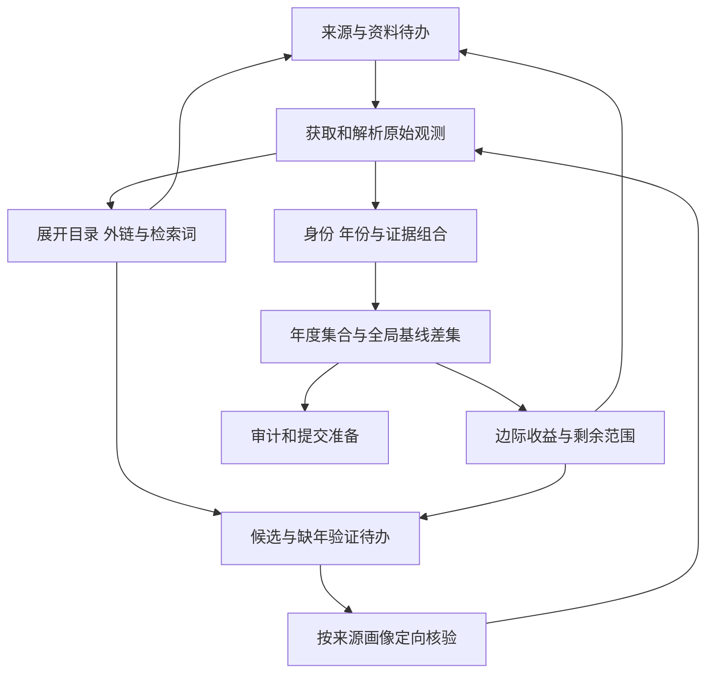

# 历史网站发现问题定义

## 研究对象与目标

给定一组既有年度主机名清单、固定英语权重表、历史资料和有限获取预算，设计一套可以反复运行的发现系统：找到基线之外的 hostname-year，为每条记录保存足够的历史网站证据，按年合并输出，并利用来源产出和失败信息改进后续检索。

全过程与成熟工作机制的具体定义见[全过程与剩余发现](PROCESS_AND_RESIDUAL_DISCOVERY.md)：分别管理来源资料的展开和确切 hostname 的逐年举证，统一核算贡献。

这是一个开放资料空间中的、带证据约束的序贯发现问题。真实历史网站全集不可直接观测，因此不能用“已抓取文件的完整率”宣称全网召回率。能直接衡量的是指定基线和指定证据规则下的新增记录、EED、覆盖结构、成本及审计通过情况。[S1 §I—II、VIII、XIII]

## 对象、输入与输出

| 符号 | 定义 |
|---|---|
| `Y` | 核心年份集合 `{1996,…,2001}` |
| `h` | 经过确定性规范化和完整性检查的确切 hostname；保留裸域和 `www.` 差别 |
| `(h,y)` | 基本计数单位；不等同于可注册域，也不等同于 URL、网页或单次捕获 |
| `B_y` | 冻结版本的第 y 年比较基线 |
| `E(h,y)` | 关联到确切 h 和 y 的全部证据，保留出处、日期含义与原始对象定位 |
| `V(h,y)` | 证据符合当前年度网站规则且通过完整性审查的判定 |
| `A_y` | 本轮提出且满足 V 的记录集合；组织者尚未复核时只称本地合格集合 |
| `D_y = A_y \ B_y` | 本轮真正新增的同年记录 |
| `M_y = B_y ∪ A_y` | 合并后的年度集合 |
| `w(t)` | 固定模型中最右侧 TLD t 的英语份额；未匹配为零 |
| `C` | 活动候选 hostname 集合，另附来源、状态和待验证年份 |

输入除上述数据外，还包括规则版本、来源许可/访问条件、当前可用预算、查询检查点和组织者的基线时间戳。输出包括 `1996.txt`—`2001.txt`、证据账本、候选与隔离清单、来源收益账本、合并差集和 EED 报告、可复现代码与日志；扩展年份单独导出。

## 目标函数与约束

核心 EED 采用以下定义：

```text
EED(B) = Σ[y∈Y] Σ[h∈B_y] w(TLD(h))
ΔEED   = Σ[y∈Y] Σ[h∈A_y \ B_y] w(TLD(h))
p      = 100 × ΔEED / EED(B)        # EED(B)>0
```

`A_y` 在公式中已经经过证据筛选和同年去重。无效记录不纳入集合；若仅复现附带计算器，则应另报其语法无效计数。有效但无模型权重的记录可以有研究价值，EED 贡献仍为零。若基线为零，增长百分比不定义，须先确定适用的组织者口径。

在给定预算下，工程目标可表述为最大化预期的、最终可验收的 `ΔEED`，并同时记录未知可注册域覆盖、逐年覆盖和单位成本收益。这里的“预期”用于选择下一步查什么，不能替代证据门槛。来源调度的一个可检验启发式是：

```text
优先级(s) ≈ 预期新增且可验收的EED(s) / 预期获取与审核成本(s)
```

这是实施建议，不是官方评分公式。它需要为陌生来源保留探索预算，否则会锁定已有高权重来源，漏掉新的来源家族。最终竞赛排序仍使用 `Σ_i 10 p_i/t_i`；扩展年度的官方 p_i 应由组织者确认，不能随意混合分母。[S1 §III]

必须满足的约束：

- 每个 `(h,y)` 至少关联一项可重现、确切主机名、目标年的合格网站证据；所有纳入年份独立成立。
- DNS、WHOIS/RDAP 注册、邮件头和一般文字出现只提供发现线索；多个弱线索叠加也不自动构成网站证据。
- 主机名语法和语义完整性均通过；不得用父域、另一种 hostname 形式或相邻年份代替。
- 来源访问和使用条件可追溯；受限源可保留受控证据及验证方法，不要求公开其原始数据。
- 基线、权重、规则和规范化版本固定；原始计分、清洗计分、正式验收结果分别标明。
- 核心年度、扩展年度、候选和隔离材料分层保存；不改变历史记录来填补证据空缺。

这些约束来自 S1 §IV、XI—XIV。早期 WHOIS 条款的冲突按[核查记录](SOURCES_AND_AUDIT.md)所述处理。

## 证据状态与数据模型

建议以记录库作为事实来源，以年度 TXT 和候选 TXT 作为可重新生成的视图。下表描述逻辑处理状态，不应在实现中压成一个跨对象的互斥枚举：资料是否已展开、查询是否完整、年度证据是否成立和是否已计分，是不同状态轴。证据可以由具有明确对应关系的多项资料组成一个合格证据包。下表为实现建议，不是已经实现的系统。

| 状态 | 含义 | 允许操作 |
|---|---|---|
| `raw` | 尚未可靠解析的原始字符串或资料 | 保留原始内容与定位，尝试可审计解析 |
| `candidate` | hostname 合法，网站年份尚未证实 | 进入来源分析和验证队列 |
| `pending_retry` | 查询未完成、限流、超时或证据服务故障 | 保留检查点，调度重试；不判为不存在 |
| `no_match_in_scope` | 指定来源、时间范围的查询已成功完成但未命中 | 记录检索边界，可尝试其他来源 |
| `verified_web_year` | 本地证据已满足确切 hostname 和目标年要求 | 可以导出本地年度建议结果，等待组织者验收 |
| `accepted` | 组织者已确认纳入特定基线版本 | 记入官方贡献和计分记录 |
| `quarantined` | 完整性失败、身份不明或证据损坏/冲突需隔离复核 | 保存原因及来源，不计入年度或活动候选结果；单纯缺少网站证据仍保留为候选 |

最小证据记录建议包含：`hostname_raw`、`hostname_normalized`、`year`、`evidence_type`、`observed_at`、`date_semantics`、`original_url`、`recovery_url`、`source_id`、`source_version`、`source_file`、`source_hash`、`record_locator`、`capture_status`、`normalization_version`、`validation_status`、`reason`、`extraction_code_version`。访问条件和查询模板可以关联到来源表，避免重复。

活动候选池按任务书要求排除已经出现在任一年度主表中的 hostname：令 `J` 为当前全部已纳入的核心与扩展年份，`C_active = C_valid \ union_{y∈J} M_y`。这不应删除其来源历史，也不应丢掉其他年份的未验证任务。为此另建以 `(hostname, year)` 为键的验证队列：h 已在 1997 年入选时，可从活动 hostname 候选导出中移除，但 1998 年仍保持未验证；不得自动入选 1998 年。[集合规则来自 S1 §XII；队列设计为建议]

## 连续发现流程



直接贡献分支可以提前排除已计入的同年记录；资料展开分支使用独立的版本与操作进度，保留已知页面提供新目标的能力。普通外链的时间只表示发现线索的时间，目标年度仍需按相应规则举证。证据落盘、派生任务入队和游标推进应可协调提交或幂等重放，避免续跑时丢失后继任务。

## 可操作的验收条件

1. **数据恒等式成立。** 每年验证 `|M_y| = |B_y| + |D_y|`；交集、差集和合并统计一致；采用精确十进制或整数化权重时，两套独立汇总的 EED 相等。
2. **证据可回查。** 每条新增记录能从年度行定位到来源记录、日期字段及确切 hostname；审计样本不得将注册证据、HTTP 错误、别名或错误年份误作合格网站证据。具体 HTTP 状态/重定向接受策略须版本化。
3. **可重复导出。** 同一基线、证据库、规则和模型导出相同排序清单与哈希；重复跑不会增加贡献；规则变更能从证据库重建。
4. **候选不丢失也不混入年表。** 活动候选与年度 hostname 集合无交集，隔离数据不计分，已入一年但未验证的其他年份仍有任务记录。
5. **收益可归因。** 区分候选数、语法有效数、本地证据合格数、基线外新增数和官方接受数；同一记录多来源发现不得重复归功到总贡献。
6. **完整提交满足现行规则。** EED 门槛、7z 文件名、Word 说明、开放问题答复、证据、代码和复现材料全部满足任务书；本地核查不替代组织者决定。

上述不变量和数据结构是依据任务书提出的工程定义，尚不表示相应发现系统已经完成实现。

