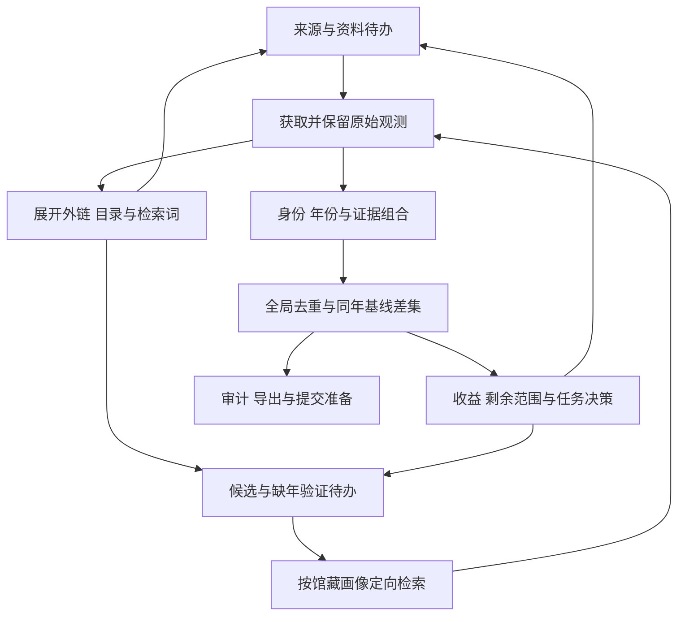

# 全过程与剩余发现：从成熟系统到 Creeperman

设计日期：2026-11-24（UTC+8）。本文件补充并约束[方案设计](SOLUTION_DESIGN.md)中的执行路线，优先规定对象、状态、操作和决策，再选择实现。竞赛事实依据[问题定义](PROBLEM_DEFINITION.md)、[规则核查](SOURCES_AND_AUDIT.md)和[当前基线审计](BASELINE_AUDIT.md)。外部方法的事实依据列于文末；数学关系、迁移方式和调度建议是本项目的设计判断。后续[门槛估算与全球分布执行](CAPACITY_AND_GLOBAL_EXECUTION.md)在这些对象与状态上补充容量模型、全球任务分配和提交协议。

## 1. 任务应怎样表述

当前以用户提供的 IA/WebBase 主体近乎读完为前提。[档案起源与剩余发现](ARCHIVE_ORIGINS_AND_RESIDUAL_FRONTIER.md)进一步追溯原始生产链；[组件审计](OPEN_SOURCE_COMPONENT_AUDIT.md)固定用户所列项目的代码边界。此前来源探针只作为已有观察，不代表当前需要新增测试。

**在已有年度清单的条件下，持续找到尚未计入、可以逐年举证的确切主机名；用每轮真实增量和未完成范围，决定接下来处理哪些历史资料。**

这个任务同时包含三件事：发现可能支持新增的资料与候选、把资料转为合格历史网站证据、将证据投影到基线之外的计分对象。三个环节都需要有自己的状态。抓到了新的 URL，只说明输入发生变化；只有获得了新的合格 `(hostname, year)`，才增加年度贡献。

当前基线有 **140,073,629 个 hostname-year 条目**，初算为 **76,430,446.4446 EED**。最低 1% 对应未舍入的 **764,304.464446 EED**。这些是年度条目的规模与计分门槛，不是不同网站数，也不是历史网络完整率。没有历史网站全集分母，不能从基线规模判断“已覆盖了绝大多数”。[R0]

### 1.1 五种对象各自回答什么问题

| 对象 | 问题 | 例子与限制 |
|---|---|---|
| 来源及其具体分片 | 哪里还能取得相关历史观测？ | 某收藏的 1998 年索引、某张光盘的 URL 映射；提供者不等于抓取祖源 |
| 原始资料及观测 | 实际读到了什么？ | CDX 行、WARC 记录、目录条目、光盘文件、搜索结果；保留原 URL、日期含义与定位 |
| 候选及验证目标 | 接下来要确认什么？ | 独立发现的确切 host，以及需要核验的年份；尚未举证的年份不是已成立事实 |
| 证据包 | 什么共同支持一个年度网站事实？ | HTTP 捕获；或原文件、URL 映射、可信时间日志的组合 |
| 年度计分键 | 是否产生了新的合格贡献？ | `(example.org,1998)` 与 `(www.example.org,1998)` 分开；路径、重复捕获不另计 |

来源的原始投影与其潜在发现范围也不同。一个 CDX 索引直接列出的 host 已经全部在基线中，并不在逻辑上证明对应引用也全部处理；但当前也不能据此假定引用仍有残余。是否继续展开由具体版本、操作和完成清单决定。

### 1.2 四种“已经知道”不能共用一个标记

- **已计入**：特定 `(h,y)` 已在基线或本轮合格集合中，重复证据不再增加 EED。
- **已处理**：特定来源版本、文件范围和操作已完整执行，例如某捕获已提取外链。它决定是否重复劳动。
- **已有证据**：某个目标已有合格证据包，是否需要补充取决于审计、规则变更或证据失效。
- **已检索无匹配**：指定来源版本、查询、年份和过滤范围内没有结果。它不能推出其他来源、其他年份或真实历史中不存在。

因此，`known_host`、`verified_year`、`expanded_outlinks`、`extracted_terms`、`query_complete` 必须是不同的状态。一个已计入的 host 可以有未核验年份，也可以有尚未展开的历史资料。

## 2. 成熟工作怎样组织全过程

这些工作各自解决流程的一部分。Heritrix 和归档分析工具提供成熟工程结构；MementoMap 有现存工具与论文，RSM 有论文方法但所链接仓库的关键词模块仍为 TODO；Archive95 提供独立介质恢复实践。它们的目标、部署程度和验证范围应分别理解。

### 2.1 Heritrix / Mercator：把待处理对象、执行和反馈分开

Mercator 的基本循环是从 frontier 取 URL，下载并抽取链接，过滤和分配链接，经去重后把新任务送回 frontier。Heritrix 将抓取范围、处理链、队列、限速、重试和检查点显式组织起来。队列记录待做的工作，日志记录执行结果；“已见”不能被理解成一切情况下永久禁止再次处理。[R1、R2]

**迁移到 Creeperman：** frontier 中可放索引分片、历史页面捕获、全文查询和证据查询。任务必须带来源范围、版本、预算及完成条件。失败与完整空结果分别回写。任务去重与年度计分去重分开。

**迁移边界：** 现网爬虫访问的是现在的资源，不能以今天抓到的页面证明 1998 年。爬虫的规范化 URL 也不能直接充当竞赛身份；调度层可以粗分组，最终必须恢复并检查原始 URL 的 exact hostname。

### 2.2 Arquivo / ArchiveSpark / ARCH：先缩小资料，再读取内容

Arquivo 官方 bulk 流程是选择收藏、下载 CDXJ、筛选 URL、按需取资源。ArchiveSpark 用轻量 CDX 元数据完成筛选、分组等操作，必要时加载原始内容，并记录派生值与原记录之间的来源链。ARCH 将归档加工成可复用的文本、链接等衍生数据。[R3、R4、R5]

**迁移到 Creeperman：** 能从索引得到确切 host、年份和证据定位时，先做直接贡献分支的全局归并与同年差集；正文读取集中在待补证项和有明确发现价值的资料上。历史链接衍生物若已经可取，可优先读取，减少重复解析正文。

**迁移边界：** “先筛选”需要针对下游任务定义。已在基线中的页面可停止重复证明自身，但仍可能值得提取其目录条目、外链或词汇。通用 Domain Graph 的 `www` 合并和低频边过滤也不能照搬到确切 host 的残余发现。

### 2.3 IIPC 的真实经验：全量集中与持续更新有代价

IIPC 对 MAMA 项目的复盘记载，集中传输约 5 TB CDX 后，持续同步新索引及跨机构协调仍难维持；这推动了馆藏摘要和采样研究。2016 年最终报告记载，利用历史请求响应训练的轻量路由方法已在 LANL 投产。[R6、R7]

**迁移到 Creeperman：** 开放且可流式处理的索引可以批量求差；只提供查询的来源则先建立本地覆盖摘要和查询历史。两种接入方式并存，不以“所有机构都必须先给全量索引”为启动前提。基线已有大量对象时，能否稳定取得下一批资料，与一次处理速度同样重要。

### 2.4 MementoMap / Archival Voids：先判断去哪里查

MementoMap 将 CDX 中的 URI 空间按前缀概括，支持不同精度的馆藏描述和本地查询。论文在指定 Arquivo 与查询日志上评估了摘要大小和路由召回之间的关系。Archival Voids 进一步利用访问日志，描述反复查询却没有可返回资源的范围。[R8、R9]

固定源码的默认生成器只读取 SURT 列，不保留捕获年份。年度路由应按真实捕获年预分片或另建年度辅助表；不能把跨年画像解释成目标年命中。代码依据见[组件审计 §2.3](OPEN_SOURCE_COMPONENT_AUDIT.md)。

**迁移到 Creeperman：** 对候选维护“哪些来源、年代和 URI 范围值得查”的画像；完整空结果在相同来源版本和查询范围内可复用。一个候选无需默认向所有档案广播。

**迁移边界：** 粗粒度摘要用于查询选择，不是 hostname 或网站年份的证明。抽样画像不完整时，“画像没收录”不能作为硬排除条件。来源更新、时间窗口变化或过滤策略改变后，旧空结果可能失效。2019 年 MementoMap 论文中的低流量 MemGator 实例当时仍采用广播，不能把实验效果写成该实例的生产部署效果。

### 2.5 Random Searcher Model：没有全量索引时，从检索结果发展入口

RSM 维护 `Vocabulary`、`SearchLog`、`ResultBank`：选择词语检索归档，记录新 URI，必要时读取结果页提取新的词语，再继续检索。其 conservative 模式先消耗已有词表，耗尽后才读取页面补词，减少额外请求。论文称提供实现，但本轮核读所链接仓库固定提交 `339fbc9338c705c2a107702eb13dbdfc81e3e7e1`，关键词模块仍为 TODO，主程序主要实现 CDX profiling；未定位到可直接接入的完整 RSM。采用其论文机制前仍需适配档案接口并实现相应循环。[R10]

**迁移到 Creeperman：** 对支持历史全文检索的来源，按年代与收藏限制查询；从新增或互补的历史材料中发展词表。评价量改为后续可兑现的基线外 hostname-year，而不是搜索结果 URL 数。

**迁移边界：** 这是受全文索引和词汇可达性限制的探索。它可能进入超链接遍历未触及的页面集合，但不能保证发现所有孤立站点，也不是对 host 的均匀抽样。需要来自不同历史资料、语言或收藏的入口，避免词表长期停留在同一范围。

### 2.6 Archive95 / NYPW：采用不同表示和入口时，先核对目标

Archive95 从离线互联网光盘等材料重建早期网页，检查并修复原材料中的链接改写；核心工作包括恢复文件与原 URL 的对应关系，以及解释来源时间。它直接展示了主流档案以外的材料如何转成历史观测。[R11]

NYPW 2025 年论文从 IA 提供的 ZipNum 样本开始，经 URL 清理、MIME 核验、时间查询和重采样构造纵向语料；它还从已发现的深路径构造同 host 根 URL，查询更早的捕获。其 ZipNum 获取依赖 IA 提供，不能假定我们已经能下载同样的数据。[R12]

**迁移到 Creeperman：** 独立介质扩展可观察的来源；同一个确切 host 的根路径可以成为缺失年份的补证入口。保留原 URL 和逐年 witness。

**迁移边界：** NYPW 的目标是构造研究样本，其指定后期年份的长尾削减、别名合并及前 1996 过滤不适用于本竞赛的完整残余发现；不同主机名和罕见合法站点不能为了样本均衡被删除。缺年补证也不能把一次捕获外推到其他年份。

## 3. 统一抽象：观测、证据闭包和剩余覆盖

令 H 为确切 hostname 的集合，`Y={1996,…,2001}`；`B_all` 为全部适用年度的冻结基线，`O_t` 为截至第 t 轮已经取得并保留出处的观测。给定证据规则 r，先区分全部年度与核心计分域：

```text
V_t^all = Γ_r(O_t)
V_t = V_t^all ∩ (H × Y)
B = B_all ∩ (H × Y)
D_t = V_t \ B
K_t = B ∪ V_t
W(D_t) = Σ[(h,y)∈D_t] w(TLD(h))
```

`Γ_r` 表示从观测及其合法组合中，形成目前证据成立的年度记录。它不是把候选打分后阈值化；年份、身份和网站语义仍须有实际依据。规则变化或矛盾材料出现后，可以重新判定证据并重建 `V_t`。扩展年度单列，不进入上述核心分母对应的贡献。

### 3.1 为什么要允许证据组合

单个 CDX 行有时已经足够定位合格捕获；有些来源则需要多个材料共同完成证明，例如：

- 光盘文件提供历史网页内容，映射表提供原 URL，抓取日志提供时间。
- 匿名链接节点需要与同一数据版本的身份映射结合。
- revisit 记录需要沿真实引用关系回查原 payload，同时保留 revisit 自身的捕获时间语义。

一个合格 witness 可以是上述可审计证据包。组合必须补足明确的身份、日期和网站事实；多个 DNS/注册弱线索堆叠并不会因此成为网站证据。

这修正了来源独立计分的适用范围。若每个来源 s 已经独立产出完整合格集合 `V_s`，则

```text
F(S) = W((∪s∈S V_s) \ B)
```

确实是非负加权覆盖函数，边际贡献随已处理集合扩大而递减。但对原始资料未必如此：文件与映射分别贡献 0，合起来可能贡献大于 0。因此不能把整个发现流程无条件视为次模优化，也不能由前一个公式推导通用贪心最优性。调度时须识别形成完整证据所需的任务组合。

### 3.2 哪些压缩保留了目标

对固定六年计分，每个 host 的已验证年份与基线年份用两个 6 bit 掩码即可表达：

```text
novel_mask(h) = verified_mask(h) & ~baseline_mask(h) & 0b111111
ΔEED = Σ_h w(TLD(h)) × popcount(novel_mask(h))
```

它对计分充分，对后续发现不充分。同一 `(h,1998)` 下，页面甲可能链接到 b，页面乙可能链接到 c；如果只保留 h 与年份，就无法判断两页的外链是否已经展开，也无法复现不同后继任务。

因此保留两层表示：用于集合运算的紧凑年度键；用于发现和审计的原资料定位、证据关联、处理范围及操作版本。没有必要先建立复杂知识图谱，普通表和版本化记录已能表达这些关系。相同 payload 可以复用文本解析，但相对链接还依赖原始 URL 与 `base href`，不得只凭内容 digest 跨上下文复用最终目标地址。

### 3.3 最小状态账本

| 账本 | 至少保存 | 支持的决定 |
|---|---|---|
| 任务契约与覆盖集 | 规则/基线/模型/规范化版本，年度成员或位图 | 什么算新增、怎样计分 |
| 来源与分片 | provider、origin_family、版本、年代、可获取范围、完整性 | 从哪里继续，是否与既有材料同源 |
| 原资料与观测 | 原 URL、捕获/来源日期及含义、locator、hash、解析状态 | 怎么回查、能否重新解释 |
| 证据与主张 | `(h,y)`、证据包成员、判定版本、本地合格/待定/冲突状态；组织者接受状态、批次和基线版本另存 | 哪些记录可进入年度结果 |
| 操作与查询历史 | 对象版本、operator/version、scope、cursor、尝试与完成状态 | 是否重复处理、如何续跑和复用空结果 |
| 待办与收益 | 来源/展开任务、候选验证任务、依赖、成本、全局边际增量 | 下一步做什么、继续还是换入口 |

活动候选导出另按规则派生：排除 `B_all` 以及 `V_t^all` 中当前已纳入核心或扩展年度表的 host；六位掩码只服务核心六年计分。被移出的 host 仍可保留其他年份的验证任务；这两个视图不能共用一个集合。[R0]

## 4. 全过程：两条发现路径，一套证据和计分

具体对象与接口已落实到[发现与取证流水线](DISCOVERY_AND_VERIFICATION_PIPELINE.md)。离线资料处理和在线补证各自调度，但共享观测与证据库；已有合格证据直接结算，只有剩余缺口进入查询队列。RDAP、全文检索和首次资料获取各有网络预算，不归入“离线零请求成本”。



图中的先后表达逻辑依赖，不要求每个资料都经历全部分支。索引可以直接提供可核验的捕获；普通外链进入候选；可信且符合规则的目录或图可以走相应证据路线。完整流程如下。

| 阶段 | 输入与操作 | 输出与完成条件 |
|---|---|---|
| 0. 固定任务 | 绑定规则、最新基线、权重、年份范围和证据策略 | 一个版本化契约；后续报告引用同一版本 |
| 1. 描述已知覆盖 | 基线按年/host/TLD等聚合；已知来源谱系另表记录 | 计数、年份掩码、已处理资料范围；缺少出处时标 unknown，不推断祖源 |
| 2. 形成任务 | 从收藏目录、原始介质、独立候选、历史链接和全文入口提出工作 | 指定来源、范围、读取方式、目标、依赖与预算的任务；不能仅写“继续爬 IA” |
| 3. 取得资料 | 完整下载、分片读取、定向查询或合法恢复 | 原始定位、对象版本、完整/未完整标记；失败回到待办，空结果记录具体范围 |
| 4. 提取观测 | 从原始 URL 取 exact host，解释日期字段，提取记录类型与关系 | 可追溯观测；错误身份或跨年歧义隔离/待定，不强行分年 |
| 5. 分流工作 | 直接计分目标先低成本求差；按价值选择需要展开的资料 | 直接证明待办、外链/目录候选、检索词与新来源；三者分别去重 |
| 6. 形成证据 | 合并必要材料，补取正文/映射，处理状态和年份边界 | 每个新增目标至少一个合格证据包；未知候选仍保留，超时不是负证据 |
| 7. 结算增量 | 对 exact `(h,y)` 全局归并，再对基线和本轮已完成项求差 | 确切新增 EED、新可注册域、逐年产出；替代证据不重复计分 |
| 8. 反馈决策 | 合并全部成本、未完成范围与产出；比较下一任务 | 扩大、换片区、换入口、补证或暂缓；完整性未达到不标“来源耗尽” |
| 9. 审计与交付 | 用提交时适用基线重新求差，生成年度表、证据和复现材料 | 满足最低 1% 且材料完整时准备提交；验收后更新官方覆盖，保留旧版本 |

来源调查与候选验证可并行，证据结算使用同一套键和规则。运行中的来源增益相对于 `K_t` 计算，避免多个来源都把同一新增记录报告成各自独占收益。提交归因另保留完整的多来源关系。

查询完成单独判定：`qualified`、`witness_rejected`、`complete_for_declared_index_view`、`budget_exhausted`、`possibly_truncated`、`transient_failure` 不互相替代。CDX 的空结果、无 resumeKey 或 Activity 正常返回均不足以单独证明范围已消费完整。相邻 `collapse=timestamp:4` 也不是按 hostname-year 分组。固定源码依据与静态反例见[流水线第 5 节](DISCOVERY_AND_VERIFICATION_PIPELINE.md#5-cdx-查询必须以证据目标为中心)。

## 5. 大基线会怎样改变策略

### 5.1 先判断剩下的是哪一种缺口

“已有很多网址”至少可能对应五种不同情况，需要不同操作。

| 缺口 | 可观测的表现 | 对应操作 |
|---|---|---|
| host 未发现 | 独立历史资料出现未在任一年度计入的 exact host | 候选发现与目标年代举证；优先观察新可注册域覆盖 |
| host 已知、年份缺失 | 同一 host 已在部分年份出现，其他年份有待验证 | 单独年份队列；一次定向查询尽可能核验多个缺年 |
| 名字已知、网站证据缺失 | 候选很多，但只有注册/文字线索或年代不清 | 查询路由、原文/日志恢复和身份时间核对 |
| 资料已知、内容未展开 | 索引已处理，自身 host 已计入，但目录/外链仍未提取 | 按资料与操作状态选择性展开 |
| 来源尚未接入或不可枚举 | 常用索引重复很高，却缺少另一类历史观测 | 新收藏、全文入口、离线介质和独立 HTTP 调查等来源工作 |

基线的数量分布只能描述“已经有多少”，不能单独告诉我们哪个维度尚有最大剩余量。来源出处缺失时，需对实际可取得片区做精确交集；不能把“TLD 数量少”直接等同于“容易发现更多”。

### 5.2 已知集合的两种用途

**对直接计分，它是差集条件。** 若某记录只为证明其自身 `(h,y)`，该键已经在 `K_t` 中且无需审计补充，就可以停止这条补证分支。

**对发现，它可以提供入口。** 来自独立历史资料的已知目录页，可以引出新 host；已知 exact host 的历史根页面，可以帮助寻找缺失年份；已知材料的来源信息，可以帮助定位同一收藏中尚未处理的部分。

这里保留任务书的边界：优先未知可注册域与独立候选，不以基线根域为起点大规模枚举子域。查询同一个确切 host 的原页面、读取独立历史资料中的真实外链，与猜测生成一批子域是不同操作。[R0]

### 5.3 为什么不能在展开资料之前一律删掉已知 host

设 1998 年的 `a.example` 已在基线中，某历史目录页属于它，页面含有指向未知 `b.example` 的真实外链。

- 先按来源页的 host 删除基线命中项，会删掉整页，从而永远不产生 b 的候选。
- 先保留值得展开的页面并提取真实外链，再对目标 host 去重，能够发现 b。
- 普通链接只生成 b 的线索；是否可纳入 1998 年，仍须符合相应网站证据规则。

记 `L` 为链接提取，`N_K` 为排除已覆盖计分目标的操作。由于过滤作用于来源对象和目标对象的语义不同，一般不能把“对页面按自身 key 过滤后再 L”等同于“L 后按目标 key 过滤”。这正是前一版单一路线需要补充分支的地方。

需要展开的不是全部已知网站。应从独立历史资料中筛选目录、索引、门户、机构名单等明确承担发现作用的页面，优先使用已有链接衍生物；按照实际边际产出限制同一 host、同一来源和高度相似页面的重复投入。高出度本身不保证高残余收益。

### 5.4 来源重复时，要区分重复的层次

1. **相同内容副本。** 新提供者可能只改善可获取性或证明稳定性，不增加直接计分。
2. **相同抓取祖源、不同覆盖范围。** 某派生收藏可能提供尚未处理的年份、分片或字段，仍可能互补。
3. **同一批页面、不同投影。** 已做自身 host 归并，但尚未抽取目录节点或外链，可能存在发现空间。
4. **独立观测机制。** 光盘、机构镜像、历史 HTTP 调查等可能触及现有采集未覆盖的部分；是否有目标年、行级身份和足够容量仍须核实。

记录 `provider` 与 `origin_family`，再看实际边际集合。不能从不同域名的下载站数量推断独立来源数量；同源也不自动意味着零收益。

### 5.5 邻接发现存在结构性边界

在一个固定的、可访问历史链接图上，仅沿已发现节点的出边遍历，只能到达这些入口的可达集合。没有可达路径的部分，需要新的入口；把队列并发度加大不会改变可达性。

因此流程要保留来源级探索：历史全文检索、不同馆藏目录、不同年代与语言的独立材料、离线介质映射等。它们能改变入口和可观察范围。它们也有自己的边界：全文检索只能看到被该索引收录并可检索的材料，介质恢复只能处理真实保留下来的资料。

## 6. 怎样选择下一步：边际收益、剩余容量和依赖

### 6.1 评价完整任务带来的可兑现增量

对一个有明确范围的工作任务 j，可用以下关系组织判断：

```text
V_(t+j) = Γ_r(O_t ∪ O_j) ∩ (H × Y)
预计贡献净变化 = E[W(V_(t+j) \ B) − W(V_t \ B) | 当前观测与任务范围]
任务成本 = 获取、解析、必要补证、审核及等待的实际资源消耗
工作优先级参考 = 预计贡献净变化 / 所比较的瓶颈资源成本
```

该定义同时计入新成立记录与因冲突而撤回的记录；在固定规则、只追加合格证据且不撤回的常见批次中，它退化为 `E[W(V_(t+j) \ K_t)]`。必要的质量复核即使可能降低分数，也须完成。上述比值是资源选择启发式，不是官方排名公式，也不以估计代替证据。墙钟时间、请求、字节和人工分钟应分别报告；在指定瓶颈下比较，不随意把不同单位相加成一个伪精确数值。

这里的任务应足以形成有意义的结果。例如“取得映射并核验一批文件”可以作为一个有依赖的任务；如果把它拆成每个 HTTP 请求并只看即时 EED，前置获取步骤会被误判为零价值。陌生来源还需要有边界的探索额度，以便建立下一轮判断所需的信息。

对固定的合格来源集合，可以直接计算重叠和边际增量；对于需要组合的证据来源，要记录共同兑现的成本与贡献。多来源证据链属于一个结果，不把相同 EED 计数多次。

### 6.2 同时看产率和库存

一个小来源可以有很高的新颖率，但总容量不足以承担门槛；一个大来源可以高度重复，却仍有较大的可兑现残余。决策同时需要：

- **已经兑现的边际 EED**，基于全局唯一键和当前 `K_t`。
- **单位成本产率**，包含失败、重试与补证。
- **剩余可取得范围**，例如尚未读完的完整分片，不是提供者宣传的总页数。
- **证据不确定性**，例如年份、节点映射和 soft error 尚未解决的比例。
- **新 host / 新可注册域与补年构成**，检验策略是否符合任务侧重。

以目标年代、来源祖源、材料类型和实际可枚举分片组织统计；TLD 权重用于价值计算。分层数量随决策需要增加，初期不建立大量无人能解释的小层。

已有 Roteiro 全量索引的本次解析得到 4,955 个不同 exact hostname-year；尚未与完整基线求差。即使这 4,955 项全部合格、新颖且权重为 1，也只相当于最低门槛的 0.6483%。这说明其直接索引路线适合小来源闭环；不限制对应正文的其他发现路径，也不说明其他收藏的剩余容量。[R0]

### 6.3 哪些观察会改变下一步

| 观察 | 说明的瓶颈 | 下一步 |
|---|---|---|
| 大量 capture 压缩成很少 host-year | 同站多路径/多次捕获占主导 | 更早按目标键归并，保留候选 witness 与展开价值 |
| 合格目标很多，但对基线求差几乎为空 | 当前片区直接贡献已较饱和 | 查尚未处理的年份/投影，或转向不同祖源；不只提高抓取速度 |
| 基线外名字多，逐年网站证据兑现率低 | 发现线索与目标年份/网站语义错位 | 改善证据来源与路由，核对时间及身份映射 |
| 已知 host 的新增年份占主要收益 | 时间维度存在可验证缺口 | 作为补证线路扩大，同时继续统计未知可注册域发现 |
| 高收益只存在于少量分片 | 容量而非吞吐是限制 | 消化该分片，并寻找可取得的其他独立库存 |
| 大多数查询尚未完整，超时较多 | 可访问性与任务完成度 | 保留待办、退避与续取；暂不估成低命中或不存在 |
| 多来源报告很大、全局增量很小 | 来源间重叠或归因重复 | 以合并后的集合重算边际贡献，更新来源组合 |

字节窗口、随机查询和完整分片提供的是不同观测。它们可用于判断字段、成本和局部产率，但未说明抽样设计时，不能由窗口内唯一 host 数乘文件大小推断全局剩余容量。关于总体残余量的结论，要么来自完整可枚举范围，要么附带有效抽样单位、入样机制与不确定性。

### 6.4 三种停止条件分别记录

- **资料处理完成**：指定版本、范围与操作已完整执行。重新处理要有版本、操作或规则变化的理由。
- **某路线暂缓**：下一批预期收益、容量或取得条件不如其他工作。只说明当前资源选择，不说明历史全网没有剩余。
- **批次可交付**：按提交时适用基线计算达到门槛，证据、代码、年度文件和规定说明材料完整。正式贡献以组织者验收为准。

源文件变更、档案新导入、规则修订、映射补齐或基线更新都能产生新的合法任务。负查询与完成记录必须带范围和版本，避免永久封死这些更新。

## 7. 当前推进顺序：先补齐来源契约和实现边界

### 7.1 恢复能支持判断的来源与覆盖说明

复用现有基线审计与年度位图设计。IA/WebBase 主体近乎处理完来自用户说明，已纳入计划；仍需将具体版本、年份、操作与规范化补入处理谱系。未重新完成全量差集，也不将未知投影默认当作未处理。

来源研究优先整理已具体定位的历史文本库存：Usenet 分组 mbox、W3C 同期 HTML 邮件及 arXiv 明确正文版本；同时推进 PANDORA 目标年业务档案系列与字段、Kulturarw3 生产/保存清单、独立交存原件及映射。文件列示、目标记录可读、批量交付和基线外容量分层记录。WebBase/IA 派生渠道只有明确遗漏分片、信息投影或证据补全依据时才重开。原始文献与限制见[档案起源](ARCHIVE_ORIGINS_AND_RESIDUAL_FRONTIER.md)及[流水线来源契约](DISCOVERY_AND_VERIFICATION_PIPELINE.md)。

### 7.2 固定发现与验证操作

直接年度投影、历史资料展开、同 exact host 根 URL 补年和全文入口分别定义。已知页面不因已计分而一律删除，也不因可能含链接而重复展开；普通外链仍是目标候选，可信 dated graph 按其生成语义和适用证据规则处理。

验证复用 ArchiveSpark 的元数据先行、pywb 的 CDX/ZipNum 与局部记录加载、warcio 的解析。自身适配集中于年度差集、身份/时间解释、可替代 witness 和竞赛裁决。RSM 当前没有已确认可直接接入的关键词实现，保留为论文支持的辅助方法。

### 7.3 只对资料无法解决的关键歧义安排判别

此前“小来源验证三条分支”的安排不再作为立即动作。先写清来源契约和操作预测，再决定是否需要有边界的记录核验或集合差分。已有 Roteiro 观察可供说明格式和小来源容量，不重复取数代替知识工作。

完整输入、身份年份语义和基线明确后，来源的新增容量仍以精确差集判断。该顺序避免把解析失败、来源身份不明或不可取得误读成发现机制低产。

### 7.4 用成熟执行系统承接已定义任务

首选 Temporal 批次工作流与各地 Activity worker；只传 manifest 引用，原文就近读取，结果全局精确归并。每个 provider 的实际 HTTP 预算在主采集区管理；不增加自制 PostgreSQL 租约和跨洲逐请求许可层。具体任务、检查点与数据边界见[全球执行设计](CAPACITY_AND_GLOBAL_EXECUTION.md)。

## 8. 本次设计变更与证据边界

本轮新增了全过程、双待办循环、已计入与已展开的区别、证据组合的数学条件、来源画像和全文探索的作用范围。对前一版的直接索引主线作了一个必要限定：**基线过滤可以提前关闭重复计分分支，但不能无条件关闭资料展开分支。**

本轮完成了方法和原始资料核查及设计重构，没有执行新的生产级来源扫描或完整基线差集。IA/WebBase 主体已近乎读完，当前尚未证明有门槛级剩余供给；新 host、补年、未消费投影与独立来源各自需要实际材料支持。处理完成记录和来源库存应先于新增执行。

## 参考资料

- **R0 · 项目事实与实测。** [问题定义](PROBLEM_DEFINITION.md)、[当前基线审计](BASELINE_AUDIT.md)、[规则核查](SOURCES_AND_AUDIT.md)、[来源探针](../audit/source_probe_20261124.json)。来源探针是本项目上一轮实测；本轮未追加网络数据生产结果。
- **R1 · Mercator。** Broder, Najork & Wiener, *Efficient URL Caching for World Wide Web Crawling*, WWW 2003：[原文](https://www.ra.ethz.ch/CDStore/www2003/papers/refereed/p096/p96-broder.html)。使用其实际循环与去重结构，不将当年的吞吐或缓存实验数字外推到本项目。
- **R2 · Heritrix。** [Configuring Crawl Jobs](https://heritrix.readthedocs.io/en/stable/configuring-jobs.html)、[Operating Heritrix](https://github.com/internetarchive/heritrix3/blob/master/docs/operating.rst)、[Glossary](https://heritrix.readthedocs.io/en/latest/glossary.html)。使用 scope、frontier、retry、日志与恢复的职责。
- **R3 · Arquivo。** [官方 APIs 与 bulk 步骤](https://github.com/arquivo/pwa-technologies/wiki/APIs)。
- **R4 · ArchiveSpark。** Holzmann, Goel & Anand, JCDL 2016：[论文](https://www.helgeholzmann.de/papers/JCDL_2016_ArchiveSpark.pdf)、[作者实现](https://github.com/helgeho/ArchiveSpark)。重点 §5 元数据访问顺序与 lineage。
- **R5 · Archives Unleashed / ARCH。** [ARCH](https://archivesunleashed.org/arch/)、[链接分析配方](https://aut.docs.archivesunleashed.org/docs/link-analysis)；[UKWA Host Link Graph](https://britishlibrary.github.io/data.bl.uk/ukwa.ds.2/host-linkage/)说明年度、源/目标角色及去重对年度缺失的影响。
- **R6 · IIPC 来源协调实践。** [Web archive profiling via sampling](https://netpreserve.org/projects/web-archive-profiling-sampling/)。包括 MAMA 的集中 CDX 与持续同步经验；项目页本次直接打开有验证页，正文通过搜索索引核查。
- **R7 · IIPC 2016 最终报告。** [Web Archive Profiling Via Sampling](https://netpreserve.org/resources/IIPC_project-Archive_profiling-final_report.pdf)。§1 记载 LANL 轻量路由部署；§2—4 说明采样、画像和工具。
- **R8 · MementoMap。** Alam et al., JCDL 2019：[论文](https://arxiv.org/abs/1905.12607)、[全文](https://arxiv.org/pdf/1905.12607)、[作者实现](https://github.com/oduwsdl/MementoMap)。论文效果限于其馆藏、过滤策略和查询样本。
- **R9 · Archival Voids。** Alam, Weigle & Nelson, JCDL 2021：[全文](https://arxiv.org/html/2108.03311v1)。区分馆藏空缺、不可服务与索引/访问状态变化。
- **R10 · RSM。** Alam et al., *Web Archive Profiling Through Fulltext Search*, TPDL 2016：[原文](https://www.cs.odu.edu/~mln/pubs/tpdl-2016/tpdl-2016-alam.pdf)、[论文所链接仓库](https://github.com/oduwsdl/archive_profiler/tree/339fbc9338c705c2a107702eb13dbdfc81e3e7e1)。重点 §4 数据结构、策略与循环，§5 接口适配边界；当前关键词采样模块仍为 TODO。
- **R11 · Archive95。** [About](https://archive95.net/about)、[Sources](https://archive95.net/sources/)、[实现](https://github.com/WumboSpasm/archive95-server)。原 URL 映射与日期不确定性仍按具体介质核验。
- **R12 · NYPW。** Garg et al., *Longitudinal Sampling of URLs From the Wayback Machine*, 2025：[全文](https://arxiv.org/html/2507.14752v1)、[作者实现](https://github.com/oduwsdl/nypw)。§4.1 的 ZipNum 获取，§4.7 的根 URL 补早期样本；§4.9 的 90% 长尾削减明确限于 2004 及 2006—2020 年，不是 1996—2001 的处理。
